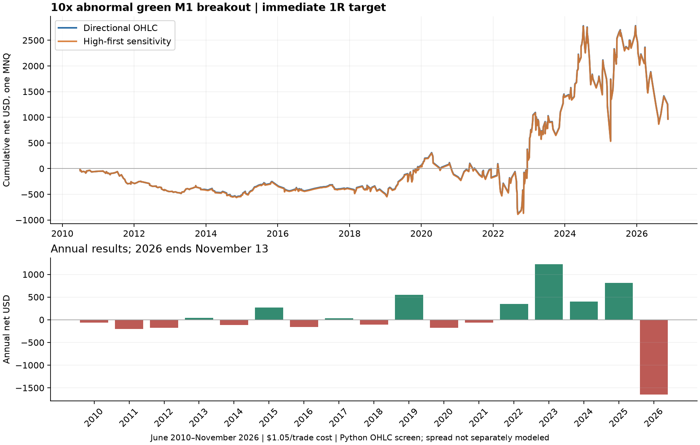

# Abnormally large green M1 breakout: initial 10x screen

Completed 2026-11-24. **Small positive historical result, fragile and uneven;
this initial screen does not establish a robust edge.** One MNQ, $2/point,
$1.05 per completed trade. Full extended continuous NQ source: 5,556,005 M1 bars,
2010-06-07 01:00 through 2026-11-13 23:59, research clock. Python OHLC replay,
not a native MT5 run. No strategy defaults or live settings changed.

## Rule

Green close > open; high-low range >= **10 times the mean high-low range of
exactly the previous 20 candles**, both colours. Signal excluded from its own
reference. Require consecutive minutes within the same session. After close,
buy at its high on a subsequent touch, SL **one tick (0.25 point) below its low**,
immediate TP at **1R from actual entry**, as confirmed by the user. One position.
Worse opening entry/stop gaps are paid. Pending waits until filled, replaced by
another qualifying signal, or session cutoff; ordinary candles and pre-entry
low touches do not cancel it. Flatten at 23:30 or the existing early close.
See [frozen protocol](PROTOCOL.md) for all order and fill assumptions.

## Counts

Of **2,395 raw 10x green signals**, **492** pass eligibility and **446** fill:

- 1,896 excluded because the previous 20 bars cross a minute gap/session boundary.
- 3 lack an immediately following minute; 4 are outside the entry session.
- Of the 492 eligible: 446 filled, 34 expired at the session cutoff, 10 occurred
  while holding a position, and 2 pending orders were replaced.
- Since 2016: 348 eligible signals and 313 trades. This exceeds the predeclared
  100-signal minimum, so **the threshold was not lowered**.

The scan covers every available minute. The continuity requirement materially
reduces early-history counts; raw and excluded signals are retained in the
signal ledger, not silently discarded. Price alone does not establish a news cause.

## Results

| Period | Trades | Net $ | Win % | PF | Mean net R | OHLC path DD $ |
|---|---|---|---|---|---|---|
| 2010-15 | 133 | -251.15 | 51.1 | 0.802 | -0.103 | 559.15 |
| 2016-19 | 111 | 314.45 | 59.5 | 1.193 | 0.120 | 386.25 |
| 2020-Sep2026 | 199 | 1,114.55 | 53.8 | 1.076 | 0.047 | 2,424.90 |
| Oct-Nov2026 | 3 | -205.65 | 33.3 | 0.537 | -0.216 | 537.05 |
| 2016-Nov2026 | 313 | 1,223.35 | 55.6 | 1.073 | 0.071 | 2,424.90 |
| all | 446 | 972.20 | 54.3 | 1.054 | 0.019 | 2,424.90 |

Win percentage and PF use net dollars. Drawdown above is marked along assumed
OHLC paths, including open positions, rather than just closed balance. Full-history
closed-trade DD is $2,240.65. Era rows reset equity at each era's start. Signal
and entry are within the same session; 33 session-flattened trades do not end at
exactly +1R or -1R. No end-of-data marking was needed in the observed run.



## Fragility and execution assumptions

- Largest winner: signal **2025-04-09 20:19:00**, range **601.50
  points**, ratio **11.08x**, net **$1,202.45**. Removing this one
  trade changes full-history net from **$972.20** to **$-230.25**;
  2020-Sep2026 changes to **$-87.90**. This is a concentration
  diagnostic, not a rule to exclude trades.
- 2026 through November 13: **-$1,644.25** on 25 trades. Positive earlier periods
  therefore do not establish stable annual performance.
- Extra $1/trade reduces all-history net to **$526.20**; extra $2 to **$80.20**.
  Since 2016 these become $910.35 and $597.35. Spread is not separately simulated;
  the stresses do not reproduce actual news-time slippage or bid/ask execution.
- Directional and uniformly low-first paths both net $972.20 with $2,424.90 path DD.
  Uniformly high-first nets $962.20 with **$2,885.40** path DD. These are assumed
  path sensitivities, not formal bounds on all possible within-minute paths.
- 7 trades have entry/stop or stop/target overlap within a minute; 8 entries pay
  a worse opening price; 34 held trades cross missing minutes. Stops use worse
  opens, but missing prices can still hide an earlier level touch.
- Median signal-to-fill delay: **2 minutes**. 156 fills wait >5 minutes; 89 wait
  >30 minutes and 61 >60 minutes; maximum 1,188 minutes. Pending lifetime is an
  explicit research choice, and some fills are far removed from the initial
  jump. No expiry or threshold was optimized after viewing outcomes.
- Fixed one-contract sizing gives larger-dollar weight to larger candles.
  Mean net R is descriptive, not a tested constant-risk sizing policy.

## Annual results

| Year | Signals eligible | Trades | Net $ |
|---|---|---|---|
| 2010 | 14 | 13 | -63.65 |
| 2011 | 33 | 30 | -207.00 |
| 2012 | 23 | 22 | -176.10 |
| 2013 | 24 | 23 | 42.35 |
| 2014 | 22 | 19 | -113.95 |
| 2015 | 28 | 26 | 267.20 |
| 2016 | 22 | 22 | -162.60 |
| 2017 | 21 | 19 | 35.55 |
| 2018 | 24 | 23 | -108.65 |
| 2019 | 54 | 47 | 550.15 |
| 2020 | 20 | 17 | -173.35 |
| 2021 | 20 | 19 | -63.95 |
| 2022 | 33 | 31 | 347.95 |
| 2023 | 48 | 44 | 1,222.80 |
| 2024 | 37 | 32 | 403.90 |
| 2025 | 38 | 34 | 815.80 |
| 2026 | 31 | 25 | -1,644.25 |

## Reproduction and verification

Run from the project root:

```powershell
.\venv\Scripts\python.exe -m unittest discover -s python -p test_abnormal_green_m1.py -v
.\venv\Scripts\python.exe python\abnormal_green_m1.py
.\venv\Scripts\python.exe python\verify_abnormal_green_m1.py
.\venv\Scripts\python.exe python\report_abnormal_green_m1.py
```

Focused tests cover lookahead, threshold equality, red/doji/zero references,
gaps, session boundaries, entry and stop gap fills, immediate target, ambiguous
entry/stop ordering, pending persistence, cutoff and final marking. Separate
verification reads raw data again, independently finds all signals with cumulative
sums, checks every first-touch entry and every exit in all three paths, and
rebuilds marked equity DD from the complete price-mark sequence.

Source, protocol, calendar, code and output hashes are saved in
`Reports/abnormal_green_m1_20261124/manifest.json`; independent checks are in
`independent_verification.json`. The same folder contains all detected/excluded
signals and trade ledgers for each path, summary and decision counts. Compact
summary and audit files are copied beside this report. Data and results remain
exploratory; there is no untouched out-of-sample confirmation or identified
scheduled/unscheduled news attribution.
