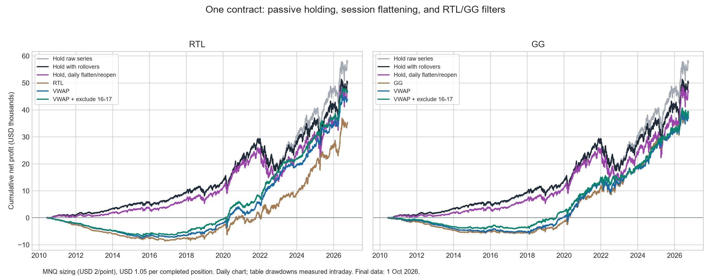

# Buy and hold versus RTL and GG, with VWAP and entry-window filters

Updated 2026-11-09 (session-flat benchmark added). Matched dataset dates, one MNQ-sized contract per individual
strategy, $2 per point and $1.05 per completed position, no compounding. Every
DD below includes unrealized P&L and external commission. The added variants
come from existing, verified native MT5 replays; no new parameter search.

## Policies

- **Hold, flatten/reopen each session:** buy one contract at the first session
  quote, close at the first quote at/after 23:30 or the existing early-close cutoff,
  and reopen at the next session's first quote. No stop or target. If the cutoff
  is not reached, use the session's final available quote (only the final partial
  dataset session needed this fallback). There are 4,203 positions and $4,413.15
  in modeled fees over the full dataset. No overnight or roll-boundary gap is held.
  Session cutoffs match RTL/GG and are earlier than the exchange's final quote.
- **RTL / GG:** original uncapped RR=1, session-flattened baselines.
- **+ VWAP:** the existing orange-cutoff gate. Skip signals closing strictly below
  session VWAP minus A20; equality or an unknown value permits entry. This is not
  the blue-line slope filter.
- **+ VWAP + exclude 16-17:** the same gate, plus `W1600W1700=false`.
  No new entries are submitted in 16:00–17:00 in the dataset clock
  (Chicago + 8 hours, corresponding to 09:00–10:00 New York). Existing positions
  retain their normal exits. No extra 16:30 flatten was added. A pending order
  can still fill on a boundary quote before cancellation, as in the original EA.



[Complete comparison CSV](comparison.csv) · [Session replay verification](session_flat_verification.json)

## Full dataset: 7 June 2010 to 1 October 2026

| Strategy | Net profit | Maximum equity DD | Net / DD |
|---|---:|---:|---:|
| Hold raw series | $57,972.95 | $12,565.50 | 4.61 |
| Hold with rollovers | $50,319.15 | $12,808.20 | 3.93 |
| Hold, flatten/reopen each session | $47,094.85 | $13,266.05 | 3.55 |
| RTL | $35,454.35 | $8,815.25 | 4.02 |
| RTL + VWAP | $43,888.45 | $7,607.25 | 5.77 |
| RTL + VWAP + exclude 16-17 | $46,898.75 | $6,826.80 | 6.87 |
| GG | $37,971.25 | $6,354.70 | 5.98 |
| GG + VWAP | $37,016.45 | $6,079.50 | 6.09 |
| GG + VWAP + exclude 16-17 | $38,832.95 | $4,615.80 | 8.41 |

Both unfiltered baselines earn less than holding with rollovers but have smaller
full-history drawdowns. VWAP and the entry exclusion improve RTL's full-history
profit and profit/DD. Full-history risk includes the early losing years; the
smaller 2016-onward DD figures must not be substituted into this table.
Profit/DD is total net dollars divided by maximum equity DD, not an annualized
return or a Sharpe ratio.

## Since 2016, same final dataset quote

| Strategy | Net profit | Maximum equity DD | Net / DD |
|---|---:|---:|---:|
| Hold raw series | $52,451.45 | $12,565.50 | 4.17 |
| Hold with rollovers | $44,603.80 | $12,808.20 | 3.48 |
| Hold, flatten/reopen each session | $43,480.65 | $13,266.05 | 3.28 |
| RTL | $42,950.55 | $5,941.70 | 7.23 |
| RTL + VWAP | $50,579.90 | $3,454.05 | 14.64 |
| RTL + VWAP + exclude 16-17 | $52,873.05 | $2,847.65 | 18.57 |
| GG | $43,079.50 | $5,621.75 | 7.66 |
| GG + VWAP | $41,529.05 | $5,797.80 | 7.16 |
| GG + VWAP + exclude 16-17 | $42,087.10 | $4,615.80 | 9.12 |

## Since 2020, same final dataset quote

| Strategy | Net profit | Maximum equity DD | Net / DD |
|---|---:|---:|---:|
| Hold raw series | $44,082.95 | $12,565.50 | 3.51 |
| Hold with rollovers | $36,620.60 | $12,808.20 | 2.86 |
| Hold, flatten/reopen each session | $35,965.20 | $13,266.05 | 2.71 |
| RTL | $38,533.90 | $5,941.70 | 6.49 |
| RTL + VWAP | $45,858.60 | $3,454.05 | 13.28 |
| RTL + VWAP + exclude 16-17 | $47,393.10 | $2,847.65 | 16.64 |
| GG | $39,443.90 | $5,621.75 | 7.02 |
| GG + VWAP | $36,787.90 | $5,797.80 | 6.35 |
| GG + VWAP + exclude 16-17 | $36,465.35 | $4,615.80 | 7.90 |

## Earlier periods

### 2010–15

| Strategy | Net profit | Maximum equity DD | Net / DD |
|---|---:|---:|---:|
| Hold raw series | $5,519.95 | $1,555.50 | 3.55 |
| Hold with rollovers | $5,713.80 | $1,555.50 | 3.67 |
| Hold, flatten/reopen each session | $3,614.20 | $1,465.25 | 2.47 |
| RTL | −$7,496.20 | $8,273.35 | -0.91 |
| RTL + VWAP | −$6,691.45 | $7,607.25 | -0.88 |
| RTL + VWAP + exclude 16-17 | −$5,974.30 | $6,826.80 | -0.88 |
| GG | −$5,108.25 | $5,843.60 | -0.87 |
| GG + VWAP | −$4,512.60 | $5,582.65 | -0.81 |
| GG + VWAP + exclude 16-17 | −$3,254.15 | $4,303.40 | -0.76 |

### 2016–19

| Strategy | Net profit | Maximum equity DD | Net / DD |
|---|---:|---:|---:|
| Hold raw series | $8,357.45 | $3,816.50 | 2.19 |
| Hold with rollovers | $7,972.15 | $3,849.05 | 2.07 |
| Hold, flatten/reopen each session | $7,515.45 | $3,426.50 | 2.19 |
| RTL | $4,416.65 | $2,348.40 | 1.88 |
| RTL + VWAP | $4,721.30 | $1,041.85 | 4.53 |
| RTL + VWAP + exclude 16-17 | $5,479.95 | $900.25 | 6.09 |
| GG | $3,635.60 | $1,765.35 | 2.06 |
| GG + VWAP | $4,741.15 | $1,994.10 | 2.38 |
| GG + VWAP + exclude 16-17 | $5,621.75 | $1,456.55 | 3.86 |

The early losses explain much of the difference between full-history and recent
results. Lower drawdown than passive holding is not universal across periods.
These are historical comparisons, not evidence that a chosen variant will keep
outperforming after this repeatedly studied dataset ends.

## RTL and GG together: allow two contracts

Each row below runs one contract in each strategy and can hold two simultaneous
contracts. Portfolio DD sums the legs' final observations each second, carrying
last values forward. It can omit intermediate fluctuations within a second;
it is neither the sum of individual DDs nor a new combined-account EA replay.

### Full history

| Strategy | Net profit | Maximum equity DD | Net / DD |
|---|---:|---:|---:|
| RTL + GG (2 contracts) | $73,425.60 | $14,531.15 | 5.05 |
| RTL + GG + VWAP (2 contracts) | $80,904.90 | $12,949.65 | 6.25 |
| RTL + GG + VWAP + exclude 16-17 (2 contracts) | $85,731.70 | $10,992.60 | 7.80 |

Two-contract holding with rollovers: $100,638.30 net, $25,616.40 equity DD.

### Since 2020

| Strategy | Net profit | Maximum equity DD | Net / DD |
|---|---:|---:|---:|
| RTL + GG (2 contracts) | $77,977.80 | $9,616.10 | 8.11 |
| RTL + GG + VWAP (2 contracts) | $82,646.50 | $6,059.90 | 13.64 |
| RTL + GG + VWAP + exclude 16-17 (2 contracts) | $83,858.45 | $5,507.40 | 15.23 |

Two-contract holding with rollovers: $73,241.20 net, $25,616.40 equity DD.

## Matching and verification

- All comparisons include the final partial session on 1 October 2026, matching
  the original buy-and-hold test. Earlier reports stopping on 30 September differ
  by any trade in that final partial session.
- Each subperiod restarts the passive benchmark on its first available quote
  and closes on its last. Strategy equity and DD reset at the same period boundary.
- Fees are $1.05 charged at each completed position's exit. MT5 spread/fill effects
  are already in strategy P&L; passive buys use the verified 0.25-point entry spread.
- All six RTL/GG variants use the native reports and equity observations
  in `Reports/rtl_gg_exclude16_20261101/`. Completed-output hashes, total trades,
  gross profits, final balances and gross-equity DD reconcile. RR=1, uncapped runs,
  VWAP settings and entry-window settings are checked explicitly.
- Individual strategy DD uses every saved native intraday observation, including
  multiple observations within a second. Passive DD uses minute highs/lows;
  full passive profit and DD reconcile to the exact-start native hold/roll runs.
  The equity chart uses daily snapshots; table DD is intraday.
- The session-flat benchmark has a separate exact-start MT5 replay under
  `Reports/buy_hold_20261108/session_flat/`. All 4,203 entries/exits were checked
  against raw source prices and the calendar, and gross-equity DD matches MT5.
  Intraday extrema after a cutoff-minute exit are excluded from its equity path.
  Every original VWAP/baseline/passive row is unchanged after adding this benchmark.
- The original baseline/passive comparison is preserved as `baseline_only_*`
  artifacts. All previously reported numeric rows are unchanged within 0.0000001.
- Roll closes use the last old-contract quote and reopens the first new-contract
  quote. This excludes the intervening market gap as well as the contract-price
  difference, not a simultaneous calendar-spread execution. NQ prices use MNQ-sized
  economics throughout, including years before the micro contract existed.
- Existing strategy runs retain their original initial history/indicator warm-up.
  No settings were retuned or live defaults changed for this comparison.

## Artifacts and reproduction

`Reports/buy_hold_20261108/comparison/` contains `comparison.csv`, `daily_equity.csv`,
`comparison.png`, `verification.json`, and the preserved baseline-only outputs.

```powershell
./venv/Scripts/python.exe python/run_buy_hold_session.py prepare
./venv/Scripts/python.exe python/run_buy_hold_session.py native
./venv/Scripts/python.exe python/run_buy_hold_session.py verify
./venv/Scripts/python.exe python/compare_buy_hold_baselines.py
./venv/Scripts/python.exe python/report_buy_hold_comparison.py
```
