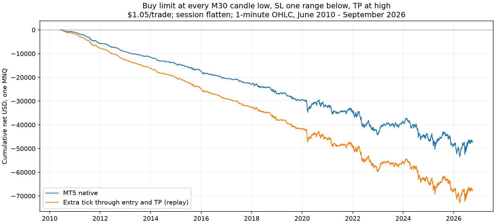

# Buy limit at the last candle low: results

2026-11-23. **Negative after costs in all three main periods.**

Native MT5, MNQ M30, 1-minute OHLC, June 2010 through September 2026. One MNQ ($2/point), one-tick spread, $1.05 round-turn commission.

## Rule

Any completed candle, including doji: buy limit at low, SL = low - (high - low), resting TP = high (1:1). User confirmed replacing unfilled orders every candle. One position at a time, original SL/TP fixed once filled. Usual 01:00-23:30 research session clock, early-close calendar and flatten fallback.

Buy limits require ask to reach entry. Skip a new order already at/above ask (1,157 cases), and zero-range signals. Resting orders may fill on the opening quote before cancellation/replacement or session flatten. [Frozen protocol](PROTOCOL.md).

## Native results

| Period | Trades | Gross $ | Net $ | Net win rate | Net PF | Closed-trade DD $ | Mean net R |
|---|---:|---:|---:|---:|---:|---:|---:|
| 2010-15 | 13,873 | -2,808.00 | -17,374.65 | 47.40% | 0.779 | 17,480.40 | -0.2301 |
| 2016-19 | 9,689 | -1,906.50 | -12,079.95 | 48.68% | 0.888 | 12,535.45 | -0.1230 |
| 2020-Sep2026 | 17,069 | 10.50 | -17,911.95 | 49.75% | 0.972 | 24,342.90 | -0.0301 |
| 2016-Sep2026 | 26,758 | -1,896.00 | -29,991.90 | 49.36% | 0.960 | 36,273.35 | -0.0637 |

**Full history: 40,631 trades, gross -$4,704.00, net -$47,366.55.** Only 2 of 17 calendar-year rows are positive: 2023 and January-September 2026. Both 2010 and 2026 are partial years.

From 2020, gross profit is just $10.50 across 17,069 trades; costs total $17,922.45. Gross mean R is -0.0056: fixed-contract dollar weighting differs from equal-risk averaging. Mean net R is -0.0301, whole-week bootstrap 95% interval -0.0450 to -0.0148, descriptive on repeatedly studied history.

All-history exits: 19,723 stops, 18,627 take profits, 2,281 session exits. Planned brackets are 1:1; session exits need not be +/-1R. Net win rate is after costs. Drawdown above uses closed-trade net balance, not intratrade equity. Daily closed-balance drawdown is also saved in summary.csv.

## Fill sensitivity

Predeclared replay: ask must trade one extra tick below entry, and bid one extra tick above TP, with fills still at requested prices. Same stop/session rules. A cautious fill scenario, not a queue or tick-data simulation.

| Period | Trades | Net $ | Net PF |
|---|---:|---:|---:|
| 2010-15 | 12,772 | -24,743.10 | 0.686 |
| 2016-19 | 9,271 | -16,844.05 | 0.844 |
| 2020-Sep2026 | 16,890 | -26,198.50 | 0.959 |
| 2016-Sep2026 | 26,161 | -43,042.55 | 0.943 |

The sensitivity begins June 11, 2010, after native startup; the native table includes its first session. Both later periods are fully aligned.



## Verification

- Native EA: zero compiler errors/warnings; zero rejected submissions. Report trade count, profit arithmetic, 1:1 geometry and non-overlap checked.
- All 40,619 trades from June 11, 2010 match independent replay on submission minute, entry minute/price, stop, exit minute/price and exit reason. The first native session (12 trades) is excluded from comparison because MT5 warms up chart history.
- Ten focused tests pass: all colours, ask-side touch, SL/TP, replacement, opening-quote precedence, zero range, marketable-order skip, early flatten, single position, penetration and one-tick minutes.
- Five initial exit differences on one-tick 2010 minutes were resolved by using raw tick volume instead of generating four duplicate quotes. One replay trade changed by $1; native outcomes never changed.
- Input/source/report hashes saved. No parameter optimization or baseline/live changes.

## Reproduce

```powershell
.\venv\Scripts\python.exe -m unittest discover -s python -p test_candle_low_buy_limit.py -v
.\venv\Scripts\python.exe python\candle_low_buy_limit.py analyze
```

Run folder: `Reports/candle_low_buy_limit_20261123/`: HTML, INI, compiler/tester logs, manifest, verification.json, trades.csv, summary.csv, annual.csv and trades_through.csv. Prepare refuses to overwrite an existing run. EA: `mt5/experts/Candle_low_buy_limit.mq5`. Replay: `python/candle_low_buy_limit.py`.

**Interpretation:** this unfiltered candle-low entry does not show a profitable edge in this test. Recent gross performance is approximately break-even; costs make it negative. One-minute OHLC assumes intraminute ordering and does not establish executable tick-level or live results.

## Manual risk/reward runs (2026-11-23)

The installed `CodexResearch\Candle_low_buy_limit` now has `RiskReward` (default 1.0).
In Strategy Tester Inputs, use 1 for 1:1, 2 for a target twice the stop distance,
or e.g. 2.5. TP = entry + RiskReward x signal range; SL remains low minus range.
TP rounds to the nearest instrument tick, with a minimum one-tick distance.
Select M30 and a custom research symbol, e.g. `MNQcontDTBNT20102026_2`.
All original session and order-replacement rules still apply.
`RunTag` defaults to `candlelow_manual`; change it for each run to retain separate
Common/Files stats CSVs. The stats CSV includes the requested risk/reward input.

The published results above remain the original 1:1 study. Its EA snapshot and
reports in the original run folder are preserved; analysis verifies that snapshot.

Validation of the input change: zero compiler errors/warnings; ten regression tests pass. September 2026 native checks at 1R (219 trades) and 2.5R (150 trades) verify every filled order's target geometry, with zero rejected orders. All 208 1R trades from September 2 match the original study exactly. Checks saved under `Reports/candle_low_buy_limit_rr_manual_20261123/`.
