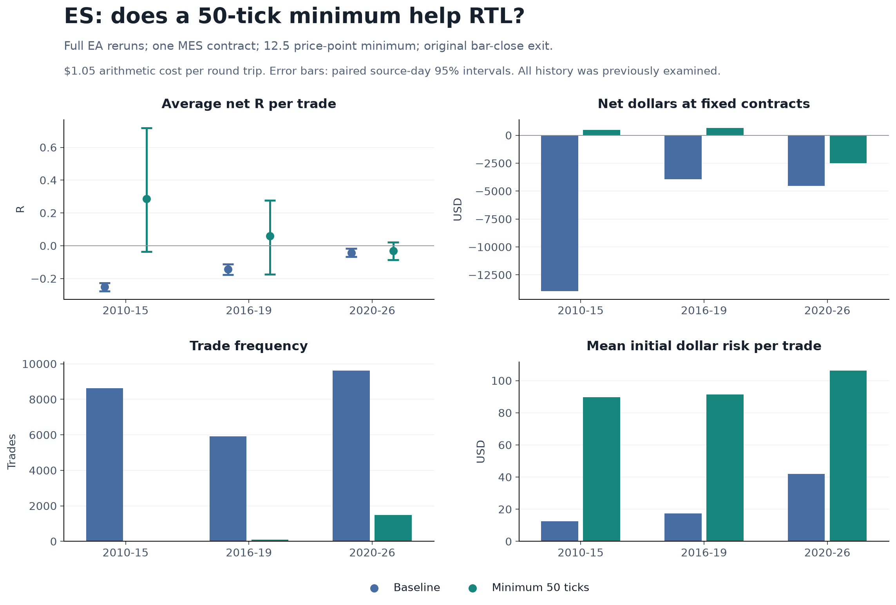
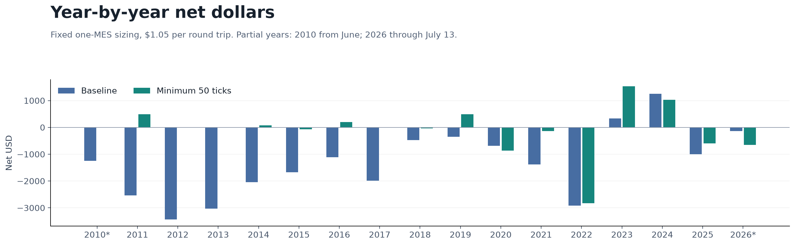

# ES minimum candle width: full EA test

2026-10-11. [Recorded protocol](PROTOCOL.md). Follow-up to [NQ resolution](../granularity/RESULTS.md) and [NQ / coarse NQ / ES paths](../path-interaction/RESULTS.md).

**The 50-tick rule does not meet the recorded historical candidate criteria. Keep the ES baseline unchanged.**

The existing MT5 EA already has the required minimum-range filter. We tested one threshold: signal range at least **50 native ticks = 12.5 ES price points**. Four complete EA reruns cover RTL and the every-bar market-buy control, each with the filter off/on. They include all changed entry opportunities and pending-order behaviour; deleting rows from the old ledger is not the test result.

## Correct MT5 inputs and actual behaviour

This symbol reports `_Point=0.01`, native tick size 0.25 and tick value $1.25 at one MES contract ($5 per ES price point). The built-in filter divides the range by `_Point`, so its input uses quote points:

| Input | Tested setting |
|---|---:|
| UseCandleRangeFilter | true |
| MinCandleRange | 1250 |
| MaxCandleRange | 100000000 |

The minimum is inclusive: equality at 50 ticks passes. The maximum is deliberately nonbinding: 1,000,000 price points versus the source M30 maximum of 363. Leaving the prior maximum of 8000 would add an unintended 80-price-point cap. Minimum initial requested risk is $62.50 per MES contract.

The range check runs while flat at a new-bar entry decision, before candle colour and run-count checks. If any later candle fails the width check, it cancels an existing buy stop, including one armed from an earlier qualifying red candle. An open position continues under its original management. Pending orders can fill on a new-bar quote before the handler cancels them. These are the built-in semantics; this experiment combines wider eligible signals with altered pending-order lifetimes and later entry opportunities.

All other inputs stay fixed: red cap3, RR1 bar-close market exit, one MES contract, M30, M1 OHLC tester, original entry windows and early-close/flatten/fallback rules, and no trailing stop. Dates are 2010-06-07 through 2026-07-13, exclusive ToDate July 14; baseline entries begin June 10 after warmup. The control uses cap0 and receives the same width check.

## RTL results

Primary results use the complete strategy ledgers and the existing $1.05 arithmetic cost convention per round trip. It is deducted once per trade. R uses profit divided by the original requested entry-minus-SL dollar risk. Dollars use a fixed one-MES contract; they weight wider-risk trades differently from mean R.

| Period | Rule | Trades | Gross R/trade | Net R/trade | Net dollars | Net PF | Closed-trade max DD | Net dollars/DD |
| --- | --- | --- | --- | --- | --- | --- | --- | --- |
| 2010-15 | Baseline | 8633 | -0.1176 | -0.2505 | $-13,949.65 | 0.785 | $14,036.85 | -0.99 |
| 2010-15 | Minimum 50 ticks | 23 | +0.2991 | +0.2865 | $494.60 | 1.763 | $260.45 | 1.90 |
| 2016-19 | Baseline | 5922 | -0.0389 | -0.1434 | $-3,923.10 | 0.930 | $4,987.95 | -0.79 |
| 2016-19 | Minimum 50 ticks | 91 | +0.0723 | +0.0597 | $651.95 | 1.187 | $866.90 | 0.75 |
| 2020-26 | Baseline | 9623 | +0.0018 | -0.0418 | $-4,539.15 | 0.979 | $7,245.20 | -0.63 |
| 2020-26 | Minimum 50 ticks | 1479 | -0.0207 | -0.0322 | $-2,515.45 | 0.967 | $4,940.20 | -0.51 |
| all | Baseline | 24178 | -0.0508 | -0.1412 | $-22,411.90 | 0.934 | $24,007.25 | -0.93 |
| all | Minimum 50 ticks | 1593 | -0.0108 | -0.0223 | $-1,368.90 | 0.983 | $4,940.20 | -0.28 |

Paired filtered-minus-baseline differences, with 95% source-entry-day bootstrap intervals:

| Period | Gross R change [95% interval] | Net R change [95% interval] | Net dollar change [95% interval] |
| --- | --- | --- | --- |
| 2010-15 | +0.4167 [+0.0836, +0.8434] | +0.5371 [+0.2036, +0.9651] | $14,444.25 [$11,598.25, $17,533.03] |
| 2016-19 | +0.1112 [-0.1192, +0.3277] | +0.2030 [-0.0274, +0.4197] | $4,575.05 [$1,191.49, $7,958.12] |
| 2020-26 | -0.0225 [-0.0742, +0.0302] | +0.0096 [-0.0417, +0.0624] | $2,023.70 [$-5,686.81, $10,024.00] |
| all | +0.0400 [-0.0064, +0.0923] | +0.1189 [+0.0727, +0.1711] | $21,043.00 [$12,584.53, $30,378.90] |

For 2016-19, filtered mean net R is +0.0597; the change is +0.2030 R/trade and $4,575.05 at fixed contracts. Recorded point criteria met: **True**.

For 2020-26, filtered mean net R is -0.0322; the change is +0.0096 R/trade and $2,023.70 at fixed contracts. Recorded point criteria met: **False**.

The recent result gives the clearest answer: **gross expectancy falls from +0.0018 to -0.0207 R/trade**. Mean cost falls from 0.0436 to 0.0114 R/trade because the risk widths are larger. That cost reduction exceeds the gross deterioration, leaving net expectancy slightly less negative. The paired recent net-R change has an interval spanning zero; this is not evidence of a stronger gross trading edge.

At fixed contracts, recent gross dollars fall from $5,565.00 to -$962.50, a $6,527.50 deterioration. Removing 8,144 trades saves $8,551.20 under the $1.05 cost convention, producing the $2,023.70 net-dollar improvement. Lower losses and drawdown accompany much less trading; the filtered strategy still loses in this period.

The earlier positive filtered result has only **91 trades** in 2016-19, with a mean-net-R interval of [-0.1744, +0.2776]. The 2010-15 result has only 23 trades. These sparse older samples do not establish a stable positive strategy.

The candidate screen requires positive filtered mean net R, improved mean net R and improved net dollars in **both** 2016-19 and 2020-26. Those are historical point criteria; intervals and year-by-year consistency determine how much confidence to place in the estimates. These years have already been studied and are not an untouched holdout.

## How much trading and risk change?

| Period | Filtered/baseline trades | Retained trade count | Mean width, price points | Mean requested dollar risk | Entry days, baseline -> filtered |
| --- | --- | --- | --- | --- | --- |
| 2010-15 | 23/8633 | 0.27% | 2.49 -> 17.96 | $12.43 -> $89.78 | 1423 -> 18 |
| 2016-19 | 91/5922 | 1.54% | 3.45 -> 18.29 | $17.26 -> $91.46 | 1031 -> 71 |
| 2020-26 | 1479/9623 | 15.37% | 8.41 -> 21.26 | $42.04 -> $106.29 | 1688 -> 811 |
| all | 1593/24178 | 6.59% | 5.08 -> 21.04 | $25.40 -> $105.21 | 4142 -> 900 |

Retained trade count is a frequency ratio, not the fraction of identical trades kept. Larger candles increase dollar stop risk at fixed contracts. Gross and net R, fixed-contract profit, total risk-normalized R and closed-trade drawdown are all saved separately; none should be substituted for another.

## Full rerun versus deleting narrow trades

Opening comparisons include actual entry time, fill, original requested risk and the original arming candle. Position IDs change between runs and are not cross-run keys. The saved turnover table flags ambiguous duplicate keys and same execution with different arming signals.

| Period | Old ledger width >=50 | Actual filtered trades | Shared qualifying openings | New filtered openings | Removed qualifying openings | Shared openings with changed profit |
| --- | --- | --- | --- | --- | --- | --- |
| 2010-15 | 34 | 23 | 19 | 4 | 15 | 0 |
| 2016-19 | 133 | 91 | 83 | 8 | 50 | 0 |
| 2020-26 | 1788 | 1479 | 1400 | 79 | 388 | 0 |
| all | 1955 | 1593 | 1502 | 91 | 453 | 0 |

For example, deleting narrow trades would leave 1,788 recent RTL trades, whereas the complete rerun makes 1,479: 1,400 shared openings, 79 new openings and 388 qualifying openings that no longer occur. The identical shared profits confirm that changed order availability, rather than changed management of those shared positions, accounts for this turnover.

The [baseline width subset](../../../Reports/es_width_filter_20261011/posthoc_diagnostic.csv) is saved only as a descriptive diagnostic, including the omitted smaller-width group. Newly available entries and cancelled older orders are incorporated in the full EA results above.

## Control, years and cost sensitivities

The control buys eligible bars while flat regardless of colour, using the preceding candle's range for its stop and target geometry. Its schedules differ from RTL. Its width-filter comparison helps describe the change in general long exposure, without isolating a causal buy-stop edge.

| Period | Baseline trades | Filtered trades | Baseline net R | Filtered net R | Baseline net dollars | Filtered net dollars | Net R change [95% interval] |
| --- | --- | --- | --- | --- | --- | --- | --- |
| 2010-15 | 13017 | 307 | -0.2528 | -0.0247 | $-30,125.35 | $-296.10 | +0.2281 [+0.1273, +0.3262] |
| 2016-19 | 9147 | 637 | -0.1660 | -0.0784 | $-15,928.10 | $-3,602.60 | +0.0876 [+0.0203, +0.1574] |
| 2020-26 | 15278 | 5265 | -0.0760 | -0.0139 | $-24,169.40 | $-538.25 | +0.0621 [+0.0381, +0.0873] |
| all | 37442 | 6209 | -0.1594 | -0.0211 | $-70,222.85 | $-4,436.95 | +0.1384 [+0.1150, +0.1608] |

Year-by-year RTL results, including zero/sparse years. 2010 and 2026 are partial years:

| Year | Filtered trades | Baseline net R | Filtered net R | Baseline net dollars | Filtered net dollars |
| --- | --- | --- | --- | --- | --- |
| 2010* | 0 | -0.2588 | unavailable | $-1,243.25 | $0.00 |
| 2011 | 5 | -0.2325 | +1.2793 | $-2,533.55 | $484.75 |
| 2012 | 0 | -0.2924 | unavailable | $-3,432.35 | $0.00 |
| 2013 | 0 | -0.3080 | unavailable | $-3,024.75 | $0.00 |
| 2014 | 3 | -0.2573 | +0.4142 | $-2,044.35 | $76.85 |
| 2015 | 15 | -0.1553 | -0.0699 | $-1,671.40 | $-67.00 |
| 2016 | 8 | -0.1810 | +0.1871 | $-1,110.10 | $201.60 |
| 2017 | 1 | -0.2467 | -0.0288 | $-1,991.85 | $-2.30 |
| 2018 | 63 | -0.0562 | -0.0174 | $-468.50 | $-41.15 |
| 2019 | 19 | -0.0877 | +0.2665 | $-352.65 | $493.80 |
| 2020 | 243 | -0.0106 | -0.0327 | $-686.00 | $-861.40 |
| 2021 | 85 | -0.0741 | -0.0326 | $-1,384.90 | $-133.00 |
| 2022 | 354 | -0.0498 | -0.0800 | $-2,919.15 | $-2,829.20 |
| 2023 | 98 | -0.0737 | +0.1558 | $328.75 | $1,528.35 |
| 2024 | 143 | -0.0275 | +0.0697 | $1,251.85 | $1,027.35 |
| 2025 | 328 | -0.0187 | -0.0660 | $-997.50 | $-596.90 |
| 2026* | 228 | -0.0312 | -0.0531 | $-132.20 | $-650.65 |

Only 2023 and 2024 have positive filtered mean net R among the seven recent calendar years; the other five are negative. Earlier yearly estimates are especially sparse: 2017 contains one filtered trade, and three of the old calendar years contain none.

| Period | Round-trip cost | Baseline net R | Filtered net R | Baseline net dollars | Filtered net dollars |
| --- | --- | --- | --- | --- | --- |
| 2016-19 | $1.05 | -0.1434 | +0.0597 | $-3,923.10 | $651.95 |
| 2016-19 | $2.30 | -0.2677 | +0.0447 | $-11,325.60 | $538.20 |
| 2016-19 | $3.55 | -0.3921 | +0.0297 | $-18,728.10 | $424.45 |
| 2020-26 | $1.05 | -0.0418 | -0.0322 | $-4,539.15 | $-2,515.45 |
| 2020-26 | $2.30 | -0.0937 | -0.0458 | $-16,567.90 | $-4,364.20 |
| 2020-26 | $3.55 | -0.1455 | -0.0594 | $-28,596.65 | $-6,212.95 |

The $2.30 and $3.55 scenarios add one or two native ticks of friction once per round trip ($1.25 or $2.50 extra). They are arithmetic sensitivities, not estimates of real fees, spread or slippage, and do not change tester executions.

## Validation and interpretation limits

All four runs pass complete MT5 HTML orders/deals, independent observer and tester total reconciliation. Both baseline raw ledgers **and complete path ledgers** reproduce earlier runs byte for byte. There are **69,422 complete paths**, zero observer errors/entry delay, and no open positions at completion. All filtered original order signals and requested risks meet 12.5 price points; equality is observed in submitted 50-tick orders. The data cache binds to the frozen original ES M1 source; every recorded order signal OHLC and observed M30 close matches it. All 39 frozen input hashes and 32 completion-output hashes are checked.

The control logger omitted 127 baseline and two filtered trades; the complete observer and HTML ledger recover all of them. Order risk corrects two baseline-control logger rows and one filtered-control row. Raw files remain unchanged; analysis uses complete original order risks and actual deal profits.

One thousand shared resamples of whole ES source-entry days provide the paired intervals for each era and the pooled span. The 4,145-day calendar includes zero-trade dates. Mean R is recomputed from sampled total R divided by sampled trades. Drawdown uses actual closed-trade chronology including the initial zero; it excludes intratrade floating equity and has no bootstrap interval. Longer serial dependence and the broader history of exploratory selection are not covered.

Full ledgers are primary. [Source-hole/cross-date contributions](../../../Reports/es_width_filter_20261011/exclusion_contributions.csv) and the corresponding secondary summary are saved separately. Source clock is Chicago local time plus eight hours with US DST. Sessions/yearly tables use entry time; the sensitivity removes entries on 2020-02-28/2020-06-30 and cross-date trades consistently across arms.

Removing source-hole and cross-date contributions leaves recent filtered RTL at 1,476 trades, -0.0302 net R/trade and -$2,108.55. The secondary sensitivity therefore leaves the conclusion unchanged.

This test answers whether the existing complete width-filtered strategy performed better on this history. Even a favourable result would not establish that relative tick discreteness caused ES's weakness: the filter selects different volatility/session conditions and changes pending-order lifetimes, trade frequency, risk widths and available holding time. M1 OHLC quotes are generated tester paths, not exchange tick replay. No threshold optimization, live-profitability claim or automatic strategy adoption follows.

## Reproducible files

- [Preparation and exact copied source](../../../python/prepare_es_width_filter.py), [resumable runner and gates](../../../python/run_es_width_filter.py), [analysis and synthetic checks](../../../python/analyze_es_width_filter.py), [figures](../../../python/plot_es_width_filter.py).
- Run directory: `Reports/es_width_filter_20261011/`, with copied source/includes, all four INIs, raw/complete ledgers, reports, orders, target checks, path extrema and symbol metadata. [Manifest](../../../Reports/es_width_filter_20261011/manifest.json), [run validation](../../../Reports/es_width_filter_20261011/validation.json), [analysis checks](../../../Reports/es_width_filter_20261011/analysis_checks.json), [generated overview](../../../Reports/es_width_filter_20261011/ANALYSIS.md).
- [Period metrics and intervals](../../../Reports/es_width_filter_20261011/summary.csv), [paired contrasts](../../../Reports/es_width_filter_20261011/contrasts.csv), [yearly](../../../Reports/es_width_filter_20261011/yearly.csv), [sessions](../../../Reports/es_width_filter_20261011/sessions.csv), [aligned source days](../../../Reports/es_width_filter_20261011/daily.csv), [turnover summary](../../../Reports/es_width_filter_20261011/turnover.csv), [individual changed openings](../../../Reports/es_width_filter_20261011/turnover_entries.csv).
