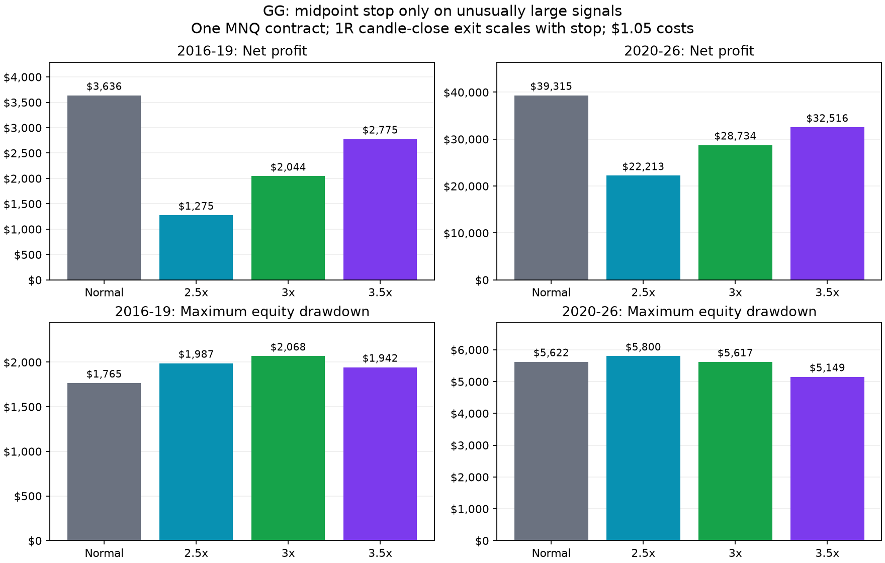

# GG midpoint stops on unusually large session candles

Completed 2026-11-10; protocol frozen 2026-11-09. Exploratory.

**Does not meet the predeclared consistency screen.**

- **2016-19, primary 3x:** net $3,635.60 -> $2,044.20; equity DD $1,765.35 -> $2,067.60; net/DD 2.06 -> 0.99.
- **2020-26, primary 3x:** net $39,315.45 -> $28,733.80; equity DD $5,621.75 -> $5,617.35; net/DD 6.99 -> 5.12.

## Exact test

Compare signal high-low range (including wicks) with the median range of **all
earlier M30 candles in the same full session**, both colours, at least five
earlier bars. Exclude the signal itself, later bars, and previous sessions.
Primary >=3x; neighbours >=2.5x and >=3.5x. Stop at high-low midpoint, nearest
tick; entry stays at green signal high. Larger-than-threshold candles qualify.
Research session starts 01:00; not US cash session only.

Per your answer, profit-exit threshold shrinks with the stop, keeping RR=1.
It requires an M30 close at/above the threshold, then exits at the next quote.
Full MT5 replay, one-minute OHLC, one MNQ contract, uncapped GG, no VWAP or hour
exclusions, normal 23:30/early-close flatten. $1.05 per completed position.
Primary sample ends before October 1, 2026. Midpoint halves price risk on
flagged trades, subject to rounding, but changes exits and subsequent entries.
It does not automatically halve portfolio drawdown. No position-size increase.

## Era comparisons

### 2016-19

| Rule | Trades | Tightened | Net | Mean net R | Equity DD | Net/DD | Worst-session DD | Net PF | Net win rate |
|---|---|---|---|---|---|---|---|---|---|
| Normal GG | 6388 | 0 | $3,635.60 | -0.0163 | $1,765.35 | 2.06 | $535.75 | 1.05 | 43.4% |
| Midpoint >= 2.5x | 7049 | 1227 | $1,275.05 | -0.0281 | $1,987.15 | 0.64 | $535.75 | 1.02 | 42.0% |
| Midpoint >= 3x | 6856 | 806 | $2,044.20 | -0.0225 | $2,067.60 | 0.99 | $535.75 | 1.03 | 42.6% |
| Midpoint >= 3.5x | 6699 | 513 | $2,775.05 | -0.0199 | $1,942.40 | 1.43 | $535.75 | 1.04 | 42.9% |

### 2020-26

| Rule | Trades | Tightened | Net | Mean net R | Equity DD | Net/DD | Worst-session DD | Net PF | Net win rate |
|---|---|---|---|---|---|---|---|---|---|
| Normal GG | 11181 | 0 | $39,315.45 | +0.0444 | $5,621.75 | 6.99 | $2,423.50 | 1.08 | 43.2% |
| Midpoint >= 2.5x | 12236 | 1980 | $22,213.20 | +0.0296 | $5,800.20 | 3.83 | $2,397.00 | 1.05 | 41.8% |
| Midpoint >= 3x | 11904 | 1246 | $28,733.80 | +0.0371 | $5,617.35 | 5.12 | $2,397.00 | 1.06 | 42.4% |
| Midpoint >= 3.5x | 11688 | 815 | $32,516.10 | +0.0414 | $5,149.30 | 6.31 | $2,397.00 | 1.07 | 42.7% |

### 2016-26

| Rule | Trades | Tightened | Net | Mean net R | Equity DD | Net/DD | Worst-session DD | Net PF | Net win rate |
|---|---|---|---|---|---|---|---|---|---|
| Normal GG | 17569 | 0 | $42,951.05 | +0.0223 | $5,621.75 | 7.64 | $2,423.50 | 1.08 | 43.3% |
| Midpoint >= 2.5x | 19285 | 3207 | $23,488.25 | +0.0085 | $5,800.20 | 4.05 | $2,397.00 | 1.04 | 41.9% |
| Midpoint >= 3x | 18760 | 2052 | $30,778.00 | +0.0153 | $5,617.35 | 5.48 | $2,397.00 | 1.05 | 42.5% |
| Midpoint >= 3.5x | 18387 | 1328 | $35,291.15 | +0.0191 | $5,149.30 | 6.85 | $2,397.00 | 1.06 | 42.8% |

### 2010-15 (secondary)

| Rule | Trades | Tightened | Net | Mean net R | Equity DD | Net/DD | Worst-session DD | Net PF | Net win rate |
|---|---|---|---|---|---|---|---|---|---|
| Normal GG | 8935 | 0 | $-5,108.25 | -0.1488 | $5,843.60 | -0.87 | $254.35 | 0.91 | 41.0% |
| Midpoint >= 2.5x | 10046 | 2251 | $-7,212.30 | -0.1647 | $7,633.80 | -0.94 | $224.80 | 0.87 | 39.5% |
| Midpoint >= 3x | 9710 | 1466 | $-6,655.00 | -0.1585 | $7,297.60 | -0.91 | $186.90 | 0.88 | 40.0% |
| Midpoint >= 3.5x | 9500 | 982 | $-6,071.00 | -0.1531 | $6,760.95 | -0.90 | $211.85 | 0.89 | 40.4% |

## Flagged trades and opportunity changes

| Period | Tightened | Share | Median full-candle risk | Median actual risk | Stopped tightened trades |
|---|---|---|---|---|---|
| 2016-19 | 806 | 11.8% | $44.50 | $22.00 | 429 |
| 2020-26 | 1246 | 10.5% | $163.50 | $81.50 | 680 |
| 2016-26 | 2052 | 10.9% | $116.00 | $58.00 | 1109 |

Pairs match submission and entry timestamps. Their P&L difference excludes new opportunities after changed exits; it is not the whole-strategy change.

| Period | Matched affected | Their P&L change | Old winners now stopped | Both paths stopped | New entries | Old entries absent |
|---|---|---|---|---|---|---|
| 2016-19 | 711 | $-697.50 | 100 | 214 | 538 | 70 |
| 2020-26 | 1077 | $-5,695.00 | 155 | 369 | 841 | 118 |
| 2016-26 | 1788 | $-6,392.50 | 255 | 583 | 1379 | 188 |

## Cost sensitivity at 3x

| Period | Rule | Net at $1.05 | Net at $2.05 | Net at $3.05 | Mean net R | R at $2.05 | R at $3.05 |
|---|---|---|---|---|---|---|---|
| 2016-19 | Normal GG | $3,635.60 | $-2,752.40 | $-9,140.40 | -0.0163 | -0.0998 | -0.1834 |
| 2016-19 | Midpoint >= 3x | $2,044.20 | $-4,811.80 | $-11,667.80 | -0.0225 | -0.1073 | -0.1920 |
| 2020-26 | Normal GG | $39,315.45 | $28,134.45 | $16,953.45 | +0.0444 | +0.0224 | +0.0004 |
| 2020-26 | Midpoint >= 3x | $28,733.80 | $16,829.80 | $4,925.80 | +0.0371 | +0.0150 | -0.0071 |

## Annual results

| Year | Rule | Net | Mean net R | Equity DD | Net/DD |
|---|---|---|---|---|---|
| 2010 | Normal GG | $-552.90 | -0.1696 | $670.50 | -0.82 |
| 2010 | Midpoint >= 3x | $-704.65 | -0.1848 | $810.45 | -0.87 |
| 2011 | Normal GG | $-912.75 | -0.1312 | $1,282.35 | -0.71 |
| 2011 | Midpoint >= 3x | $-871.40 | -0.1296 | $1,244.60 | -0.70 |
| 2012 | Normal GG | $-1,787.20 | -0.2184 | $1,902.95 | -0.94 |
| 2012 | Midpoint >= 3x | $-2,138.65 | -0.2247 | $2,209.15 | -0.97 |
| 2013 | Normal GG | $-1,277.75 | -0.1642 | $1,547.45 | -0.83 |
| 2013 | Midpoint >= 3x | $-1,772.10 | -0.1811 | $1,993.05 | -0.89 |
| 2014 | Normal GG | $-733.55 | -0.1337 | $1,079.65 | -0.68 |
| 2014 | Midpoint >= 3x | $-1,110.45 | -0.1496 | $1,169.40 | -0.95 |
| 2015 | Normal GG | $155.90 | -0.0843 | $923.60 | 0.17 |
| 2015 | Midpoint >= 3x | $-57.75 | -0.0924 | $786.90 | -0.07 |
| 2016 | Normal GG | $-495.70 | -0.0711 | $929.30 | -0.53 |
| 2016 | Midpoint >= 3x | $-896.20 | -0.0884 | $1,263.05 | -0.71 |
| 2017 | Normal GG | $-54.65 | -0.0409 | $374.30 | -0.15 |
| 2017 | Midpoint >= 3x | $-49.75 | -0.0424 | $500.20 | -0.10 |
| 2018 | Normal GG | $1,320.30 | +0.0138 | $1,765.35 | 0.75 |
| 2018 | Midpoint >= 3x | $639.60 | +0.0108 | $1,174.35 | 0.54 |
| 2019 | Normal GG | $2,865.65 | +0.0335 | $1,179.20 | 2.43 |
| 2019 | Midpoint >= 3x | $2,350.55 | +0.0320 | $1,132.25 | 2.08 |
| 2020 | Normal GG | $8,799.55 | +0.0817 | $2,614.90 | 3.37 |
| 2020 | Midpoint >= 3x | $7,940.95 | +0.0840 | $2,389.50 | 3.32 |
| 2021 | Normal GG | $4,222.80 | +0.0281 | $1,997.45 | 2.11 |
| 2021 | Midpoint >= 3x | $2,017.30 | +0.0158 | $2,829.60 | 0.71 |
| 2022 | Normal GG | $406.60 | +0.0245 | $5,147.70 | 0.08 |
| 2022 | Midpoint >= 3x | $1,946.75 | +0.0228 | $4,248.85 | 0.46 |
| 2023 | Normal GG | $7,283.05 | +0.0375 | $2,348.05 | 3.10 |
| 2023 | Midpoint >= 3x | $4,505.50 | +0.0261 | $2,469.05 | 1.82 |
| 2024 | Normal GG | $8,215.90 | +0.0645 | $3,105.15 | 2.65 |
| 2024 | Midpoint >= 3x | $8,465.90 | +0.0614 | $1,964.40 | 4.31 |
| 2025 | Normal GG | $4,170.70 | +0.0196 | $5,621.75 | 0.74 |
| 2025 | Midpoint >= 3x | $1,419.05 | +0.0075 | $5,617.35 | 0.25 |
| 2026 | Normal GG | $6,216.85 | +0.0600 | $4,308.30 | 1.44 |
| 2026 | Midpoint >= 3x | $2,438.35 | +0.0474 | $4,533.95 | 0.54 |

## Verification and limits

- Disabled native run is byte-identical to saved GG: 26,505 trades. Compilation: zero errors and warnings.
- Checked all 5,511,965 cached minute OHLC rows against raw CSV, aggregated 191,786 M30 bars, rebuilt every candidate reference and stop.
- gglarge_20261109_control: 38,041 candidate decisions; all 26,505 native trades match independent minute replay in entry/exit minute, requested/fill/stop/exit price and submission bar. Full-run gross equity DD $5,406.50 matches MT5.
- gglarge_20261109_r3: 40,707 candidate decisions; all 28,471 native trades match independent minute replay in entry/exit minute, requested/fill/stop/exit price and submission bar. Full-run gross equity DD $5,284.50 matches MT5.
- gglarge_20261109_r2p5: 41,879 candidate decisions; all 29,332 native trades match independent minute replay in entry/exit minute, requested/fill/stop/exit price and submission bar. Full-run gross equity DD $5,329.50 matches MT5.
- gglarge_20261109_r3p5: 39,933 candidate decisions; all 27,888 native trades match independent minute replay in entry/exit minute, requested/fill/stop/exit price and submission bar. Full-run gross equity DD $4,922.50 matches MT5.

- Report/ledger totals and economics agree. R uses actual initial risk.
  Simulator warmup trades before the native first entry are excluded.
- 36 focused tests passed: session isolation, future-bar exclusion, minimum
  history, median, thresholds, rounding, stop chronology, scaled exit, and
  existing weekly/intrabar behavior.
- Equity DD uses marked-to-market equity on generated OHLC quotes. Fees use
  native exit times; same-second fee-order sensitivity is recorded in CSV.
  No real-tick/slippage validation. R is not a fixed-dollar-risk sizing model.
- Reused history is exploratory, not untouched out of sample. No live strategy
  or default changed. Screenshot contract/date not identified or reproduced.
- Account-free portable startup failed because this build requires an account.
  After the user closed MT5 and authorized reopening, runs used the established
  tester. Failed-start logs remain; no trades came from those attempts.

## Evidence and reproduction

[Protocol](PROTOCOL.md), [prepare](../../../python/prepare_gg_large_candle.py),
[native runner](../../../python/run_gg_large_candle_native.py),
[analysis/checks](../../../python/analyze_gg_large_candle.py),
[stop helper](../../../mt5/experts/gg_large_candle_research.mqh),
[tests](../../../python/test_gg_large_candle.py).

Reports/gg_large_candle_20261109/ holds frozen inputs, native reports, ledgers,
candidate logs, equity observations, hashes and verification.
[Summary CSV](summary.csv), [paired entries](paired.csv).

Run with the project venv: python/prepare_gg_large_candle.py (new study only),
python/run_gg_large_candle_native.py (MT5 closed), then
python/analyze_gg_large_candle.py and python/report_gg_large_candle.py.
