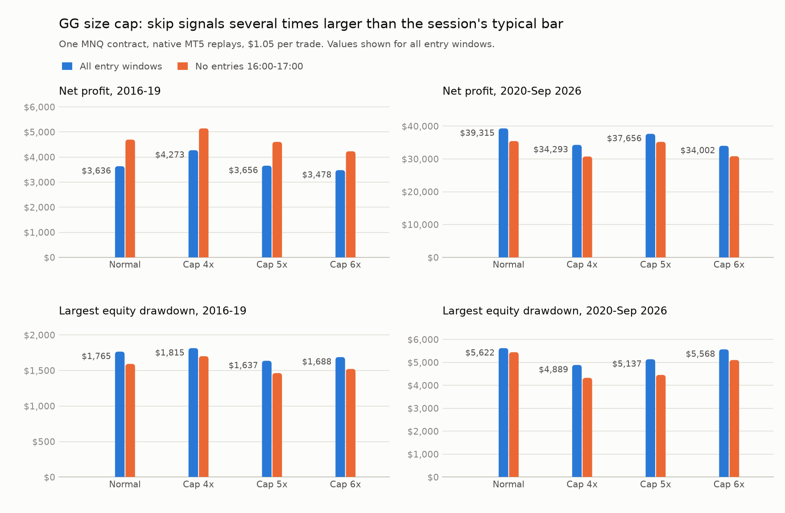

# GG size cap on outsized signal candles

Completed 2026-11-11 under the [frozen protocol](PROTOCOL.md). Exploratory.

**Does not meet the pre-set screen: 6x net/DD is below normal GG in 2020-Sep 2026.**

- **2016-19, 5x, all entry windows:** net $3,635.60 -> $3,655.95; equity DD $1,765.35 -> $1,636.80; net/DD 2.06 -> 2.23; largest single risk $303.00 -> $228.00.
- **2020-Sep 2026, 5x, all entry windows:** net $39,315.45 -> $37,655.55; equity DD $5,621.75 -> $5,136.75; net/DD 6.99 -> 7.33; largest single risk $1,245.50 -> $1,245.50.
- **With no entries 16:00-17:00 (secondary):** the same screen is not met: 6x net/DD is below normal GG in 2016-19; 6x net/DD is below normal GG in 2020-Sep 2026.
## Reading the result

All figures here are 2020-September 2026 with all entry windows.

- **Only one threshold looks acceptable.** Net change: -$5,022.20 at 4x, -$1,659.90 at 5x, -$5,313.20 at 6x. Normal-GG trades by signal size: 4x to 5x $2,584.30 (304 trades); 5x to 6x -$4,432.60 (122 trades); 6x and more $4,156.40 (102 trades). There is no steady pattern from smaller to larger candles, so the better result at one threshold reads as a selected cell, not as a property of large candles.
- **The cap does not limit the largest bets.** The largest initial risk ($1,245.50), the worst trade (-$782.55) and the worst-session DD ($2,423.50) are the same at every threshold. Of 38 normal-GG trades that risked $500 or more, 5x removes 15. 19 came in sessions whose earlier bars were large too (median range 90 points against 22 for a typical trade), and 4 had fewer than five earlier bars. A size measured against the session's own bars lets those through.
- **The trades that replace capped ones did worse.** At 5x the 224 capped trades had earned -$276.20; the 280 trades that exist only with the cap earned -$1,952.00.

## Exact test

A green GG signal is rejected when its high-low range (wicks included) is at
least k times the median range of **all earlier M30 candles of the same full
session** (both colours, at least five earlier bars, the signal itself and
later bars excluded). Rejected means what the EA already does for its other
filters: no buy stop is placed and a pending one is cancelled. k = 5 is
primary; 4 and 6 are the neighbours fixed beforehand. Everything else is normal
GG: entry at the signal high, stop at its low, 1R candle-close exit, 23:30 and
early-close flatten, one MNQ contract, no VWAP gate. $1.05 per completed
position. The primary sample ends before October 1, 2026.

5x was chosen after ledger cuts of this same history, so this is a check of a
selected threshold on reused data. It can show that the idea fails; a pass is
only a reason for a forward trial.

## Results by era

### All entry windows

**2016-19**

| Rule | Trades | Capped signals | Net | Mean net R | Equity DD | Net/DD | Worst-session DD | Largest risk | Worst trade | Net PF |
|---|---|---|---|---|---|---|---|---|---|---|
| Normal GG | 6388 | 0 | $3,635.60 | -0.0163 | $1,765.35 | 2.06 | $535.75 | $303.00 | -$194.55 | 1.05 |
| Cap >= 4x | 6406 | 575 | $4,273.20 | -0.0164 | $1,814.65 | 2.35 | $535.75 | $228.00 | -$181.05 | 1.06 |
| Cap >= 5x | 6421 | 240 | $3,655.95 | -0.0151 | $1,636.80 | 2.23 | $535.75 | $228.00 | -$194.55 | 1.05 |
| Cap >= 6x | 6410 | 112 | $3,478.00 | -0.0160 | $1,688.35 | 2.06 | $535.75 | $228.00 | -$194.55 | 1.05 |

**2020-Sep 2026**

| Rule | Trades | Capped signals | Net | Mean net R | Equity DD | Net/DD | Worst-session DD | Largest risk | Worst trade | Net PF |
|---|---|---|---|---|---|---|---|---|---|---|
| Normal GG | 11181 | 0 | $39,315.45 | +0.0444 | $5,621.75 | 6.99 | $2,423.50 | $1,245.50 | -$782.55 | 1.08 |
| Cap >= 4x | 11225 | 912 | $34,293.25 | +0.0424 | $4,888.80 | 7.01 | $2,423.50 | $1,245.50 | -$782.55 | 1.07 |
| Cap >= 5x | 11219 | 390 | $37,655.55 | +0.0426 | $5,136.75 | 7.33 | $2,423.50 | $1,245.50 | -$782.55 | 1.08 |
| Cap >= 6x | 11225 | 187 | $34,002.25 | +0.0422 | $5,568.25 | 6.11 | $2,423.50 | $1,245.50 | -$782.55 | 1.07 |

**2016-Sep 2026**

| Rule | Trades | Capped signals | Net | Mean net R | Equity DD | Net/DD | Worst-session DD | Largest risk | Worst trade | Net PF |
|---|---|---|---|---|---|---|---|---|---|---|
| Normal GG | 17569 | 0 | $42,951.05 | +0.0223 | $5,621.75 | 7.64 | $2,423.50 | $1,245.50 | -$782.55 | 1.08 |
| Cap >= 4x | 17631 | 1487 | $38,566.45 | +0.0210 | $4,888.80 | 7.89 | $2,423.50 | $1,245.50 | -$782.55 | 1.07 |
| Cap >= 5x | 17640 | 630 | $41,311.50 | +0.0216 | $5,136.75 | 8.04 | $2,423.50 | $1,245.50 | -$782.55 | 1.08 |
| Cap >= 6x | 17635 | 299 | $37,480.25 | +0.0210 | $5,568.25 | 6.73 | $2,423.50 | $1,245.50 | -$782.55 | 1.07 |

**2010-15 (secondary)**

| Rule | Trades | Capped signals | Net | Mean net R | Equity DD | Net/DD | Worst-session DD | Largest risk | Worst trade | Net PF |
|---|---|---|---|---|---|---|---|---|---|---|
| Normal GG | 8935 | 0 | -$5,108.25 | -0.1488 | $5,843.60 | -0.87 | $254.35 | $270.00 | -$101.05 | 0.91 |
| Cap >= 4x | 8939 | 1196 | -$6,617.45 | -0.1575 | $7,087.70 | -0.93 | $299.05 | $150.50 | -$151.55 | 0.88 |
| Cap >= 5x | 8974 | 563 | -$6,232.20 | -0.1525 | $6,922.70 | -0.90 | $299.05 | $150.50 | -$151.55 | 0.89 |
| Cap >= 6x | 8962 | 320 | -$6,138.60 | -0.1509 | $6,825.45 | -0.90 | $400.05 | $220.00 | -$221.05 | 0.89 |

### No entries 16:00-17:00

**2016-19**

| Rule | Trades | Capped signals | Net | Mean net R | Equity DD | Net/DD | Worst-session DD | Largest risk | Worst trade | Net PF |
|---|---|---|---|---|---|---|---|---|---|---|
| Normal GG | 6052 | 0 | $4,696.40 | -0.0171 | $1,592.75 | 2.95 | $535.75 | $303.00 | -$194.55 | 1.07 |
| Cap >= 4x | 6074 | 638 | $5,143.80 | -0.0159 | $1,700.90 | 3.02 | $535.75 | $228.00 | -$181.05 | 1.08 |
| Cap >= 5x | 6094 | 280 | $4,605.30 | -0.0143 | $1,463.30 | 3.15 | $535.75 | $228.00 | -$194.55 | 1.06 |
| Cap >= 6x | 6081 | 138 | $4,229.95 | -0.0167 | $1,521.80 | 2.78 | $535.75 | $228.00 | -$194.55 | 1.06 |

**2020-Sep 2026**

| Rule | Trades | Capped signals | Net | Mean net R | Equity DD | Net/DD | Worst-session DD | Largest risk | Worst trade | Net PF |
|---|---|---|---|---|---|---|---|---|---|---|
| Normal GG | 10554 | 0 | $35,450.80 | +0.0410 | $5,443.70 | 6.51 | $2,423.50 | $1,245.50 | -$782.55 | 1.08 |
| Cap >= 4x | 10616 | 1009 | $30,743.70 | +0.0396 | $4,325.80 | 7.11 | $2,423.50 | $1,245.50 | -$782.55 | 1.07 |
| Cap >= 5x | 10590 | 438 | $35,206.50 | +0.0404 | $4,452.50 | 7.91 | $2,423.50 | $1,245.50 | -$782.55 | 1.08 |
| Cap >= 6x | 10603 | 199 | $30,830.85 | +0.0386 | $5,103.30 | 6.04 | $2,423.50 | $1,245.50 | -$782.55 | 1.07 |

**2016-Sep 2026**

| Rule | Trades | Capped signals | Net | Mean net R | Equity DD | Net/DD | Worst-session DD | Largest risk | Worst trade | Net PF |
|---|---|---|---|---|---|---|---|---|---|---|
| Normal GG | 16606 | 0 | $40,147.20 | +0.0198 | $5,443.70 | 7.37 | $2,423.50 | $1,245.50 | -$782.55 | 1.08 |
| Cap >= 4x | 16690 | 1647 | $35,887.50 | +0.0194 | $4,325.80 | 8.30 | $2,423.50 | $1,245.50 | -$782.55 | 1.07 |
| Cap >= 5x | 16684 | 718 | $39,811.80 | +0.0204 | $4,452.50 | 8.94 | $2,423.50 | $1,245.50 | -$782.55 | 1.08 |
| Cap >= 6x | 16684 | 337 | $35,060.80 | +0.0184 | $5,103.30 | 6.87 | $2,423.50 | $1,245.50 | -$782.55 | 1.07 |

**2010-15 (secondary)**

| Rule | Trades | Capped signals | Net | Mean net R | Equity DD | Net/DD | Worst-session DD | Largest risk | Worst trade | Net PF |
|---|---|---|---|---|---|---|---|---|---|---|
| Normal GG | 8447 | 0 | -$4,031.35 | -0.1395 | $4,911.95 | -0.82 | $249.35 | $270.00 | -$105.55 | 0.92 |
| Cap >= 4x | 8458 | 1273 | -$5,312.90 | -0.1481 | $5,671.10 | -0.94 | $299.05 | $150.50 | -$151.55 | 0.89 |
| Cap >= 5x | 8487 | 616 | -$4,736.85 | -0.1422 | $5,238.70 | -0.90 | $299.05 | $150.50 | -$151.55 | 0.91 |
| Cap >= 6x | 8482 | 353 | -$4,763.60 | -0.1410 | $5,364.00 | -0.89 | $400.05 | $220.00 | -$221.05 | 0.91 |

## Where the profit change comes from

A capped signal removes its own trade. Its absence also changes what happens
next: other control trades disappear and trades appear that the control never
took. The three parts add up to the net change.

| Windows | Rule | Period | Net change | Capped trades removed | Their net | Other trades gone | Their net | New trades | Their net |
|---|---|---|---|---|---|---|---|---|---|
| All entry windows | Cap >= 4x | 2016-19 | $637.60 | 338 | -$474.90 | 31 | $159.45 | 387 | $322.15 |
| All entry windows | Cap >= 4x | 2020-Sep 2026 | -$5,022.20 | 528 | $2,308.10 | 35 | $1,119.25 | 607 | -$1,594.85 |
| All entry windows | Cap >= 4x | 2016-Sep 2026 | -$4,384.60 | 866 | $1,833.20 | 66 | $1,278.70 | 994 | -$1,272.70 |
| All entry windows | Cap >= 5x | 2016-19 | $20.35 | 157 | $420.15 | 9 | $99.55 | 199 | $540.05 |
| All entry windows | Cap >= 5x | 2020-Sep 2026 | -$1,659.90 | 224 | -$276.20 | 18 | -$15.90 | 280 | -$1,952.00 |
| All entry windows | Cap >= 5x | 2016-Sep 2026 | -$1,639.55 | 381 | $143.95 | 27 | $83.65 | 479 | -$1,411.95 |
| All entry windows | Cap >= 6x | 2016-19 | -$157.60 | 77 | $457.65 | 2 | $41.40 | 101 | $341.45 |
| All entry windows | Cap >= 6x | 2020-Sep 2026 | -$5,313.20 | 102 | $4,156.40 | 8 | $25.60 | 154 | -$1,131.20 |
| All entry windows | Cap >= 6x | 2016-Sep 2026 | -$5,470.80 | 179 | $4,614.05 | 10 | $67.00 | 255 | -$789.75 |
| No entries 16:00-17:00 | Cap >= 4x | 2016-19 | $447.40 | 370 | -$13.00 | 37 | $140.15 | 429 | $574.55 |
| No entries 16:00-17:00 | Cap >= 4x | 2020-Sep 2026 | -$4,707.10 | 600 | $3,375.50 | 44 | $977.80 | 706 | -$353.80 |
| No entries 16:00-17:00 | Cap >= 4x | 2016-Sep 2026 | -$4,259.70 | 970 | $3,362.50 | 81 | $1,117.95 | 1135 | $220.75 |
| No entries 16:00-17:00 | Cap >= 5x | 2016-19 | -$91.10 | 174 | $725.80 | 15 | $73.75 | 231 | $708.45 |
| No entries 16:00-17:00 | Cap >= 5x | 2020-Sep 2026 | -$244.30 | 274 | $1,769.80 | 23 | $41.35 | 333 | $1,566.85 |
| No entries 16:00-17:00 | Cap >= 5x | 2016-Sep 2026 | -$335.40 | 448 | $2,495.60 | 38 | $115.10 | 564 | $2,275.30 |
| No entries 16:00-17:00 | Cap >= 6x | 2016-19 | -$466.45 | 90 | $1,123.00 | 9 | $104.05 | 128 | $760.60 |
| No entries 16:00-17:00 | Cap >= 6x | 2020-Sep 2026 | -$4,619.95 | 119 | $4,487.55 | 8 | $54.60 | 176 | -$77.80 |
| No entries 16:00-17:00 | Cap >= 6x | 2016-Sep 2026 | -$5,086.40 | 209 | $5,610.55 | 17 | $158.65 | 304 | $682.80 |

## Cost sensitivity at 5x, all entry windows

| Period | Rule | Net at $1.05 | Net at $2.05 | Net at $3.05 | Mean net R | R at $2.05 | R at $3.05 |
|---|---|---|---|---|---|---|---|
| 2016-19 | Normal GG | $3,635.60 | -$2,752.40 | -$9,140.40 | -0.0163 | -0.0998 | -0.1834 |
| 2016-19 | Cap >= 5x | $3,655.95 | -$2,765.05 | -$9,186.05 | -0.0151 | -0.0993 | -0.1834 |
| 2020-Sep 2026 | Normal GG | $39,315.45 | $28,134.45 | $16,953.45 | +0.0444 | +0.0224 | +0.0004 |
| 2020-Sep 2026 | Cap >= 5x | $37,655.55 | $26,436.55 | $15,217.55 | +0.0426 | +0.0205 | -0.0016 |

## Annual results at 5x, all entry windows

| Year | Normal net | Cap net | Normal equity DD | Cap equity DD | Capped signals |
|---|---|---|---|---|---|
| 2010 | -$552.90 | -$672.25 | $670.50 | $786.90 | 43 |
| 2011 | -$912.75 | -$978.50 | $1,282.35 | $1,350.85 | 46 |
| 2012 | -$1,787.20 | -$2,017.90 | $1,902.95 | $2,107.10 | 66 |
| 2013 | -$1,277.75 | -$1,291.90 | $1,547.45 | $1,500.15 | 110 |
| 2014 | -$733.55 | -$1,059.70 | $1,079.65 | $1,333.10 | 183 |
| 2015 | $155.90 | -$211.95 | $923.60 | $903.30 | 115 |
| 2016 | -$495.70 | -$586.30 | $929.30 | $939.20 | 66 |
| 2017 | -$54.65 | $295.55 | $374.30 | $344.45 | 94 |
| 2018 | $1,320.30 | $1,358.45 | $1,765.35 | $1,636.80 | 42 |
| 2019 | $2,865.65 | $2,588.25 | $1,179.20 | $1,206.70 | 38 |
| 2020 | $8,799.55 | $8,267.95 | $2,614.90 | $2,614.90 | 34 |
| 2021 | $4,222.80 | $4,418.50 | $1,997.45 | $1,998.40 | 57 |
| 2022 | $406.60 | $997.20 | $5,147.70 | $4,842.15 | 69 |
| 2023 | $7,283.05 | $6,558.85 | $2,348.05 | $1,940.40 | 96 |
| 2024 | $8,215.90 | $8,214.05 | $3,105.15 | $2,680.15 | 66 |
| 2025 | $4,170.70 | $4,939.95 | $5,621.75 | $5,136.75 | 45 |
| 2026 | $6,216.85 | $4,259.05 | $4,308.30 | $4,338.00 | 23 |

Since 2016 the cap has the higher net in 5 of 11 years and the lower equity DD in 6 (all 17 years: 5 and 8).

## Verification and limits

- Raw minutes checked: 5,511,965; M30 bars rebuilt: 191,786. Compilation: zero errors and warnings.
- ggcap_20261111_base_control: 38,041 candidate decisions (0 capped), all rebuilt from raw minutes; all 26,505 native trades match the independent minute replay in entry/exit minute, requested/fill/stop/exit price and submission bar; gross equity DD $5,406.50 equals MT5's; ledger byte-identical to the saved run.
- ggcap_20261111_base_c4: 40,756 candidate decisions (2,683 capped), all rebuilt from raw minutes; all 26,571 native trades match the independent minute replay in entry/exit minute, requested/fill/stop/exit price and submission bar; gross equity DD $4,672.50 equals MT5's.
- ggcap_20261111_base_c5: 39,301 candidate decisions (1,193 capped), all rebuilt from raw minutes; all 26,615 native trades match the independent minute replay in entry/exit minute, requested/fill/stop/exit price and submission bar; gross equity DD $4,921.50 equals MT5's.
- ggcap_20261111_base_c6: 38,720 candidate decisions (619 capped), all rebuilt from raw minutes; all 26,598 native trades match the independent minute replay in entry/exit minute, requested/fill/stop/exit price and submission bar; gross equity DD $5,353.00 equals MT5's.
- ggcap_20261111_ex16_control: 36,532 candidate decisions (0 capped), all rebuilt from raw minutes; all 25,054 native trades match the independent minute replay in entry/exit minute, requested/fill/stop/exit price and submission bar; gross equity DD $5,240.00 equals MT5's; ledger byte-identical to the saved run.
- ggcap_20261111_ex16_c4: 39,509 candidate decisions (2,920 capped), all rebuilt from raw minutes; all 25,149 native trades match the independent minute replay in entry/exit minute, requested/fill/stop/exit price and submission bar; gross equity DD $4,099.00 equals MT5's.
- ggcap_20261111_ex16_c5: 37,950 candidate decisions (1,334 capped), all rebuilt from raw minutes; all 25,172 native trades match the independent minute replay in entry/exit minute, requested/fill/stop/exit price and submission bar; gross equity DD $4,169.00 equals MT5's.
- ggcap_20261111_ex16_c6: 37,310 candidate decisions (690 capped), all rebuilt from raw minutes; all 25,167 native trades match the independent minute replay in entry/exit minute, requested/fill/stop/exit price and submission bar; gross equity DD $4,897.50 equals MT5's.

- No accepted order came from a capped signal. Report, ledger and trade
  economics agree. Trades common to a cap run and its control are identical.
- Equity DD uses marked-to-market equity on generated OHLC quotes, after
  costs. No real-tick or slippage validation. One contract throughout; R is
  not a fixed-dollar sizing model.
- Reused history, and the primary threshold was chosen on it: exploratory, not
  out of sample. No live strategy or default changed.

## Evidence and reproduction

[Protocol](PROTOCOL.md), [prepare](../../../python/prepare_gg_size_cap.py),
[analysis/checks](../../../python/analyze_gg_size_cap.py),
[cap helper](../../../mt5/experts/gg_size_cap_research.mqh),
[tests](../../../python/test_gg_size_cap.py),
[first look](../../../python/explore_gg_session_filters.py).

Reports/gg_size_cap_20261111/ holds the frozen inputs, native reports, ledgers,
decision logs, equity observations and verification.
[Summary CSV](summary.csv), [decomposition](decomposition.csv).

Run with the project venv and MT5 closed: python/prepare_gg_size_cap.py (new
study only), python/run_mt5_job.py Reports/gg_size_cap_20261111 GG_size_cap,
then python/analyze_gg_size_cap.py and python/report_gg_size_cap.py.
