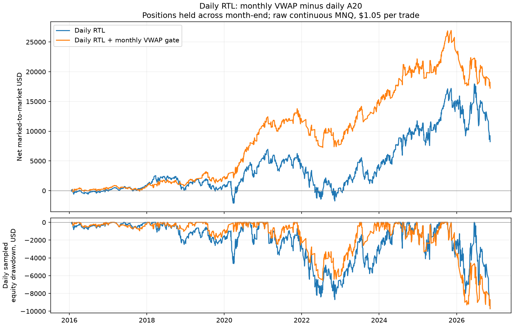

# Daily RTL with monthly VWAP: positive profit screen, mixed drawdown

2026-11-18. **The monthly VWAP - daily A20 gate improves daily RTL's net
profit in both main eras.** Across 2016-November 13, 2026, net rises from
**$8,235.60 to $17,234.95 (+109.3%)**, with 348 versus 311 trades.
Maximum floating-equity drawdown barely changes: **$10,666.75 to $10,388.55
(-2.6%)**. The initial profit screen therefore does not reject the idea, but
it does not establish a reliable way of avoiding large selloffs.

[Frozen protocol](PROTOCOL.md) | [Period and annual figures](summary.csv) |
[Verification record](verification.json)

## What was run

Two native MT5 runs on `MNQcontDTBNT20261114`: original RTL on **D1**, and
the same strategy with the orange VWAP gate. One MNQ, $1.05 per completed
trade, 1-minute OHLC execution. No intraday entry windows or flattening.
As explicitly requested, positions remain open across month-end; only VWAP
resets. No other strategy filters are added.

- Buy stop at the last red day's high; stop at its low; normal 1R target
  confirmed by a daily close and executed on the next daily bar's first quote.
- Monthly VWAP uses **original M1 HLC3 weighted by exchange volume**, from
  the month's first available minute through the completed signal day.
- A20 is the **simple mean of 20 completed daily true ranges**, including
  the signal day; it does not reset monthly.
- A red signal closing strictly below VWAP - A20 cancels the previous pending
  order and withholds the new order. Equality passes. Green/doji days leave
  pending orders alone. Open-position stops and targets remain active.
- The original EA's reset convention is preserved: at a new month's first
  trading day, the prior month's signal has an unknown current-month VWAP
  label and is allowed through. Monthly reset alone cancels nothing.

This is **daily RTL with an entry filter**, not a persistent daily on/off gate
around M30 RTL. There is no need for a separate resume trigger in this screen:
each new red daily setup is evaluated on its own.

## Results

Profit is realized net PnL for trades **exited** in the period. DD is maximum
intraday floating-equity drawdown after costs during that interval. Equity
includes carried-in positions; separate net equity changes are in the CSV.
For the main intervals below, equity change and realized net happen to agree.

| Period | Trades, original / gated | Original net | Gated net | Original equity DD | Gated equity DD |
|---|---:|---:|---:|---:|---:|
| 2010-15 reference | 176 / 143 | $1,207 | -$614 | $1,143 | $1,298 |
| 2016-19 | 128 / 114 | $861 | $2,211 | $2,832 | $2,020 |
| 2020-Sep 2026 | 215 / 194 | $11,213 | $15,791 | $8,822 | $9,948 |
| Oct 1-Nov 13, 2026 | 5 / 3 | -$3,838 | -$767 | $5,693 | $2,622 |
| **2016-Nov 13, 2026** | **348 / 311** | **$8,236** | **$17,235** | **$10,667** | **$10,389** |
| Full tester history | 524 / 454 | $9,442 | $16,621 | $10,667 | $10,389 |



The plot samples equity at daily closes; tabulated maximum drawdowns use
every recorded native equity observation, including intraday lows.

For 2016-November 13, profit factor rises **1.083 -> 1.235**, mean net R rises
**+0.0904 -> +0.1144**, and net profit divided by equity DD rises
**0.77 -> 1.66**. With an extra $1 cost per trade, net is $7,887.60 versus
$16,923.95; the ordering is unchanged.

The picture is mixed across periods. In 2016-19 the gate improves dollars and
drawdown, but mean net R decreases (+0.0577 -> +0.0432): fixed-contract dollars
weight larger-risk trades more heavily. In 2020-September 2026 profit improves
40.8%, mean net R rises (+0.1225 -> +0.1594), but equity DD **increases 12.8%**.
It loses money over the older 2010-15 reference period.

Annual net profit is higher with the gate in **6 of 11 years since 2016**.
It does not protect every selloff: 2022 loses $3,857 / $4,100 and partial
2026 loses $5,777 / $6,519 (original / gated). The October-November comparison
contains only five versus three trades and is too small to establish robustness.

## What changed and what is verified

Across the full tester history, the gated strategy evaluates 1,266 red
candidates, of which 1,202 have known labels and **362 are blocked**. The
64 unknown cases are month-reset signals. Candidate opportunities differ from
the control because blocking trades changes when the strategy is flat.
Of the completed trades, **380 are identical**, **144 occur only in the
control**, and **74 only in the gated run**. This is a full replay, not a
subtraction of filtered trades from the original ledger.

- All **4,234** daily OHLC, monthly cumulative VWAP, and daily A20 rows match
  a separate calculation from the original raw minute data and volume.
- All **524 control and 454 gated trades** match the independent minute
  replay in submission/fill/exit minutes, entry/stop/exit prices and exit reason.
- Every **1,090 / 1,266 candidate** decision and its feature values match.
  Six/eight callback timestamps differ only in seconds because MT5 compresses
  OHLC minutes with fewer distinct quotes; comparisons use minute precision.
- Actual native startup was **2010-10-26 01:00**, after D1 warm-up. The replay
  uses that same first callback, including the first trade. Earlier raw data
  supplies historical candles and A20 but is not counted as traded history.
- Native reports, trade exports and tester totals reconcile. Full gross
  equity DD is reproduced exactly ($10,651 / $10,356) before adding costs.
  Every closing timestamp is observed, and final equity equals balance and
  cumulative realized profit.
- **7 focused tests pass**, covering strict equality, unknown/reset labels,
  pending replacement/persistence, causal lookup, and month-end holding.
- Both arms compile with **0 errors, 0 warnings**. Frozen input and output
  hashes, INIs, native reports, logs and ledgers are preserved in
  `Reports/rtl_daily_monthly_vwap_20261118/`.

## Scope of the result

This is the requested quick **raw continuous-contract/native-fill screen**.
Held positions can cross artificial roll jumps: 28 control trades and 20
gated trades do so (22 / 15 since 2016). Native stop fills can also differ
from fills available after real overnight gaps. These figures are therefore
not an executable rolled-futures return estimate. No threshold was tuned,
and no live or baseline setting was changed.

The profit result is enough to keep the idea open under this screening setup.
It is not proof that the gate avoids deep selloffs, and it does not establish
that daily labels improve M30 RTL. Those are separate tests. No independent
forward validation or statistical-significance claim is made.

Reproduce with the project venv:

```powershell
.\venv\Scripts\python.exe python\rtl_daily_vwap.py
.\venv\Scripts\python.exe -m unittest discover -s python -p test_rtl_daily_vwap.py -v
```

Preparation/source: `python/prepare_rtl_daily_vwap.py`,
`mt5/experts/RTL_daily_monthly_vwap.mq5`,
`mt5/experts/daily_monthly_vwap.mqh`. Analysis and independent replay:
`python/rtl_daily_vwap.py`.
