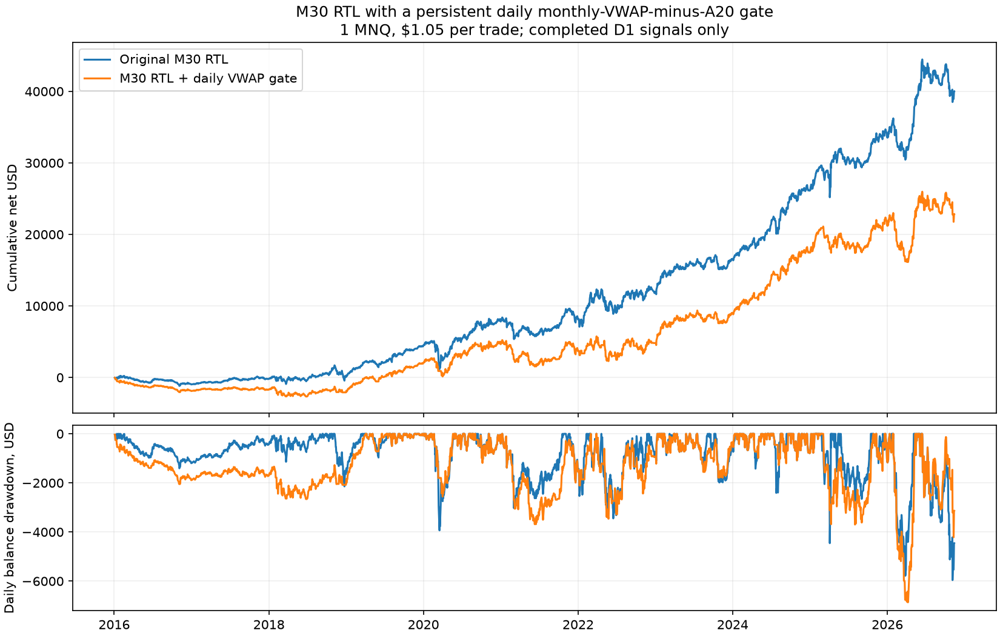

# M30 RTL with the daily VWAP regime gate: lower profit and larger drawdown

2026-11-18. **The daily VWAP gate does not improve the M30 baseline.**
Across 2016-November 13, 2026, net falls from **$40,010.90 to $22,838.25**
(-42.9%), while maximum intraday equity drawdown rises from **$6,584.30 to
$7,185.20** (+9.1%). Net profit is lower in every calendar year since 2016,
including partial 2026. No baseline or live setting was changed.

[Frozen protocol](PROTOCOL.md) | [Period and annual results](summary.csv) |
[Comparisons](comparisons.csv) | [Verification](verification.json)

## Exact rule tested

Trading remains original **M30 RTL**, with normal entry windows, daily/early-
close flattening, stop at the red M30 candle's low, and close-confirmed 1R exit.
No separate M30 VWAP entry filter is added.

After each completed D1 candle, regardless of its colour:

- Close below that day's **monthly VWAP - daily A20**: disable new entries.
- Close above that line: enable entries. No previous-red breakout requirement.
- Equality or unavailable warm-up: preserve state; initially enabled.
- Apply at the next available quote; cancel pending entries while halted.
  Existing positions keep normal RTL exits.

VWAP uses original M1 HLC3 and exchange volume from the calendar month's start.
A20 is a simple mean of 20 completed daily true ranges, including the signal
day. The state survives month-end: the final day's own completed monthly VWAP
still determines the next day's state. A monthly reset does not itself resume
trading. This differs intentionally from the daily-entry experiment's unknown
label on a new month's first candidate: here the user requested persistence.

Two full native MT5 runs, `MNQcontDTBNT20261114`, one MNQ, $1.05 per trade,
1-minute OHLC execution, source history through November 13, 2026.

## Native results

DD means maximum **intraday equity drawdown after costs**, not only daily
closed-balance drawdown. Each interval starts from its own initial equity.

| Period | Trades, baseline / gated | Baseline net | Gated net | Baseline DD | Gated DD |
|---|---:|---:|---:|---:|---:|
| 2010-15 reference | 9,164 / 7,934 | -$7,496 | -$8,155 | $8,273 | $8,359 |
| 2016-19 | 6,167 / 5,554 | $4,417 | $2,011 | $2,348 | $2,786 |
| 2020-Sep 2026 | 10,501 / 9,106 | $38,400 | $22,840 | $5,942 | $7,185 |
| Oct 1-Nov 13, 2026 | 204 / 125 | -$2,806 | -$2,013 | $5,830 | $4,474 |
| 2016-Sep 2026 | 16,668 / 14,660 | $42,817 | $24,852 | $5,942 | $7,185 |
| **2016-Nov 13, 2026** | **16,872 / 14,785** | **$40,011** | **$22,838** | **$6,584** | **$7,185** |



The lower chart is daily closed-balance drawdown; the table includes intraday
floating losses. The small October-November extension avoids $792.45 of losses,
but this does not offset the earlier losses of profit. Both arms lose there.

## What the gate removes

Since 2016 it halts **348 of 2,808 sessions (12.4%)**, removing **2,087 trades**
that earned **$17,172.65 net**. Their mean net R was **+0.0941**, compared with
**+0.0128** on retained trades. The unfiltered average was +0.0229.
Profit factor falls 1.078 -> 1.055, and net/equity-DD falls 6.08 -> 3.18.
With another $1 cost per trade, net is $23,138.90 versus $8,053.25.

The full replay confirms the gated trades are exactly the retained subset:
no replacement trades, no new submissions or fills while halted. There are
188 halt and 188 resume transitions over all available history. Every state
is exposed in [daily_decisions.csv](daily_decisions.csv), with intervals in
[halt_periods.csv](halt_periods.csv).

At the gated strategy's 87.3% holding-time exposure, a theoretical uniformly
scaled baseline earns **$34,947** with **$5,751 DD**, versus the gate's
$22,838 / $7,185. Fractional size is an analytical benchmark, not a fractional
MNQ execution recommendation. The lower exposure does not explain an advantage.

Paired weekly-block bootstrap, 10,000 draws: the 95% interval for the pooled
2016-November net change is **-$34,810 to -$1,403**, observed -$17,173.
For 2020-September it is -$31,883 to -$932. These are descriptive intervals
on already-studied history; resampling weeks does not preserve every longer
regime dependency or supply independent forward confirmation.

## Verification

- Both tester-only builds compile with **0 errors, 0 warnings**.
- All **4,234** daily features independently rebuilt from original minute
  OHLC/volume; all **4,233 available daily state decisions** match native logs.
  The last dataset day cannot affect trading without a subsequent quote.
- The control ledger is **byte-identical** to the saved extended M30 control;
  all 25,832 historical trades through September also reconcile.
- Native reports, ledgers and tester totals reconcile for **26,036 baseline**
  and **22,719 gated** trades over the full history.
- Independent minute replay matches **26,028 / 22,711 trades** after the first
  tester startup session, including submission/fill/exit minutes, prices,
  stops and exit reasons. The first eight native trades in each arm remain in
  reported economics but are excluded from this replay comparison.
- Native gross equity DD matches the full equity observation stream before
  deducting costs; session equity envelopes reproduce interval drawdowns.
- **11 tests pass:** five new state/causality tests and six existing execution,
  cancellation and cost-accounting regression tests.
- Inputs/protocol/settings and native outputs are hashed and preserved in
  `Reports/rtl_m30_daily_vwap_gate_20261118/`. Main script:
  `python/rtl_m30_daily_vwap_gate.py`; tester EA:
  `mt5/experts/RTL_m30_daily_vwap_gate.mq5`.

Recalculate with the project venv:

```powershell
.\venv\Scripts\python.exe python\rtl_m30_daily_vwap_gate.py
.\venv\Scripts\python.exe -m unittest discover -s python -p test_rtl_m30_daily_vwap_gate.py -v
.\venv\Scripts\python.exe -m unittest discover -s python -p test_rtl_news_windows.py -v
```

The feature construction uses the research session clock and raw continuous
prices; roll gaps can affect daily VWAP/A20. No threshold or anchor was tuned.
The earlier positive daily-trading screen and this negative M30 overlay test
measure different trades and rules. The daily result did not transfer to this
specific regime filter; the observed sample offers no adoption case.
