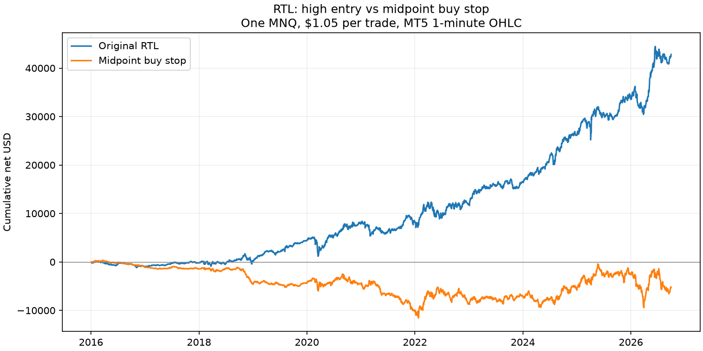

# RTL midpoint buy stop: worse than the high breakout

2026-11-16. Exploratory native MT5 test. **The midpoint entry does not improve RTL:**
it loses after costs in both main periods, with more trades and larger drawdowns.

## What was tested

The user's clarified rule: buy stop at the completed red M30 candle's high-low
midpoint, including wicks; skip if this is at/below the current ask. No buy limits
and no requirement to break the high first. Half-tick midpoints round up to the
next 0.25 tick. Stop stays at the signal low. RTL's original M30 close-confirmed
exit stays, with 1R calculated from the actual new entry. Normally the threshold
is the red high, or one tick above it after rounding. The actual exit is at the
next bar's first quote, so a gap can change realized R.

Order lifetime/replacement, entry windows, session flatten, fallback, early-close
calendar and one-contract sizing are unchanged. No filters, offsets or tuning.
[Protocol and preparation history](PROTOCOL.md).

Native Strategy Tester, `MNQcontDTBNT20102026_2`, M30, one-minute OHLC, one MNQ
($2 per point), **$1.05 round-turn cost**. The current experiment's full control
matches the saved baseline trade ledger byte for byte.

## Results

Net dollars after costs. Drawdown is **daily closed-balance drawdown**, not
intraday floating equity drawdown. Periods use order-submission session.

| Period | Original RTL net | Midpoint net | RTL daily DD | Midpoint daily DD |
|---|---:|---:|---:|---:|
| 2010-15 (reference) | -$7,496 | -$11,972 | $8,254 | $12,086 |
| 2016-19 | +$4,417 | -$4,433 | $2,143 | $5,588 |
| 2020-Sep 2026 | +$38,400 | -$879 | $5,781 | $9,058 |
| 2016-Sep 2026 pooled | +$42,817 | -$5,312 | $5,781 | $11,902 |

| Period / strategy | Trades | Win rate | Profit factor | Mean gross R | Mean net R |
|---|---:|---:|---:|---:|---:|
| 2016-19 RTL | 6,167 | 43.17% | 1.064 | +0.0807 | -0.0143 |
| 2016-19 midpoint | 9,736 | 36.92% | 0.944 | +0.0551 | -0.1004 |
| 2020-Sep 2026 RTL | 10,501 | 42.71% | 1.090 | +0.0715 | +0.0476 |
| 2020-Sep 2026 midpoint | 17,362 | 35.70% | 0.998 | +0.0257 | -0.0180 |
| Pooled RTL | 16,668 | 42.88% | 1.087 | +0.0749 | +0.0247 |
| Pooled midpoint | 27,098 | 36.14% | 0.990 | +0.0363 | -0.0476 |

R uses actual entry-to-stop dollars, not the original whole candle range.
Fixed-contract dollars and average R need not have the same sign: larger-risk
trades carry more dollar weight. All figures: [summary.csv](summary.csv).



## What changes with the earlier entry

Over 2016-Sep 2026 the midpoint version trades 63% more often, yet its gross
profit falls from $60,318 to $23,141. Stop exits rise from 53.94% to 62.71% of
trades. Its gross return per unit of risk is weaker in both eras; this is not
only a commission effect. The smaller entry-to-stop distance also raises the
average commission burden from 0.0502R to 0.0839R per trade pooled.

This is consistent with losing useful breakout confirmation. It is not a
same-trade causal attribution: earlier fills and exits change which later
signals are available, which is why both strategies were fully rerun.

With another $1 per trade, pooled midpoint net is -$32,410, versus +$26,149
for RTL. The midpoint has 5 profitable calendar years of 17, versus 10 for RTL
(2010 and 2026 are partial). [Annual results](annual.csv).

Weekly-block bootstrap 95% intervals for midpoint mean net R: 2016-19
[-0.1309, -0.0696]; 2020-Sep 2026 [-0.0421, +0.0057]; pooled
[-0.0672, -0.0280]. Recent results are statistically compatible with
break-even in R, but neither period improves on RTL in the observed sample.
These are intervals on each strategy's mean, not a paired difference test.

## Verification and artifacts

- Both final native runs compile with zero errors/warnings. Final source:
  `mt5/experts/RTL_midpoint.mq5`; tester-only initialization guard.
- Disabled midpoint control reproduces the existing RTL ledger byte for byte.
- Native HTML report, EA trade export, Strategy Tester totals, contract PnL
  arithmetic and output file hashes reconcile for both runs.
- Independent raw-minute replay matches 25,824 RTL and 39,266 midpoint trades
  from 2010-06-11 through September 2026: submission/entry/exit minutes,
  entry and stop prices, exit price and exit reason all agree. The first native
  trading day is excluded from this comparison because of tester startup;
  it remains in the reported native economics. Intraminute seconds are not
  compared because MT5 shortens minutes with fewer than four distinct quotes.
- 10 focused midpoint tests and 11 existing exit-engine tests pass.
- [Verification record](verification.json). Full native reports, input files,
  binaries, compiler logs and trade ledgers: `Reports/rtl_midpoint_20261116`.
  The preliminary build is preserved separately and not used in these results.

Reproduce the analysis with the project venv:

```powershell
.\venv\Scripts\python.exe python\rtl_midpoint.py
.\venv\Scripts\python.exe -m unittest discover -s python -p test_rtl_midpoint.py -v
```

No baseline or live setting changed. This repeatedly studied history and
one-minute OHLC execution model are research evidence, not forward validation.
The experiment provides no case for replacing the high-breakout entry.
