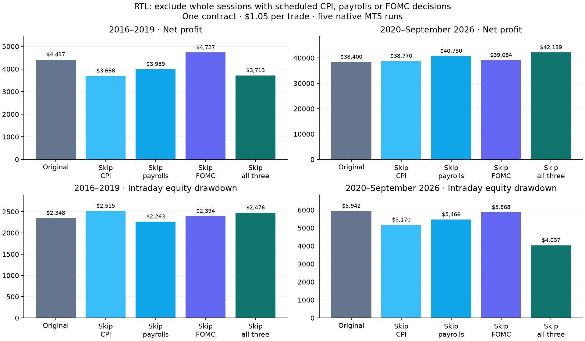

# RTL: skipping scheduled major US news days

Completed 2026-11-10 under the [frozen protocol](PROTOCOL.md).

**Promising recent risk reduction, but not a stable improvement across eras.**
Skipping CPI, payroll and scheduled FOMC announcement sessions raises recent net
profit and lowers intraday equity drawdown substantially. In 2016–19 it lowers
profit and increases drawdown. No baseline setting is changed.



## Main comparison

Original uncapped RTL M30, RR=1, one MNQ-sized contract ($2/point), all original
entry windows, VWAP off, daily/early-close flatten. Costs are $1.05 per round trip.
DD below is sampled **intraday marked-to-market equity** after external costs,
not just closed trades or end-of-day equity. Generated 1-minute OHLC ticks are
used, consistent with existing research; actual-news slippage is not modelled.

| Era | Policy | Trades | Net | Equity DD | Net/DD |
| --- | --- | --- | --- | --- | --- |
| 2016-19 | Original RTL | 6,167 | $4,417 | $2,348 | 1.88 |
| 2016-19 | Skip CPI | 5,873 | $3,698 | $2,515 | 1.47 |
| 2016-19 | Skip payrolls | 5,874 | $3,989 | $2,263 | 1.76 |
| 2016-19 | Skip FOMC | 5,972 | $4,727 | $2,394 | 1.97 |
| 2016-19 | Skip all three | 5,416 | $3,713 | $2,476 | 1.50 |
| 2020-26 | Original RTL | 10,501 | $38,400 | $5,942 | 6.46 |
| 2020-26 | Skip CPI | 10,007 | $38,770 | $5,170 | 7.50 |
| 2020-26 | Skip payrolls | 10,021 | $40,750 | $5,466 | 7.46 |
| 2020-26 | Skip FOMC | 10,167 | $39,084 | $5,868 | 6.66 |
| 2020-26 | Skip all three | 9,209 | $42,139 | $4,037 | 10.44 |
| 2016-26 | Original RTL | 16,668 | $42,817 | $5,942 | 7.21 |
| 2016-26 | Skip CPI | 15,880 | $42,467 | $5,170 | 8.21 |
| 2016-26 | Skip payrolls | 15,895 | $44,740 | $5,466 | 8.19 |
| 2016-26 | Skip FOMC | 16,139 | $43,812 | $5,868 | 7.47 |
| 2016-26 | Skip all three | 14,625 | $45,852 | $4,037 | 11.36 |

For **2020–September 2026**, the combined rule raises net profit by $3,739
(9.7%) and reduces equity DD by $1,905 (32.1%). Net/DD rises from 6.46 to 10.44.
It skips 210 of 1,745 available sessions (12.0%) and removes 1,292 trades (12.3%).
For **2016–19**, it reduces profit by $703 (15.9%) and increases DD by $127 (5.4%).
Pooled 2016–September 2026 net rises $3,035 (7.1%), but pooling hides that disagreement.

The individual exclusions are less impressive recently: CPI adds $370 while
reducing DD $771; payrolls add $2,351 while reducing DD $476; FOMC adds $684 while
reducing DD $74. The union is a prespecified fourth filter, not a combination
selected after seeing these outcomes. Overlapping announcements count once per
session, so the three individual profit differences need not sum to the union.

## Does it beat simply trading fewer days?

10,000 random exclusions per filter/era, preserving the number excluded within
each calendar year and weekday, including sessions without a baseline trade.
Seed 20261110. Every retained session keeps its full native equity path; the
path is reassembled chronologically, so the control measures intraday DD.

The combined filter's recent net/DD exceeds 99.67% of matched random exclusions;
its DD is no worse than 99.64% of them. Recent net profit exceeds 95.79%.
In 2016–19 its net/DD is only at the 32.37th percentile. These descriptive ranks
are not multiple-test-adjusted significance or evidence of live profitability.

| Era | Net change | 95% interval low | 95% interval high | Random median net | Random median DD | Net/DD percentile |
| --- | --- | --- | --- | --- | --- | --- |
| 2016-19 | $-703 | $-2,559 | $1,180 | $3,770 | $2,229 | 32.37 |
| 2020-26 | $3,739 | $-5,413 | $13,501 | $35,356 | $5,379 | 99.67 |
| 2016-26 | $3,035 | $-6,354 | $12,988 | $39,118 | $5,379 | 99.70 |
| 2010-15 | $1,227 | $290 | $2,186 | $-6,322 | $7,120 | 53.40 |

Intervals resample paired calendar-week P&L differences (10,000 draws). The recent
profit-change interval is approximately **−$5,413 to +$13,501** and includes zero.
The filter's drawdown result is stronger than its estimated profit advantage.

## Annual concentration and schedule sensitivity

| Year | Original net | Skip-all net | Difference | Original DD | Skip-all DD |
| --- | --- | --- | --- | --- | --- |
| 2010 | $-643 | $-542 | $100 | $788 | $718 |
| 2011 | $-1,919 | $-1,469 | $450 | $2,055 | $1,750 |
| 2012 | $-2,188 | $-1,889 | $300 | $2,320 | $2,012 |
| 2013 | $-1,170 | $-951 | $219 | $1,224 | $1,005 |
| 2014 | $-1,422 | $-1,387 | $35 | $1,707 | $1,743 |
| 2015 | $-154 | $-30 | $124 | $992 | $981 |
| 2016 | $-972 | $-426 | $546 | $1,456 | $1,152 |
| 2017 | $761 | $703 | $-59 | $445 | $339 |
| 2018 | $274 | $-39 | $-312 | $2,348 | $2,476 |
| 2019 | $4,354 | $3,475 | $-879 | $1,105 | $1,188 |
| 2020 | $3,402 | $3,113 | $-289 | $4,463 | $4,037 |
| 2021 | $311 | $706 | $395 | $3,336 | $3,462 |
| 2022 | $3,683 | $7,170 | $3,488 | $3,763 | $2,694 |
| 2023 | $4,661 | $3,440 | $-1,221 | $2,287 | $2,287 |
| 2024 | $9,662 | $6,085 | $-3,577 | $2,716 | $2,716 |
| 2025 | $7,423 | $9,728 | $2,306 | $5,007 | $3,166 |
| 2026 | $9,259 | $11,895 | $2,637 | $5,942 | $3,964 |

2026 ends September 30; 2010 begins with available June data. The recent profit
gain comes mainly from 2022, 2025 and 2026, offset by substantial profit sacrificed
in 2023–24. The combined rule improves profit in 4 of the 7 recent annual slices.

The schedule-quality sensitivity removes 2013, 2025 and 2026 entirely because
publication disruptions require extra point-in-time schedule evidence. For the
recent sample this leaves **2020–24**: original net $21,719 / DD $4,463 versus
filtered net $20,515 / DD $4,037. Profit falls 5.5%, DD falls 9.5%, and net/DD
only moves from 4.87 to 5.08. Thus the headline gain is **not robust to removing
the latest two years**. Excluding 2020 as well leaves the same modest risk/profit
tradeoff. This changes the sample; it does not prove those release dates are wrong.

2010–15 remains loss-making: original −$7,496 versus filtered −$6,269. The combined
rule's risk-adjusted rank is ordinary among matched random exclusions there.

## Calendar and exact rule

- [BLS CPI archive](https://www.bls.gov/bls/news-release/cpi.htm): headline and core
  inflation belong to one release date.
- [BLS Employment Situation archive](https://www.bls.gov/bls/news-release/empsit.htm):
  payrolls, unemployment and wages belong to one release date.
- [Fed historical meeting archive](https://www.federalreserve.gov/monetarypolicy/fomc_historical_year.htm)
  and [recent calendars](https://www.federalreserve.gov/monetarypolicy/fomccalendars.htm):
  scheduled policy announcement day, not the first day of a two-day meeting.

533 events on 523 distinct dates from January 2010 through September 2026.
This is a **core subset** of the user's Investing.com three-star definition,
not a reconstruction of all historical Investing.com ratings. It excludes PCE,
PPI, ADP, JOLTS, claims, speeches and FOMC minutes in this first study.

The Fed parser excludes 14 unscheduled/cancelled/notation-vote items, including
the March 2020 emergencies and cancelled March 17–18 meeting. The BLS archives
contain 11 releases per category in 2025, versus 12 in ordinary full years;
missing releases are not invented. Actual archived publication dates are used,
including the 2013 shutdown delays. No release value or sentiment enters the rule.

The CSV date is the US announcement date. For these daytime releases it is also
the date in the research clock (Chicago+8 / New York+7). Skip the whole research
session, including its overnight portion. Bars/bookkeeping still advance.
All native reported trades and filled orders stay within their submission dates;
the excluded runs contain no trades on excluded dates. No pre-news positions
remain to flatten in this dataset.

**Calendar limitation:** archived publication dates do not establish exactly
when every rescheduled date became known. This is a release-day exclusion study,
not a fully reconstructed vintage calendar. A deployable scheduled filter needs
advance-known calendars and cancellation updates. The year-removal sensitivity
above makes the important limitation visible.

## Verification and reproduction

Five native MT5 runs completed; the disabled control is byte-identical to the
saved RTL ledger. Every candidate's native report, fills, exits and profit match
the baseline's surviving sessions exactly. Independently checking the raw ledgers
gives the same result. Full native equity paths match the reassembled session
paths, and all five gross-equity DD figures match MT5's own report statistic.
Six focused tests cover dates, unscheduled meetings, duplicate-day unions,
drawdown reconstruction, matched sampling and the zero-profit closure edge case.

Two zero-profit closes in 2011/2013 have no observer sample because gross equity
did not change. Their $1.05 fees are inserted at the actual close timestamps;
all daily net changes then reconcile exactly. Equity DD resets its running high
only at each reported era/year boundary. Costs at equal one-second timestamps
follow the existing at-close convention.

The tester includes one incomplete October 1, 2026 trade for exact old-control
reconciliation. All published tables exclude it. This explains the $133.95
difference from older RTL totals that included that trade.

Artifacts: `Reports/rtl_news_days_20261110/`; [summary](summary.csv),
[matched comparisons](comparisons.csv), [sensitivity](schedule_sensitivity.csv),
[annual table](annual_combined.csv). Calendar and hashed source snapshots are
in `data/calendars/us_major_news_2010_2026*`. The source ZIP permits offline rebuild;
the BLS web-reader snapshots preserve resolved dated official URLs because direct
HTTP requests returned 403. Federal Reserve snapshots are original HTML.

```powershell
.\venv\Scripts\python.exe python\build_news_calendar.py
.\venv\Scripts\python.exe -m unittest discover -s python -p test_rtl_news_days.py -v
# Prepare/run only for a fresh study directory; existing artifacts are protected.
.\venv\Scripts\python.exe python\prepare_rtl_news_days.py
.\venv\Scripts\python.exe python\run_rtl_news_days.py
.\venv\Scripts\python.exe python\analyze_rtl_news_days.py
.\venv\Scripts\python.exe python\verify_rtl_news_days.py
.\venv\Scripts\python.exe python\report_rtl_news_days.py
```

The historical eras have already been used extensively for research. No untouched
holdout or live adoption claim is made. This supports further validation of the
combined filter, not changing the baseline on the strength of the pooled result.
