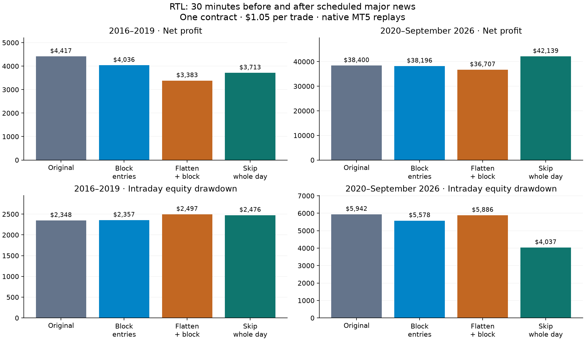

# RTL: thirty-minute news exclusion windows

Completed 2026-11-11 under the [November 10 frozen protocol](PROTOCOL.md), following the
[whole-day study](../rtl-news-days/RESULTS.md).

**The narrower rule does not produce a consistent improvement.** Blocking new
entries gives a small recent drawdown reduction with almost unchanged profit.
Flattening positions sacrifices more profit and offers little recent drawdown
benefit. Both rules are worse in 2016–19. Keep this as research evidence; the
results do not support adopting the flat-window rule or changing the baseline.



## Main comparison

Original uncapped RTL M30/RR1, VWAP off, one MNQ-sized contract ($2/point), all
original entry windows and daily/early-close flatten. Costs: $1.05 per round trip.
DD is sampled **intraday marked-to-market equity drawdown after costs**, not
closed-trade or daily-close drawdown. Native tester uses generated minute-OHLC
quotes; actual-news spreads, slippage, queueing and execution failures are not
modelled. This matters especially when comparing exposure near announcements.

| Era | Policy | Trades | Net | Equity DD | Net/DD |
| --- | --- | --- | --- | --- | --- |
| 2016-19 | Original RTL | 6,167 | $4,417 | $2,348 | 1.88 |
| 2016-19 | Block entries | 6,118 | $4,036 | $2,357 | 1.71 |
| 2016-19 | Flatten + block | 6,124 | $3,383 | $2,497 | 1.35 |
| 2016-19 | Skip whole day | 5,416 | $3,713 | $2,476 | 1.50 |
| 2020-26 | Original RTL | 10,501 | $38,400 | $5,942 | 6.46 |
| 2020-26 | Block entries | 10,407 | $38,196 | $5,578 | 6.85 |
| 2020-26 | Flatten + block | 10,410 | $36,707 | $5,886 | 6.24 |
| 2020-26 | Skip whole day | 9,209 | $42,139 | $4,037 | 10.44 |
| 2016-26 | Original RTL | 16,668 | $42,817 | $5,942 | 7.21 |
| 2016-26 | Block entries | 16,525 | $42,232 | $5,578 | 7.57 |
| 2016-26 | Flatten + block | 16,534 | $40,090 | $5,886 | 6.81 |
| 2016-26 | Skip whole day | 14,625 | $45,852 | $4,037 | 11.36 |

Recent entry blocking loses $204 (0.5%) while lowering DD $364 (6.1%): net/DD
6.46 → 6.85. Only 94 fewer trades (0.9%) remain after the full strategy replay.
Flattening loses $1,692 (4.4%) and lowers DD just $56 (0.9%); net/DD falls to 6.24.
In 2016–19, entry blocking loses $381 with essentially unchanged DD; flattening
loses $1,034 and increases DD $149. Pooled results hide this era disagreement.

The whole-day rule is much stronger in the recent sample, but its earlier-era
failure and dependence on 2025–26 remain. These outcomes suggest that removing
only the immediate announcement window does not reproduce the whole-day result.
They do not establish why: the policies also change later opportunities and exits.

## Exact rules and calendar

- **Block entries:** cancel pending orders at the first available quote on or
  after window start and block new submissions throughout. Existing positions
  retain normal stop/close-based exits. This rule permits news exposure.
- **Flatten + block:** also close existing positions on that quote and remain
  flat after each EA callback during the window.
- Window is **[event −30 minutes, event +30 minutes)**. Start is inclusive, end
  exclusive; overlapping or touching windows merge. Entry logic resumes only
  at the next ordinary M30 new-bar callback. Signal candles may contain news prices.

Scope remains CPI, Employment Situation/payrolls, and scheduled FOMC decisions,
with each associated FOMC press-conference **start** added separately. These are
a core subset of Investing.com's three-star category, not all historical ratings.
No PCE, PPI, ADP, JOLTS, claims, speeches, minutes or emergency Fed meetings.

The calendar has 626 timestamps (533 releases + 93 conference starts), forming
541 merged windows from January 2010 through September 2026. Of these, 525 have
eligible quotes within the native test. BLS releases are 08:30 New York, so their
window is 08:00–09:00. Modern FOMC statement and conference-start windows merge
to 13:30–15:00 New York. That does **not** guarantee avoidance of the whole press
conference. Older Fed times preserve a tradable gap: for example, a 12:30
statement and 14:15 conference give 12:00–13:00 and 13:45–14:45 windows.

Research clock = New York +7 hours (Chicago +8); UTC conversions use US DST,
independently of European DST. All 400 BLS times were checked: 395 release headers
and five prior releases announcing the next date/time. Four 2012 Fed archive
labels differ from the scheduled 12:30 time; contemporaneous minutes explicitly
approve 12:30, which is used here and recorded in the provenance manifest.

Sources include the [Fed's March 2011 timing notice](https://www.federalreserve.gov/newsevents/pressreleases/monetary20110324a.htm),
[2013 timing change](https://www.federalreserve.gov/newsevents/pressreleases/monetary20130313a.htm),
[New York Fed's account of the 2012 schedule](https://libertystreeteconomics.newyorkfed.org/2013/11/a-way-with-words-the-economics-of-the-feds-press-conference/),
individual statements/conference pages and BLS archive releases. Portable
[event times](../../../data/calendars/us_major_news_times_2010_2026.csv),
[merged windows](../../../data/calendars/us_major_news_windows_30m_2010_2026.csv),
[provenance](../../../data/calendars/us_major_news_times_2010_2026_manifest.json),
and [source bundle](../../../data/calendars/us_major_news_times_2010_2026_sources.zip).

Archived publication dates do not establish when every rescheduling was known.
This is not a complete point-in-time schedule. The year-removal check below
retains the earlier study's explicit schedule-quality sensitivity.

## Exposure and execution audit

Across the full native dataset, both window rules cancel 131 pending orders.
No submitted order lies inside a window, and no boundary-quote fills occurred.
Broker processing still precedes the EA callback, so boundary fills are possible
in principle and are covered by focused tests.

Entry blocking leaves **250 positions** exposed within windows, totalling
10,434 minutes. Flat mode makes **277 forced closes**. Four windows have delayed
first quotes (maximum 61 seconds); three positions remain open briefly between
the scheduled boundary and that first quote, totalling 63 seconds. None survives
the first available callback. Every logged first action matches the raw quotes.
Thus even flat mode means first executable quote, not a guaranteed fill exactly
at the clock boundary. Counts include all tested years, not just the recent era.

## Uncertainty, costs and stability

Paired calendar-week P&L bootstrap, 10,000 draws, seed 20261110. These are
descriptive 95% intervals for profit differences, not out-of-sample evidence or
multiple-test-adjusted significance. No random intraday omission claim is made:
that would require additional full strategy replays.

| Era | Policy | Net change | 95% low | 95% high |
| --- | --- | --- | --- | --- |
| 2016-19 | Block entries | −$381 | −$1,090 | $300 |
| 2016-19 | Flatten + block | −$1,034 | −$1,981 | −$122 |
| 2016-19 | Skip whole day | −$703 | −$2,559 | $1,180 |
| 2020-26 | Block entries | −$204 | −$4,290 | $3,946 |
| 2020-26 | Flatten + block | −$1,692 | −$6,732 | $3,448 |
| 2020-26 | Skip whole day | $3,739 | −$5,413 | $13,501 |

The recent profit-change intervals include zero for both window variants. The
early flattening loss has an interval below zero. Additional $1 per round trip
(total $2.05), applied at each native closure, gives:

| Era | Policy | Stressed net | Stressed DD | Stressed net/DD |
| --- | --- | --- | --- | --- |
| 2016-19 | Original RTL | −$1,750 | $5,318 | -0.33 |
| 2016-19 | Block entries | −$2,082 | $5,424 | -0.38 |
| 2016-19 | Flatten + block | −$2,741 | $5,935 | -0.46 |
| 2016-19 | Skip whole day | −$1,703 | $4,639 | -0.37 |
| 2020-26 | Original RTL | $27,899 | $6,190 | 4.51 |
| 2020-26 | Block entries | $27,789 | $5,823 | 4.77 |
| 2020-26 | Flatten + block | $26,297 | $6,131 | 4.29 |
| 2020-26 | Skip whole day | $32,930 | $4,179 | 7.88 |

All variants lose money in 2016–19 at the higher cost. The entry-only rule's
recent risk tradeoff remains small; extra flattening does not rescue it.
The complete [summary CSV](summary.csv) also reports PF, average trade, average
gross/net R and daily-close DD. Main per-trade results:

| Era | Policy | PF | Avg net trade | Avg net R | Daily-close DD |
| --- | --- | --- | --- | --- | --- |
| 2016-19 | Original RTL | 1.06 | $0.72 | -0.0143 | $2,143 |
| 2016-19 | Block entries | 1.06 | $0.66 | -0.0191 | $2,176 |
| 2016-19 | Flatten + block | 1.05 | $0.55 | -0.0227 | $2,316 |
| 2016-19 | Skip whole day | 1.06 | $0.69 | -0.0201 | $2,296 |
| 2020-26 | Original RTL | 1.09 | $3.66 | +0.0476 | $5,781 |
| 2020-26 | Block entries | 1.09 | $3.67 | +0.0447 | $5,417 |
| 2020-26 | Flatten + block | 1.09 | $3.53 | +0.0434 | $5,726 |
| 2020-26 | Skip whole day | 1.12 | $4.58 | +0.0464 | $3,804 |

Removing 2013, 2025 and 2026 leaves the recent sample at **2020–24**:

| Policy | Net | Equity DD | Net/DD |
| --- | --- | --- | --- |
| Original RTL | $21,719 | $4,463 | 4.87 |
| Block entries | $21,421 | $4,277 | 5.01 |
| Flatten + block | $21,387 | $4,278 | 5.00 |
| Skip whole day | $20,515 | $4,037 | 5.08 |

Both window variants then lose about $300 relative to the original and reduce
DD about $185: a small risk/profit tradeoff. The strong full-day profit advantage
disappears too. This changes the sample; it does not prove those dates were wrong.

Annual net profits follow. 2010 starts with available June data; 2026 ends
September 30. All 2010–15 aggregate variants remain loss-making. Annual DD and
other metrics are included in the summary CSV.

| Year | Original | Block entries | Flatten + block | Skip whole day |
| --- | --- | --- | --- | --- |
| 2010 | −$643 | −$671 | −$656 | −$542 |
| 2011 | −$1,919 | −$1,871 | −$1,849 | −$1,469 |
| 2012 | −$2,188 | −$2,144 | −$2,075 | −$1,889 |
| 2013 | −$1,170 | −$1,097 | −$1,191 | −$951 |
| 2014 | −$1,422 | −$1,537 | −$1,532 | −$1,387 |
| 2015 | −$154 | −$330 | −$160 | −$30 |
| 2016 | −$972 | −$916 | −$1,065 | −$426 |
| 2017 | $761 | $684 | $602 | $703 |
| 2018 | $274 | $157 | −$159 | −$39 |
| 2019 | $4,354 | $4,111 | $4,005 | $3,475 |
| 2020 | $3,402 | $4,036 | $3,745 | $3,113 |
| 2021 | $311 | $172 | −$367 | $706 |
| 2022 | $3,683 | $4,185 | $4,822 | $7,170 |
| 2023 | $4,661 | $4,519 | $4,862 | $3,440 |
| 2024 | $9,662 | $8,510 | $8,325 | $6,085 |
| 2025 | $7,423 | $7,559 | $6,969 | $9,728 |
| 2026 | $9,259 | $9,216 | $8,351 | $11,895 |

## Verification and reproduction

Three new native MT5 runs compiled without errors or warnings. Disabled control
is byte-identical to the original 25,833-trade ledger. Independent full replay
of 5,511,965 source minutes matches every submission bar, fill/exit minute, entry,
stop and exit price for all three runs (25,833 / 25,601 / 25,618 trades). Native
reports, ledgers, statistics and gross-equity drawdown reconcile. Daily envelopes
match direct full equity paths, including external fees at zero-profit closes.
The old whole-day benchmark reconciles to its already published results.
The incomplete October 1, 2026 trade is included in accounting audits and excluded
from all published performance tables.

Separate checks validate all source ZIP hashes, all clock conversions, an
independently reconstructed interval union, 84 metric rows and 12 comparisons.
Twelve focused tests cover release dates, whole-day controls, half-open/merged
intervals, US DST, quarter-hour boundaries, pending cancellation, boundary fills,
forced exits and zero-profit fees at both cost levels.

Evidence: `Reports/rtl_news_windows_20261110/`. Portable checks:
[native/replay audit](verification.json), [separate verification](independent_verification.json).
Research source and INIs are generated by `python/prepare_rtl_news_windows.py`;
no production EA setting changes. Run preparation only in a fresh output folder;
completed native outputs are preserved. Existing raw minutes, original baseline
and whole-day study are required for the full replay.

```powershell
& .\venv\Scripts\python.exe python/download_news_times.py
& .\venv\Scripts\python.exe python/build_news_windows.py
& .\venv\Scripts\python.exe python/prepare_rtl_news_windows.py
& .\venv\Scripts\python.exe python/run_rtl_news_windows.py
& .\venv\Scripts\python.exe python/analyze_rtl_news_windows.py
& .\venv\Scripts\python.exe python/verify_rtl_news_windows.py
& .\venv\Scripts\python.exe python/report_rtl_news_windows.py
& .\venv\Scripts\python.exe -m unittest discover -s python -p 'test_rtl_news*.py' -v
```

Calendar rebuilding also requires the saved BLS time-check excerpts, available
in the portable source bundle. Neither width optimization nor production adoption
is part of this study.
