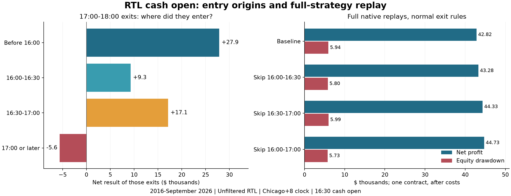

# RTL: split the cash-open hour

2026-11-11. Four complete native MT5 runs, with all checks passing. The full-hour exclusion remains the strongest of these four historical alternatives: highest pooled net profit and lowest sampled equity drawdown. Neither half alone improves on it. Exploratory evidence, not untouched out-of-sample confirmation.

## Why the 16-hour loss bar and 17-hour profit bar differ

Both earlier positions and new fills stop out after 16:30. RTL holds a broker stop that can execute inside the M30 bar, but checks its profit target against the completed candle only on the next bar. A trade filled during 16:30-17:00 normally cannot take its bar-close profit exit before 17:00. The hourly exit bars partly reflect that mechanism; they are not entry-window expectancies.

Of 1,186 baseline positions filled before and still open immediately before the 16:30 quote, 254 (21.4%) stop in the first five minutes, another 190 in minutes 5-15, and another 111 in minutes 15-30: **555 / 1,186 = 46.8% stop within the first half-hour.** There are also 396 stops during that half-hour from trades filled at/after 16:30. Native deal comments identify stops. This establishes timing association, not proof that volatility caused the losses.

The entire pre-open position cohort nevertheless earns **$15,591 net** over its full trade lifetimes. That includes P/L earned before 16:30 and is not the incremental value of holding through the open. A flatten decision requires a marked-to-market counterfactual; it cannot be inferred from whole-trade cohort P/L or stop counts.

## Where the 17:00-18:00 profits came from

Actual fill times below, pooled 2016-Sep2026. Conditional exit groups, not all outcomes for each entry window.

| Actual entry | Trades exiting 17-18 | Gross profit $ | Gross loss $ | Net $ |
|---|---|---|---|---|
| before 16:00 | 327 | 33,709.50 | 5,494.50 | 27,871.65 |
| 16:00-16:30 | 103 | 10,529.00 | 1,143.50 | 9,277.35 |
| 16:30-17:00 | 369 | 27,500.00 | 9,965.50 | 17,147.05 |
| 17:00+ | 76 | 966.50 | 6,522.50 | -5,635.80 |

About 61% of gross profits in the 17-hour exit bar came from entries before the cash open; about 38% came from fills in 16:30-17:00. By order-submission time the pre-open share is larger: some earlier orders fill after the open. See exit_origins.csv for both definitions.

## Full outcomes by entry time

All exits included, actual fill times. Dollars use one contract; R uses each trade’s planned candle risk.

| Fill half-hour starts | Trades | Net $ | Mean net R | Net PF |
|---|---|---|---|---|
| 15:30 | 432 | 966.40 | 0.0840 | 1.061 |
| 16:00 | 331 | 271.95 | -0.0503 | 1.022 |
| 16:30 | 874 | 150.30 | 0.0295 | 1.004 |
| 17:00 | 265 | 3,177.75 | 0.0354 | 1.208 |
| 17:30 | 379 | 3,673.05 | 0.1009 | 1.186 |

The 16:30-17:00 fills are approximately break-even in pooled dollars despite the dramatic exit bars: -$391 in 2016-19 and +$542 since 2020. The 16:00-16:30 fill group is -$273 early and +$545 recently. Neither is consistently losing in dollars. Submission groups differ because buy stops can remain pending.

## Full native strategy comparisons

Normal exits; no forced close at 16:30. Exclusion changes submissions and original pending cancellation. These runs have zero fills in their excluded halves, but that is not guaranteed on all data. Costs are $1.05 per trade. Equity DD is sampled open-equity peak-to-trough after costs.

### 2016-26

| Run | Trades | Net $ | Equity DD $ | Net / equity DD | Net PF |
|---|---|---|---|---|---|
| Baseline | 16668 | 42,816.60 | 5,941.70 | 7.21 | 1.087 |
| Skip 16:00-16:30 | 16178 | 43,280.60 | 5,798.70 | 7.46 | 1.092 |
| Skip 16:30-17:00 | 15816 | 44,329.70 | 5,990.10 | 7.40 | 1.097 |
| Skip 16:00-17:00 | 15500 | 44,728.50 | 5,734.00 | 7.80 | 1.100 |

### 2016-19

| Run | Trades | Net $ | Equity DD $ | Net / equity DD | Net PF |
|---|---|---|---|---|---|
| Baseline | 6167 | 4,416.65 | 2,348.40 | 1.88 | 1.064 |
| Skip 16:00-16:30 | 5976 | 4,550.70 | 2,070.10 | 2.20 | 1.069 |
| Skip 16:30-17:00 | 5842 | 4,699.40 | 1,760.15 | 2.67 | 1.073 |
| Skip 16:00-17:00 | 5709 | 4,877.05 | 1,698.05 | 2.87 | 1.078 |

### 2020-26

| Run | Trades | Net $ | Equity DD $ | Net / equity DD | Net PF |
|---|---|---|---|---|---|
| Baseline | 10501 | 38,399.95 | 5,941.70 | 6.46 | 1.090 |
| Skip 16:00-16:30 | 10202 | 38,729.90 | 5,798.70 | 6.68 | 1.095 |
| Skip 16:30-17:00 | 9974 | 39,630.30 | 5,990.10 | 6.62 | 1.101 |
| Skip 16:00-17:00 | 9791 | 39,851.45 | 5,734.00 | 6.95 | 1.104 |

### 2010-15

| Run | Trades | Net $ | Equity DD $ | Net / equity DD | Net PF |
|---|---|---|---|---|---|
| Baseline | 9164 | -7,496.20 | 8,273.35 | -0.91 | 0.865 |
| Skip 16:00-16:30 | 8858 | -6,982.40 | 7,520.35 | -0.93 | 0.868 |
| Skip 16:30-17:00 | 8736 | -7,428.80 | 7,993.55 | -0.93 | 0.857 |
| Skip 16:00-17:00 | 8542 | -7,146.60 | 7,616.35 | -0.94 | 0.858 |

## Why a full replay differs from removing baseline trades

Simple omission by submission time removes profitable baseline trades. Native reruns also change pending-order lifetimes and later opportunities.

| Exclusion | Native net change $ | Naive omission change $ | Removed/replaced trades | Added/changed trades |
|---|---|---|---|---|
| Skip 16:00-16:30 | 464.00 | -880.95 | 582 | 92 |
| Skip 16:30-17:00 | 1,513.10 | -321.75 | 946 | 94 |
| Skip 16:00-17:00 | 1,911.90 | -1,202.70 | 1280 | 112 |

Changed trades use exact submission, fill, original stop and exit identity; this includes changed outcomes and different opportunities.

## Annual consistency

| Exclusion | Years net improves / 11 | Years equity DD improves / 11 |
|---|---|---|
| Skip 16:00-16:30 | 7 | 9 |
| Skip 16:30-17:00 | 5 | 5 |
| Skip 16:00-17:00 | 6 | 10 |

Full-hour exclusion improves net in both primary eras. Post-open-only slightly raises recent equity DD ($5,942 to $5,990); excluding both halves lowers it to $5,734. Historical selection and 1-minute OHLC modelling limit causal and forward-performance claims.

## Verification and reproduction

Four jobs compile with zero errors/warnings. Control and full-hour ledgers match earlier runs byte for byte. Every native deal reconciles to ledger timestamps, candle risk, P/L and stats. Every filled signal/accepted decision checked; forbidden submissions absent. Sampled full-history gross equity DD matches MT5 in all arms. Three boundary/aggregation tests pass.

Primary sample: January 2016-September 2026; 2010-15 secondary. Incomplete October endpoint excluded. Chicago+8 custom-symbol clock, not changing Estonia wall-clock differences.

Evidence folder: Reports/rtl_open_halves_20261111. Contains frozen manifest, native HTML/INI/ledgers, equity paths, verification.json, replay_metrics.csv, half_hour_outcomes.csv, exit_origins.csv, entry_exit_matrix.csv, opening_cohorts.csv, baseline_attributed_trades.csv and replay_decomposition.csv. Compact CSV tables copied beside this report.

Reproduce: python/analyze_rtl_open_halves.py describe; python/analyze_rtl_open_halves.py; python/report_rtl_open_halves.py; python/test_rtl_open_halves.py. Preparation preserves existing artifacts. Shared run_mt5_job.py runs the isolated tester-only RTL_open_halves_20261111 expert. No live chart or production settings changed.

## Interpretation agreed after reviewing the results

The exclusion changes the subsequent trading sequence for this historical run. Removed/replaced trades collectively earned $458.50; added/changed trades earned $2,370.40, producing the $1,911.90 improvement. It is not simply avoidance of a uniformly losing entry group or later losses. Changed pending orders and occupancy can enable some later trades and prevent others.

The narrow conclusion is that excluding 16:00-17:00 improved this historical backtest. A reliable forward advantage has not been established. Annual drawdown improvement (10/11 years) is more consistent than profit improvement (6/11); both remain descriptive results from historical selection, not independent confirmation.

## Follow-up: evening 18:00-23:00

Same baseline and period; these are different trade groups in each column. No native evening-exclusion experiment was run.

| Hour starts | Trades entering | Eventual entry-group net $ | Trades exiting | Exit-group net $ |
|---|---|---|---|---|
| 18 | 820 | 2,534.50 | 330 | -3,852.50 |
| 19 | 682 | 3,284.40 | 420 | -2,027.50 |
| 20 | 649 | -375.45 | 515 | -4,193.75 |
| 21 | 546 | 533.20 | 639 | 129.05 |
| 22 | 643 | 1,794.35 | 672 | -7,485.60 |

Entries filled during 18:00-23:00 earned $7,771.00 overall. Their exits during the 23-hour bucket earned $39,354.25; earlier losses offset much of that. The exit chart therefore does not establish that evening entries lose.

The full 23-hour exit bucket earns $47,343.75 net: 194 normal bar-close profit exits at 23:00 contribute $26,446.30, and 1358 non-stop exits at the configured 23:30 flatten contribute $31,183.60. Stop exits offset the rest; one stop occurring exactly at 23:30 is excluded from the flatten count.

Those observations do not settle whether excluding the evening would improve the complete strategy. That would require a separate native replay. No evening exclusion was adopted.
