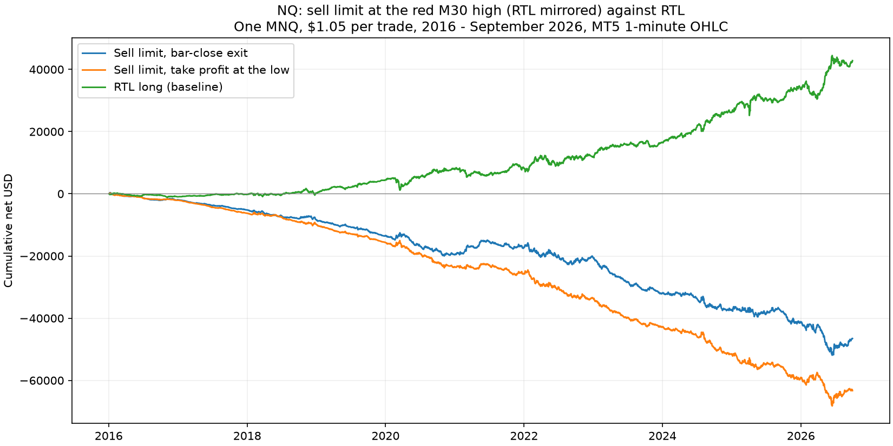

# RTL mirrored: sell limit at the red candle's high

2026-11-16, exploratory. **The mirrored trade loses in every period, before costs as well.**
With RTL's exit mirrored it lost $12,812 / $13,456 / $33,082 at one MNQ (2010-15 / 2016-19 /
2020-September 2026) and was positive in 1 year of 17. With a take profit at the low it lost
$12,142 / $15,619 / $47,666 and no year was positive. RTL on the same history: -$7,496 /
+$4,417 / +$38,400. [Rules fixed beforehand](PROTOCOL.md).

## What traded

After a red M30 candle, a sell limit at its high, a stop one candle range above the high, and
an exit at the candle's low or better. The same candles, entry price, order lifetime, entry
windows and 23:30 flatten as RTL; only the direction is turned around. Two readings of "take
profit at least the low" were run:

- **Bar close** (RTL's exit mirrored): after an M30 bar closes at or below the low, buy back
  at the next bar's first quote.
- **Take profit at the low:** a resting order exactly at the low.

For example, on January 4, 2016 the 09:30 candle was red with a 4,534.75 high and a 4,522.25
low. The sell limit at 4,534.75 filled at 10:00:40 with its stop at 4,547.25. The 10:00 candle
closed below the low and the trade was bought back at 10:30 for 4,508.00: +$52.45 net. The
18:00 order that day sold 4,461.00 and was stopped at 4,479.75 at 22:53: -$38.55.

## Results

Native MT5 Strategy Tester, `MNQcontDTBNT20102026_2`, M30, 1-minute OHLC, one MNQ ($2 per
point), $1.05 per trade. Periods by order-submission session. PF is profit factor after
costs. R divides a trade's profit by its own planned risk (the candle range). Daily drawdown
uses closed profit at each day's end. RTL rows come from the minute replay, which reproduces
its MT5 run exactly (25,833 trades from the same first day, 2010-06-10).

| Period | Trade | Trades | Net | Win rate | Net PF | Gross / net mean R | Daily drawdown |
|---|---|---:|---:|---:|---:|---:|---:|
| 2010-15 | Sell limit, bar close | 8,324 | -$12,812 | 37.6% | 0.753 | -0.066 / -0.257 | $13,016 |
| 2010-15 | Sell limit, take profit | 9,948 | -$12,142 | 49.1% | 0.772 | -0.006 / -0.193 | $12,230 |
| 2010-15 | RTL long | 9,164 | -$7,496 | 39.8% | 0.865 | +0.006 / -0.181 | $8,254 |
| 2016-19 | Sell limit, bar close | 5,893 | -$13,456 | 36.8% | 0.813 | -0.054 / -0.152 | $13,990 |
| 2016-19 | Sell limit, take profit | 6,788 | -$15,619 | 46.7% | 0.787 | -0.052 / -0.149 | $15,850 |
| 2016-19 | RTL long | 6,167 | +$4,417 | 43.2% | 1.064 | +0.081 / -0.014 | $2,143 |
| 2020-Sep 2026 | Sell limit, bar close | 9,930 | **-$33,082** | 37.9% | 0.921 | -0.029 / -0.054 | $39,379 |
| 2020-Sep 2026 | Sell limit, take profit | 11,521 | **-$47,666** | 47.7% | 0.889 | -0.043 / -0.067 | $53,197 |
| 2020-Sep 2026 | RTL long | 10,501 | +$38,400 | 42.7% | 1.090 | +0.072 / +0.048 | $5,781 |

Net mean R is below zero with its whole 95% interval in all three periods for both exits
(resampling whole weeks; 2020-26: -0.079 to -0.028 and -0.083 to -0.050). The only positive
year is 2021 with the bar-close exit (+$2,379). The drawdown is the loss itself: the curve
never recovers. [Period table](summary.csv) · [annual table](annual.csv)

## How the trades ended, 2016-September 2026

| Exit | Stopped (-1R) | Target reached | Session flatten |
|---|---:|---:|---:|
| Bar close | 58.5% | 33.4%, average +1.62R | 8.1%, average +0.09R |
| Take profit at the low | 48.9% | 44.7%, exactly +1R | 6.3%, average -0.07R |

With the take profit, wins and losses are the same size and there are 49 losses for every 45
wins. Waiting for the bar close makes the wins bigger (1.62R) but there are far fewer of them.
Both add up to about -0.04R per trade before costs, and the $1.05 cost takes another 0.02R
(2020-26) to 0.19R (2010-15, when candles were small).

## Why it loses

A sell limit at the red high is filled at the moment price breaks that high. That is exactly
RTL's entry, so every fill is the other side of an RTL trade. The earlier
[signal-colour study](../signal-colour/RESULTS.md) found that RTL's edge is this break itself:
after it, price continues up more often than a coin flip would, by about +0.07R per trade on
NQ. The mirrored trade has its stop where RTL is one range in profit and its target where
RTL is stopped, so it collects that edge with a minus sign and then pays costs on top.

It matches the expectation written before the run (about -0.05R per trade before costs with
the take profit; measured -0.046R for 2016-26). One part of the expectation was wrong: the
bar-close exit was not worse than the take profit. Since 2016 it lost less ($46,537 against
$63,285), because its winners run past the low.

## Checks

- **MT5 against an independent replay.** Separate Python code rebuilt both runs from the raw
  minutes: all 24,141 and 28,249 trades compared agree on order price, stop, entry minute,
  exit minute, exit price and exit reason. The report, the EA's own trade file and MT5's
  totals agree for every run. [Verification](verification.json)
- **A limit order filled on a touch is optimistic.** MT5 fills the sell limit as soon as
  price touches it. If it fills only when price trades one tick through (closer to a real
  order waiting in a queue), 2016-September 2026 becomes -$54,676 (bar close) and -$71,099
  (take profit) instead of -$46,537 and -$63,285. The real thing would be worse than the test.
- **An MT5 quirk, kept out of the main runs.** A new bar sometimes opens at or above the red
  high. MT5 rejects RTL's buy stop there, but it accepts a sell limit and fills it at once at
  the market. The main runs place no order in those cases (325 and 338 of them), as the
  protocol says. Two extra runs let MT5 fill them: 324 trades, +$4,839 before costs with the
  bar-close exit. But $5,859 of that comes from 79 trades that were filled above their own
  stop: MT5 then "stops" them at the stop price, below the fill, a profit no market pays. The
  other 245 lost $1,020. Even with this gift both extra runs lose in every period (2016-26:
  -$42,620 and -$58,774).

This is history studied many times before and MT5's assumed price order inside each minute.
For a losing result that matters less than for a winning one: the idea would need the test to
be wrong by more than its whole size to work.

## Files

- EA: [RTL_red_high_sell_limit.cs](../../../mt5/experts/shorts/RTL_red_high_sell_limit.cs),
  installed in MT5 as `Experts\CodexResearch\RTL_red_high_sell_limit` (Strategy Tester only).
  Default inputs give the bar-close run; `ExitMode = 1` gives the take profit;
  `AllowOrderAtMarket = true` gives the extra runs.
- Replay, preparation and analysis: [rtl_sell_limit_fade.py](../../../python/rtl_sell_limit_fade.py),
  8 tests in [test_rtl_sell_limit_fade.py](../../../python/test_rtl_sell_limit_fade.py).
- Run folder: `Reports/rtl_sell_limit_fade_20261116/` (reports, trade files, the first build's
  two runs in `first_build/`).

No baseline or live setting changed.
