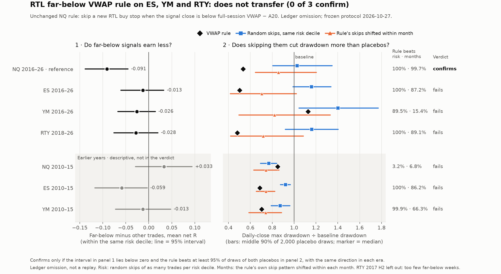

# RTL far-below VWAP rule on ES, YM and RTY: results

Completed 2026-10-27. [Protocol](CROSS_PROTOCOL.md) frozen before any ES/YM/RTY label or outcome
(SHA-256 `39a0884b…2886`). Follow-up to the NQ [study](RESULTS.md), [full replay](REPLAY_RESULTS.md)
and the [evaluation](../../JOURNAL.md#2026-10-27-evaluation-of-the-vwap-study).

**Verdict: does not transfer. None of ES, YM or RTY confirms the NQ result (0 of 3).** The rule
also fails on NQ's own 2010-15, which had never been analysed for it. As fixed in the protocol:
treat the NQ 2016-26 result as possibly specific to that history. No rescue (no other threshold,
anchor, instrument or period on these data); the rule stays a forward candidate only. No strategy,
default or live change.



## What was tested

The unchanged NQ rule: skip a new RTL buy stop when the signal close is below full-session HLC3
VWAP minus A20 (z < -1). The same code as the NQ study, on the existing RTL runs of each instrument,
by removing far-below trades from the ledger (not a replay). Two questions:

1. Do far-below signals earn less net R than other signals with similar planned risk?
2. Does skipping them cut daily-close drawdown more than two placebos that skip without VWAP?
   *Risk*: as many random trades per risk decile. *Months*: the rule's own skip pattern shifted
   within each month, which keeps the runs of skipped trades and each month's count.

An instrument confirms only if the answer to 1 is yes with the 95% interval below zero, the rule
beats at least 95% of draws of both placebos, and the direction holds in each era.

## Results

Pooled samples: NQ (reference) and ES/YM 2016-Sep 2026, RTY 2018-Sep 2026. Net of $1.05 per trade.

| | NQ (reference) | ES | YM | RTY |
|---|---:|---:|---:|---:|
| Far-below trades | 4,506 | 4,581 | 4,762 | 4,099 |
| 1. Far-below minus others, mean net R, same risk decile | **-0.091** | -0.013 | -0.026 | -0.028 |
| 95% interval | -0.138 to -0.045 | -0.061 to +0.033 | -0.067 to +0.014 | -0.076 to +0.020 |
| Risk deciles where far-below is worse | 18 of 20 | 11 of 20 | 12 of 20 | 13 of 20 |
| Baseline net / daily-close DD | $42,817 / $5,781 | -$13,738 / $15,022 | -$1,776 / $5,368 | -$5,666 / $7,333 |
| Rule net / daily-close DD | $47,374 / $3,084 | -$6,526 / $7,539 | -$88 / $6,055 | -$1,442 / $3,523 |
| 2. Rule's DD beats risk placebo | 100% | 100% | 89.45% | 100% |
| 2. Rule's DD beats months placebo | 99.65% | 87.25% | 15.45% | 89.1% |
| Months placebo, median DD | $4,957 | $10,583 | $4,412 | $5,259 |
| 3. Same direction in each era | yes | yes | no | no |
| **Verdict** | confirms | fails | fails | fails |

Era contrasts (test 1 by era): NQ -0.082 / -0.096; ES -0.008 / -0.016; YM -0.040 / -0.019;
RTY +0.012 (2018-19) / -0.040. YM fails test 3 because its 2020-26 rule DD ($6,055) is above the
months placebo's median ($4,396); RTY because 2018-19 points the wrong way.

Earlier years, never analysed for this rule (secondary, not in the verdict):

| | NQ 2010-15 | ES 2010-15 | YM 2010-15 |
|---|---:|---:|---:|
| Far-below minus others, mean net R (95% interval) | +0.033 (-0.029 to +0.094) | -0.059 (-0.117 to -0.003) | -0.013 (-0.072 to +0.048) |
| Rule's DD beats risk / months placebo | 3.25% / 6.8% | 100% / 86.2% | 99.85% / 66.35% |

On NQ 2010-15 far-below trades did slightly better than similar-risk trades, and skipping them left
a larger drawdown than 93-97% of placebos. RTY's 2017 launch half-year is inadequate (25 active
far-below weeks, fewer than 30).

## Why it fails, and what the dollars show

- **The dollar picture looks like NQ's on ES and RTY.** Skipping far-below trades about halves
  drawdown there too ($15.0k to $7.5k; $7.3k to $3.5k) and cuts losses. On YM drawdown rises.
- **Most of that is timing, not VWAP.** Far-below trades are the large-risk trades of strategies
  that lose money, and they bunch in the same weeks. Shifting the same skips within each month
  does almost as well: the rule beats only 87% and 89% of those draws on ES and RTY, 15% on YM.
- **Matched on risk, the R gap is small.** Far-below trades earn 0.013-0.028 R less than
  similar-risk trades (NQ 0.091), and every interval includes zero. Without risk matching, the NQ
  study's own measure even shows far-below trades earning more R on ES, YM and RTY (for example
  +0.109 R on ES 2016-19, interval +0.030 to +0.186): their larger stops make the $1.05 cost
  weigh less per R.
- **What is left rides on NQ.** 82% of ES's, 66% of YM's and 65% of RTY's far-below trades came
  while NQ was also far below. On the rest the contrast is about zero: +0.022, -0.003 and -0.016.

## What this means

The NQ 2016-26 result was the first of many tested filters to pass, on history that had been
searched repeatedly. This test asked whether it holds where it was not found. It does not: not on
three other index futures and not on NQ's own earlier years. The most likely reading is that the
NQ effect is specific to that history, or much smaller than measured. The protocol rules out a
rescue on these data. Forward testing remains possible in principle but now has a low prior.
The [drawdown synthesis](../rtl-market-regimes/SYNTHESIS.md) stands: accepting manageable
drawdowns has stronger support than any tested timing filter.

## Checks, deviations and descriptive results

- **Sources.** All four MT5 reports reconcile with their ledgers, stats files, INIs and completion
  records (NQ 25,833, ES 26,342, YM 26,299, RTY 14,778 trades); published counts and nets are
  reproduced exactly. Every one of 93,020 in-sample trades has its signal bar at the requested
  price and stop, on a red bar.
- **NQ reference.** The new code reproduces the NQ study's 191,781 feature rows and all 16,668
  trade labels exactly, and its omission result to the cent ($3,938.65 / $931.95 and
  $43,435.25 / $3,084.05).
- **Deviation 1:** nine derived economics columns of the NQ reference panel are compared within
  1e-9, not exactly: that panel stores them at 15 significant digits. Largest difference 3.2e-12.
- **Deviation 2:** the NQ code's check that no order or position crosses a date fails on three ES
  positions and one YM order. All four come from sessions whose data ends early (the documented
  2020-02-28 and 2020-06-30 data holes; ES's 2018-07-04 session ends at 19:59), so the flatten had
  no tick, and each resolves in the first minute of the next session. They stay in the baseline,
  as in the published totals. The check now requires exactly that explanation.
- **Ties:** PnL moves in whole ticks, so a few placebo draws match the rule's net dollars exactly;
  values within $0.000001 count as ties, against the rule. Eight such net ties exist (descriptive
  column only); there are no drawdown ties, so the verdict is unaffected.
- **Descriptive placebos.** Month x risk-tertile: the rule's DD beats 100% (ES), 19% (YM), 100%
  (RTY). Skipping the same number of largest-risk trades instead loses more and draws down more
  everywhere ($14.4k, $9.5k, $6.5k DD).
- **Roll-clean trades** (no roll in the bars behind A20): contrasts -0.015, -0.027, -0.034.
- **Years:** the rule lowers yearly drawdown in 8 of 11 years on ES and YM and 8 of 9 on RTY
  (NQ 11 of 11).

## Verification and reproduction

Independent verification passed, with separate code: all 93,252 MT5 trades re-parsed from the
reports with a different HTML parser; 19,777,726 raw minutes rebuilt into M30 features; z,
far-below, unknown and roll-clean labels for all 93,020 in-sample trades; every summary, contrast
and annual row; all 40,000 saved bootstrap draws; every placebo draw, with its count and rotation
invariants; the co-movement table; and the verdict. 11 new focused tests pass (33 VWAP tests in
all). The chart was rendered and visually inspected.

Outputs: `Reports/rtl_vwap_cross_20261027/` (gitignored): source audit, labelled trades, features,
summaries, contrasts and bootstrap draws, placebo draws and masks, annual, roll-clean, co-movement,
verdict, provenance. Code: `python/analyze_rtl_vwap_cross.py`, `verify_rtl_vwap_cross.py`,
`report_rtl_vwap_cross.py`, tests `test_rtl_vwap_cross.py`.

```powershell
.\venv\Scripts\python.exe -B python\analyze_rtl_vwap_cross.py all
.\venv\Scripts\python.exe -B python\verify_rtl_vwap_cross.py
.\venv\Scripts\python.exe -B -m unittest discover -s python -p 'test_rtl_vwap*.py'
.\venv\Scripts\python.exe -B python\report_rtl_vwap_cross.py
```
