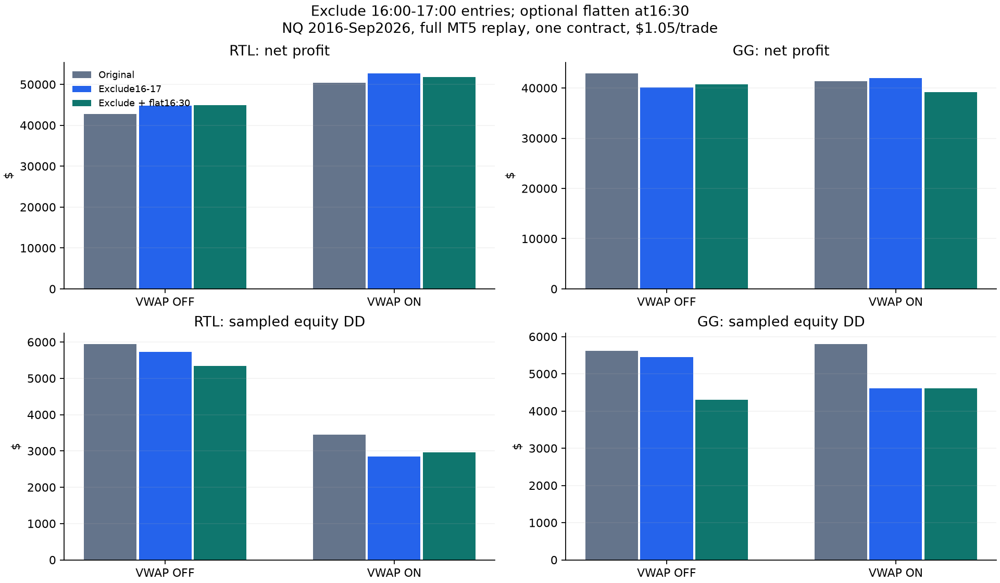

# RTL/GG: exclude 16:00-17:00, optionally flatten at 16:30

Full native MT5 replays completed 2026-11-01 under the [initial plan](EXCLUDE_16_PROTOCOL.md)
and the user's [16:30 correction](EXCLUDE_1630_FLATTEN_AMENDMENT.md). Generic intraday
drawdown only, without a firm-specific threshold or breach simulation.

## Exact policies

- Original: all baseline entry windows enabled.
- Exclude16-17: change only `W1600W1700=false`, disabling new entry submissions at
  16:00 and 16:30; resume at 17:00. Existing positions follow normal exits.
- Exclude + flat 16:30: the same entry exclusion, plus close open positions and
  cancel pending orders at the first available quote at/after16:30 each date.

Source clock is Chicago+8:16:00-17:00 is 09:00-10:00 New York, with cash open 16:30.
VWAP ON means the original signal-close filter: skip below session VWAP minus A20;
equality or unknown permits entry. No slope, blue-location, signal-open or other
condition. RTL uses red signal candles; GG uses green. Twelve separately replayed
jobs model changed subsequent orders; these are not deleted-trade ledgers.

A pending order can trigger on a boundary quote before the EA cancels it. Flatten
acts on the resulting position at the first eligible quote. The exclusion alone
does not guarantee zero fills or zero exposure during 16:00-17:00.

## Pooled 2016-Sep2026

All net dollars include $1.05 per round trip with one contract at $2/point.
Daily DD uses submission-session attribution as in the earlier studies. Equity DD
uses continuously sampled marked-to-market account equity, deducting external
cost at each closure, and a running high reset only at the analysis-period start.
This continuous equity DD is the relevant generic diagnostic for intraday trailing
risk. It has no fixed firm-specific cap/floor.

| Strategy | Filter | Window policy | Trades | Net | Daily DD | Equity DD | Worst session DD | Net/equity DD |
| --- | --- | --- | --- | --- | --- | --- | --- | --- |
| GG | Baseline | Original | 17,569 | $42,951 | $4,882 | $5,622 | $2,424 | 7.64 |
| GG | Baseline | Exclude16-17 | 16,606 | $40,147 | $4,349 | $5,444 | $2,423 | 7.37 |
| GG | Baseline | Exclude + flat 16:30 | 16,702 | $40,677 | $3,982 | $4,308 | $2,423 | 9.44 |
| GG | VWAP | Original | 15,938 | $41,401 | $5,360 | $5,798 | $2,424 | 7.14 |
| GG | VWAP | Exclude16-17 | 15,107 | $41,959 | $4,277 | $4,616 | $2,424 | 9.09 |
| GG | VWAP | Exclude + flat 16:30 | 15,206 | $39,180 | $4,255 | $4,617 | $2,424 | 8.49 |
| RTL | Baseline | Original | 16,668 | $42,817 | $5,781 | $5,942 | $2,397 | 7.21 |
| RTL | Baseline | Exclude16-17 | 15,500 | $44,728 | $5,095 | $5,734 | $2,270 | 7.80 |
| RTL | Baseline | Exclude + flat 16:30 | 15,546 | $44,897 | $4,729 | $5,338 | $1,775 | 8.41 |
| RTL | VWAP | Original | 13,331 | $50,446 | $3,158 | $3,454 | $2,397 | 14.60 |
| RTL | VWAP | Exclude16-17 | 12,508 | $52,739 | $2,698 | $2,848 | $1,274 | 18.52 |
| RTL | VWAP | Exclude + flat 16:30 | 12,532 | $51,843 | $2,810 | $2,959 | $1,274 | 17.52 |

## Matched changes

For the VWAP-filtered strategies, entry exclusion alone improves pooled net
profit and equity DD. Adding the 16:30 flatten then reduces profit without improving
pooled equity DD: RTL $52,739/$2,848 becomes $51,843/$2,959; GG $41,959/$4,616
becomes $39,180/$4,617. For unfiltered RTL/GG, flattening does further reduce DD
relative to entry exclusion alone. These conclusions describe this fixed history,
and the early/recent tables below should be checked before generalizing.

- **RTL, VWAP OFF, Exclude16-17:** net change $+1,911.90; equity-DD change $-207.70 (-3.5%); net/equity-DD 7.21 to 7.80.
- **RTL, VWAP OFF, Exclude + flat 16:30:** net change $+2,080.60; equity-DD change $-604.20 (-10.2%); net/equity-DD 7.21 to 8.41.
- **RTL, VWAP ON, Exclude16-17:** net change $+2,293.15; equity-DD change $-606.40 (-17.6%); net/equity-DD 14.60 to 18.52.
- **RTL, VWAP ON, Exclude + flat 16:30:** net change $+1,397.45; equity-DD change $-494.90 (-14.3%); net/equity-DD 14.60 to 17.52.
- **GG, VWAP OFF, Exclude16-17:** net change $-2,803.85; equity-DD change $-178.05 (-3.2%); net/equity-DD 7.64 to 7.37.
- **GG, VWAP OFF, Exclude + flat 16:30:** net change $-2,273.65; equity-DD change $-1,313.40 (-23.4%); net/equity-DD 7.64 to 9.44.
- **GG, VWAP ON, Exclude16-17:** net change $+558.05; equity-DD change $-1,182.00 (-20.4%); net/equity-DD 7.14 to 9.09.
- **GG, VWAP ON, Exclude + flat 16:30:** net change $-2,220.90; equity-DD change $-1,181.15 (-20.4%); net/equity-DD 7.14 to 8.49.

## Early and recent eras

| Era | Strategy | Filter | Window policy | Trades | Net | Daily DD | Equity DD | Worst session DD | Net/equity DD |
| --- | --- | --- | --- | --- | --- | --- | --- | --- | --- |
| 2016-19 | GG | Baseline | Original | 6,388 | $3,636 | $1,561 | $1,765 | $536 | 2.06 |
| 2016-19 | GG | Baseline | Exclude16-17 | 6,052 | $4,696 | $1,437 | $1,593 | $536 | 2.95 |
| 2016-19 | GG | Baseline | Exclude + flat 16:30 | 6,085 | $3,861 | $1,537 | $1,585 | $821 | 2.44 |
| 2016-19 | GG | VWAP | Original | 5,837 | $4,741 | $1,773 | $1,994 | $536 | 2.38 |
| 2016-19 | GG | VWAP | Exclude16-17 | 5,535 | $5,622 | $1,397 | $1,457 | $536 | 3.86 |
| 2016-19 | GG | VWAP | Exclude + flat 16:30 | 5,570 | $3,914 | $1,894 | $1,941 | $821 | 2.02 |
| 2016-19 | RTL | Baseline | Original | 6,167 | $4,417 | $2,143 | $2,348 | $464 | 1.88 |
| 2016-19 | RTL | Baseline | Exclude16-17 | 5,709 | $4,877 | $1,495 | $1,698 | $429 | 2.87 |
| 2016-19 | RTL | Baseline | Exclude + flat 16:30 | 5,726 | $4,118 | $1,451 | $1,542 | $408 | 2.67 |
| 2016-19 | RTL | VWAP | Original | 5,024 | $4,721 | $986 | $1,042 | $352 | 4.53 |
| 2016-19 | RTL | VWAP | Exclude16-17 | 4,681 | $5,480 | $825 | $900 | $352 | 6.09 |
| 2016-19 | RTL | VWAP | Exclude + flat 16:30 | 4,695 | $4,015 | $1,137 | $1,187 | $312 | 3.38 |
| 2020-26 | GG | Baseline | Original | 11,181 | $39,315 | $4,882 | $5,622 | $2,424 | 6.99 |
| 2020-26 | GG | Baseline | Exclude16-17 | 10,554 | $35,451 | $4,349 | $5,444 | $2,423 | 6.51 |
| 2020-26 | GG | Baseline | Exclude + flat 16:30 | 10,617 | $36,816 | $3,982 | $4,308 | $2,423 | 8.55 |
| 2020-26 | GG | VWAP | Original | 10,101 | $36,659 | $5,360 | $5,798 | $2,424 | 6.32 |
| 2020-26 | GG | VWAP | Exclude16-17 | 9,572 | $36,337 | $4,277 | $4,616 | $2,424 | 7.87 |
| 2020-26 | GG | VWAP | Exclude + flat 16:30 | 9,636 | $35,266 | $4,255 | $4,617 | $2,424 | 7.64 |
| 2020-26 | RTL | Baseline | Original | 10,501 | $38,400 | $5,781 | $5,942 | $2,397 | 6.46 |
| 2020-26 | RTL | Baseline | Exclude16-17 | 9,791 | $39,851 | $5,095 | $5,734 | $2,270 | 6.95 |
| 2020-26 | RTL | Baseline | Exclude + flat 16:30 | 9,820 | $40,779 | $4,729 | $5,338 | $1,775 | 7.64 |
| 2020-26 | RTL | VWAP | Original | 8,307 | $45,725 | $3,158 | $3,454 | $2,397 | 13.24 |
| 2020-26 | RTL | VWAP | Exclude16-17 | 7,827 | $47,259 | $2,698 | $2,848 | $1,274 | 16.60 |
| 2020-26 | RTL | VWAP | Exclude + flat 16:30 | 7,837 | $47,828 | $2,810 | $2,959 | $1,274 | 16.16 |

## Remaining opening-hour exposure

| Strategy | Filter | Window policy | Fills during 16-17 | Trades overlapping16-17 |
| --- | --- | --- | --- | --- |
| GG | Baseline | Original | 991 | 2335 |
| GG | Baseline | Exclude16-17 | 0 | 1344 |
| GG | Baseline | Exclude + flat 16:30 | 0 | 1344 |
| GG | VWAP | Original | 870 | 2061 |
| GG | VWAP | Exclude16-17 | 0 | 1191 |
| GG | VWAP | Exclude + flat 16:30 | 0 | 1191 |
| RTL | Baseline | Original | 1205 | 2478 |
| RTL | Baseline | Exclude16-17 | 0 | 1273 |
| RTL | Baseline | Exclude + flat 16:30 | 0 | 1273 |
| RTL | VWAP | Original | 836 | 1671 |
| RTL | VWAP | Exclude16-17 | 0 | 835 |
| RTL | VWAP | Exclude + flat 16:30 | 0 | 835 |

The flat 16:30 variant deliberately permits positions held from 16:00 until 16:30.
Its exposure count therefore need not be zero. Forced events and position exits
were checked at actual quote times; missing or delayed boundary quotes are reported
in verification, not assumed to occur exactly on the wall clock.

## Intraday measurement limits

Equity is sampled before/after strategy ticks and on trade-transaction events;
unchanged values are deduplicated. The last saved observation is carried forward
between changes. Worst-session DD seeds each date with the preceding equity, so
an overnight gap is charged to the new date. Period-boundary equity similarly uses
the last prior observation as an opening reference. This can differ from a reset
exactly at the first quote, and from daily-close DD, which attributes a whole trade
to its submission session. Costs are charged at closure for equity metrics.

These tests use generated ticks from 1-minute OHLC, not actual tick order. Sampled
equity DD therefore describes this tester path. It is more informative about
intraday exposure than daily-close DD, but it cannot prove a live trailing-account
limit would survive. Firm thresholds, payout resets and trailing caps are outside
this generic comparison. No live settings were changed.

Worst-session DD is not necessarily reduced by suppressing the opening hour: the
worst episode can occur elsewhere. For example, GG's pooled worst-session DD stays
about $2,424 in all policies despite changes in continuous equity DD.

## Verification and artifacts

All four original-window controls reproduce their saved baseline/VWAP ledgers
byte for byte. Native reports, ledgers, timestamps and $2/point economics reconcile.
Every VWAP candidate known/blocked flag and filled source signal was checked against
the frozen real-volume feature panel. Exclusion jobs have no new submissions in
the blocked hour. Flatten events leave no open positions/orders and no trade
survives its forced event. Exit counts are reconstructed from native report times
and ending balances match native totals. Drawdown is independently recomputed
from saved binary observations.

For all 12 jobs, maximum gross-equity DD over the whole run also exactly matches
MT5's native equity-DD statistic. This cross-check validates the sampled equity
path against a separate native statistic before external-cost adjustment.

The passive callback counter missed some completed-deal metadata, so costs were
reconstructed from authoritative native exit timestamps instead; raw account
balance/equity and strategy execution are independent of that counter. See the
[accounting note](EXCLUDE_16_EQUITY_NOTE.md). Charging costs strictly before versus
at the same one-second timestamp is checked as a sensitivity in the saved tables.

- ex16_20261101_rtl_base_flat 1630: 4,190 daily flatten events, 1,332 positions closed; 0 event minutes after16:30.
- ex16_20261101_rtl_vwap_flat 1630: 4,190 daily flatten events, 823 positions closed; 0 event minutes after16:30.
- ex16_20261101_gg_base_flat 1630: 4,190 daily flatten events, 1,396 positions closed; 0 event minutes after16:30.
- ex16_20261101_gg_vwap_flat 1630: 4,190 daily flatten events, 1,267 positions closed; 0 event minutes after16:30.

The earlier16:00-flatten setup was compiled but not run; it is preserved separately.
Original/exclusion evidence: `Reports/rtl_gg_exclude16_20261101/`.
Corrected flatten evidence: `Reports/rtl_gg_exclude16_flatten1630_20261101/`.
Native source, settings, hashes, ledgers/reports, candidate decisions, equity binary
paths, summaries and verification JSONs are saved (gitignored). Combined tables
include annual and secondary 2010-15 rows; all use the same fixed rules.

Code: [prepare](../../../python/prepare_exclude16_replay.py),
[flatten preparation](../../../python/prepare_exclude16_flatten.py),
[equity observer](../../../mt5/experts/window_equity_research.mqh),
[verify](../../../python/verify_exclude16_replay.py),
[report](../../../python/report_exclude16_replay.py).

Across all era/annual rows, the maximum fee-timestamp DD sensitivity is $1.05; it is $0.00 in the pooled primary comparison.
