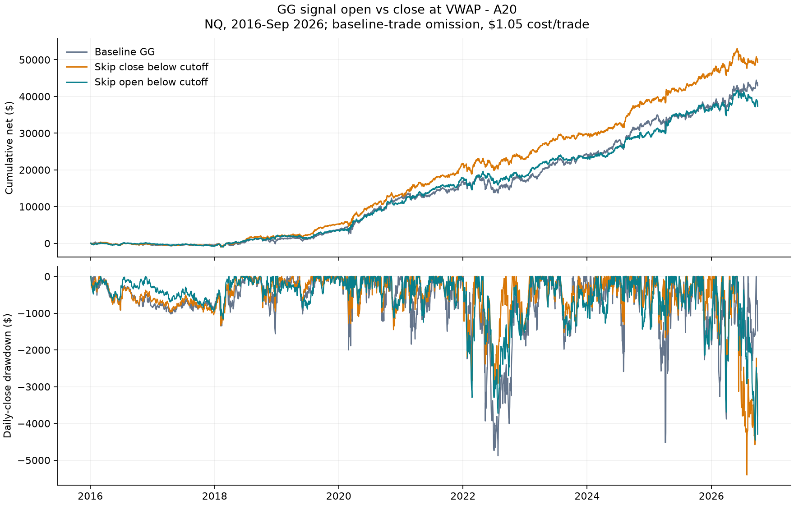

# GG open versus close below the orange VWAP cutoff

Run 2026-11-01 under the [saved plan](GG_OPEN_PROTOCOL.md). **Using the open is stricter,
but does not improve the profit/drawdown trade-off in the pooled sample.** It removes
1,870 additional trades that earned $11,916.50 net. These green candles opened below
the cutoff and closed at or above it: this group contributed profit rather than loss.

This is descriptive baseline-trade omission, not a new MT5 strategy replay. All
results include $1.05 per trade and use the original one-contract sizing.

## Definition and timing

The cutoff is the same signal-bar-close session VWAP minus A20 in both comparisons.
Only the signal price changes: `close < cutoff` versus `open < cutoff`. The signal
is evaluated after its M30 candle closes. This does not compare the open with the
VWAP line as it stood at the opening instant. Equality is allowed; unknown labels
are kept under both rules. Both use original baseline fills and exits.

## Results

| Era | Policy | Trades | Net | Mean net R | Daily-close DD | Net/DD |
| --- | --- | --- | --- | --- | --- | --- |
| 2016-19 | baseline | 6,388 | $3,636 | -0.0163 | $1,561 | 2.329 |
| 2016-19 | close | 5,448 | $5,194 | -0.0096 | $1,337 | 3.884 |
| 2016-19 | open | 4,756 | $3,466 | -0.0185 | $1,160 | 2.988 |
| 2020-26 | baseline | 11,181 | $39,315 | +0.0444 | $4,882 | 8.054 |
| 2020-26 | close | 9,408 | $44,078 | +0.0546 | $5,404 | 8.156 |
| 2020-26 | open | 8,230 | $33,890 | +0.0558 | $4,456 | 7.605 |
| 2016-26 | baseline | 17,569 | $42,951 | +0.0223 | $4,882 | 8.799 |
| 2016-26 | close | 14,856 | $49,272 | +0.0311 | $5,404 | 9.118 |
| 2016-26 | open | 12,986 | $37,356 | +0.0286 | $4,456 | 8.383 |
| 2010-15 | baseline | 8,935 | $-5,108 | -0.1488 | $5,833 | -0.876 |
| 2010-15 | close | 7,800 | $-4,144 | -0.1571 | $5,007 | -0.828 |
| 2010-15 | open | 6,732 | $-4,268 | -0.1781 | $4,777 | -0.893 |

Over 2016-Sep 2026, the close rule skips 2,713 trades (15.4%); the open rule skips
4,583 (26.1%). Relative to close, open loses $11,916.50 net for a $947.80 smaller
maximum daily drawdown. Relative to baseline, it loses $5,595.35 net for only a
$425.30 smaller drawdown. Net/DD falls from 8.80 baseline and 9.12 close to 8.38 open.
The 2010-15 secondary history remains unprofitable under all three policies.

## What the stricter rule removes

| Era | Additional skips | Net of removed trades | Mean net R | Profit factor | Win rate |
| --- | --- | --- | --- | --- | --- |
| 2016-19 | 692 | $1,728 | +0.0517 | 1.159 | 47.0% |
| 2020-26 | 1,178 | $10,189 | +0.0466 | 1.150 | 45.7% |
| 2016-26 | 1,870 | $11,916 | +0.0485 | 1.151 | 46.1% |
| 2010-15 | 1,068 | $124 | -0.0246 | 1.014 | 44.8% |

The additional group earns positive net dollars and positive mean net R in both
primary eras; it is not just a handful of large dollar winners with negative average
R over the whole era. Its pooled mean is +0.0485 R, versus +0.0286 R for the open
rule's retained trades. This is a description, without a significance claim.

The additional removed group is profitable in 9 of the 11 years from 2016 onward.
However, its mean net R is negative in 2020, 2022 and 2025 despite positive dollar
profit, reflecting differences in trade risk. Annual contributions:

| Year | Additional skips | Net of removed trades | Mean net R |
| --- | --- | --- | --- |
| 2016 | 183 | $-197 | -0.0626 |
| 2017 | 176 | $289 | +0.0351 |
| 2018 | 169 | $-125 | +0.0249 |
| 2019 | 164 | $1,760 | +0.2246 |
| 2020 | 172 | $542 | -0.0038 |
| 2021 | 169 | $1,406 | +0.0290 |
| 2022 | 173 | $1,126 | -0.0319 |
| 2023 | 186 | $1,670 | +0.1637 |
| 2024 | 185 | $2,577 | +0.0320 |
| 2025 | 165 | $534 | -0.0155 |
| 2026 | 128 | $2,334 | +0.1748 |

**2026 is not repaired:** close-filter DD is $5,404; open-filter DD is $4,456;
ungated GG DD that year is $3,881. Open removes another 128 trades worth +$2,334,
reducing 2026 net from $3,507 to $1,173. Across 2016-26, open has a larger annual
DD than close in 7 of 11 years, despite its smaller pooled maximum DD.

## Compare with simply reducing exposure

The open rule retains about 65.0% of total planned initial risk. Scaling every
baseline trade to that fraction gives $27,901 net and $3,171 DD. The actual open
filter earns more ($37,356) but also has more DD ($4,456); its net/DD is lower.
Thus some DD reduction is available from reduced exposure alone. This aggregate
risk control is descriptive fractional sizing; it is not executable one-contract
trading and does not establish that the two paths have equal market risk.

| Policy | Net | Daily-close DD | Planned risk retained | Net/DD |
| --- | --- | --- | --- | --- |
| baseline | $42,951 | $4,882 | 100.0% | 8.799 |
| close | $49,272 | $5,404 | 81.3% | 9.118 |
| open | $37,356 | $4,456 | 65.0% | 8.383 |
| close_risk_scaled_baseline | $34,919 | $3,969 | 81.3% | 8.799 |
| open_risk_scaled_baseline | $27,901 | $3,171 | 65.0% | 8.799 |

## Interpretation and limits

The user's observation is correct: green closes put fewer GG signals below the
cutoff. Using the open captures more of them, including candles that recover across
the cutoff before closing. In this history, those extra candidates supplied useful
profit. The stricter filter therefore trades away profit for a modest pooled DD
reduction; it does not support replacing the close rule on this evidence.

No threshold sweep, fresh confirmation claim, or strategy-default change. The
earlier [GG native replay](GG_RESULTS.md#mt5-replay) materially underperformed its
ledger omission because newly available trades changed the result. The open rule
has not been replayed; these filtered ledgers cannot predict that full strategy path.

## Verification and artifacts

26,504 eligible baseline trades; 26,505 whole-run trades less the one October 2026
trade. Source ledger, original independently verified feature/calendar hashes and
protocol were recorded before analysis. Existing close labels and baseline/close
counts, net, mean R and DD were reproduced. All signal candles are green; close
skips are a subset of open skips; group profits reconcile exactly.

The separate verifier rejoins frozen features by availability time, checks OHLC,
session eligibility and both masks, and independently recomputes 189 metric rows
(eras, annual policies, groups, and exposure controls). All checks pass.
It reuses the previously verified frozen features; it does not repeat their raw
minute rebuild. Evidence: `Reports/gg_vwap_open_20261101/` (gitignored), including
`input_manifest.json`, `source_checks.json`, `verification.json`, all tables,
labelled trades and output hashes.

Code: [analysis](../../../python/analyze_gg_vwap_open.py),
[verification](../../../python/verify_gg_vwap_open.py),
[report and chart](../../../python/report_gg_vwap_open.py).
