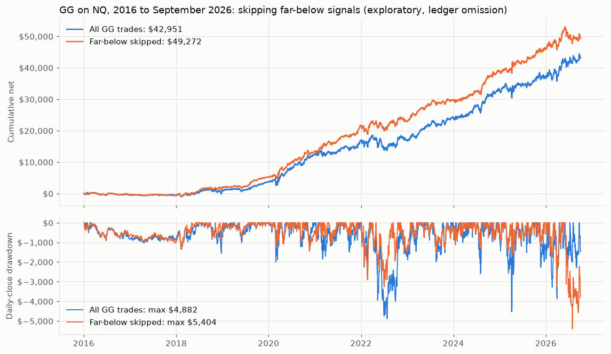

# Far-below VWAP rule on GG, NQ: results (exploratory)

Run 2026-10-30 under the frozen [protocol](GG_PROTOCOL.md) (SHA-256 `803d3444…`). **Verdict: not
consistent with RTL.** Far-below GG signals are weaker trades (test 1 passes), but skipping them
does not lower GG's drawdown more than random skipping (tests 2 and 3 fail). As agreed before the
run, this counts against the rule: the drawdown benefit looks specific to RTL. Nothing is adopted.

## Sample

The existing GG run on NQ (`ymbase_20261023_gg_nq`), reconciled with its report, ledger and stats:
26,505 trades, published counts and net reproduced, 0 signal-bar mismatches. Labels use the cross
test's frozen NQ features; relabelling the 25,833 RTL trades with them gives that test's labels
back exactly. Ledger omission, not a replay: orders freed by skipped trades are not modelled.

| Era | GG trades | Far below | Share |
|---|---|---|---|
| 2016-19 | 6,388 | 940 | 15% |
| 2020-Sep 2026 | 11,181 | 1,773 | 16% |
| 2010-15 (secondary) | 8,935 | 1,135 | 13% |

Green candles close up, so fewer of them sit far below VWAP than RTL's red ones (27% on NQ).

## Verdict tests (2016-Sep 2026)

| Test | GG | Needed | Pass | RTL on NQ (cross test reference) |
|---|---|---|---|---|
| 1. Risk-matched contrast | -0.076 R, 95% interval -0.130 to -0.021; 14 of 20 deciles negative | below zero, whole interval below zero | yes | -0.091 R (-0.138 to -0.045) |
| 2. DD beats placebos | rule DD $5,404 beats 42% of risk-decile and 33% of rolled-within-month draws | at least 95% of each | no | 100% and 99.7% |
| 3. Each era | 2016-19: -0.076 R, DD $1,337 below both medians ($1,680, $1,553). 2020-26: -0.076 R, but DD $5,404 above both medians ($5,206, $4,945) | contrast below zero and DD below both medians in both eras | no | yes |

Both eras pass 200 far-below trades and 30 active weeks, so the result is not inconclusive.

## What happened to the drawdown

| | Trades | Net | Mean net R | Daily-close DD |
|---|---|---|---|---|
| All GG, 2016-19 | 6,388 | $3,636 | -0.016 | $1,561 |
| Far-below skipped | 5,448 | $5,194 | -0.010 | $1,337 |
| All GG, 2020-26 | 11,181 | $39,315 | +0.044 | $4,882 |
| Far-below skipped | 9,408 | $44,078 | +0.055 | $5,404 |

- **Year by year, the skip lowers GG's drawdown in 9 of 11 years**, including 2022 ($4,882 to
  $3,249), the baseline's worst stretch (March to July 2022).
- **2026 decides the verdict.** From 2026-06-02 to 07-29 the 42 skipped GG trades made +$3,762
  while the 210 kept ones lost $5,336: the rule's 2026 drawdown is $5,404 against the baseline's
  $3,881. That becomes
  the rule's largest drawdown of the decade. 2017 is the other year it is worse ($541 vs $317).
- **Random skipping does as well.** Skipping as many trades at random (same risk decile, or the same
  pattern moved to other days of the month) gives a median drawdown of $5,206 / $4,945. A maximum
  drawdown is set by one bad stretch, so a single episode can decide it. That limit was known
  when the protocol was written and applies to the placebos too.
- **Net profit does rise:** $42,951 to $49,272 over 2016-26, above 99.95% / 98.85% of the
  placebo draws. Profit was reported but, as on RTL, never part of the verdict.

## Secondary and descriptive

- **2010-15:** contrast -0.006 R (interval -0.089 to +0.080); net -$5,108 to -$4,144; DD $5,833 to
  $5,007, beating 77% / 62% of placebo draws. No signal, like RTL in the same years.
- **Roll-clean subset** (no contract roll behind A20): contrast -0.078 R in 2020-26; DD $5,078 to
  $4,759.
- **RTL + GG in one account** (daily sum of both ledgers; no placebo control, so it cannot show
  that this beats random skipping):

| 2016-Sep 2026 | RTL trades | GG trades | Net | Daily-close DD |
|---|---|---|---|---|
| No gate | 16,668 | 17,569 | $85,768 | $9,141 |
| Gate on RTL only | 12,162 | 17,569 | $90,325 | $6,877 |
| Gate on both | 12,162 | 14,856 | $96,646 | $5,569 |

  2016-19 alone: $8,052 / $3,695, $7,574 / $2,195 and $9,133 / $1,669.

## Reading it

Across the tests so far, "far below VWAP" marks somewhat weaker buy-stop signals on NQ RTL, NQ GG and
the ten stocks; on ES, YM and RTY the gap was near zero. The drawdown benefit, the reason the rule
was interesting, has held only on the RTL history it was found on: it failed on the futures, on the
stocks' test 3, and now on GG's 2020-26 era. The combined-account numbers look good but come from
the same NQ history and have no random-skip control. The rule stays where it was: no further
historical tests; a forward paper test with rules written in advance is the only next step.

## Evidence

`Reports/gg_vwap_20261030/` (gitignored): source audit, labelled trades, summaries, contrast and
5,000 bootstrap draws, placebo masks and 2,000 draws each, annual, roll-clean, combined account,
verdict and provenance. [analyze_gg_vwap.py](../../../python/analyze_gg_vwap.py) (cross-test code,
seeds 202610300 / 202610310); [verify_gg_vwap.py](../../../python/verify_gg_vwap.py) re-parsed the
report, rebuilt VWAP, A20 and z from the raw NQ minutes with the cross test's independent code for
all GG and RTL trades, and recomputed every summary, bootstrap and placebo draw, the annual rows, the
combined account and the verdict: all passed (`independent_verification.json`). Chart:
[report_gg_vwap.py](../../../python/report_gg_vwap.py).
