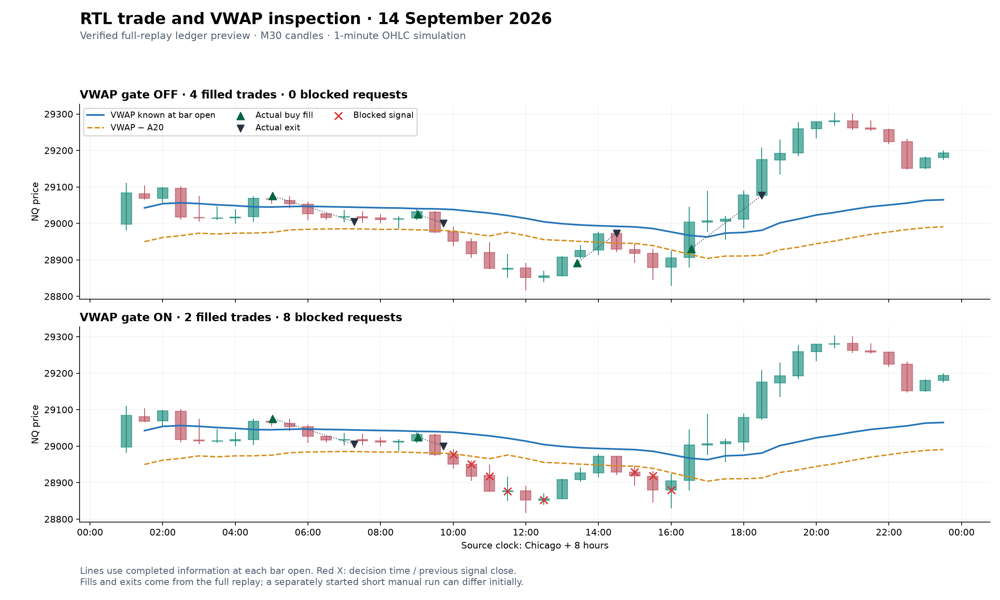

# Manual RTL VWAP runs in MT5

Prepared 2026-10-27 for the usual AMP MT5 installation. This is a separate
historical tester copy of the verified NQ replay, with display hooks. The frozen
research EA and its outputs are preserved. No filter is adopted for live trading.

## Two comparable manual runs

1. Open MT5. Press **Ctrl+R** to open Strategy Tester. Select single testing,
   with optimization disabled and a local agent.
2. Expert: **CodexVwapVisual\RTL_vwap_visual**.
   Symbol: **MNQcontDTBNT20102026_2**. Period: **M30**.
   If the expert is missing, refresh Expert Advisors in Navigator (Ctrl+N), or
   restart MT5. This copy deliberately rejects other symbols/timeframes and live charts.
3. Model: **1 minute OHLC**, execution delay **No delay**, deposit **500000 USD**,
   leverage **1:100**, and enable **Visualization**.
4. Choose a short historical week initially, for example **2026.09.14 to
   2026.09.19**. These dates are for inspection, not a new performance test.
5. In **Inputs**, right-click and **Load** `RTL_VWAP_visual_OFF.set`.
   The presets are installed in the terminal data folder under
   `MQL5\Profiles\Tester`. Workspace copies are also in
   `Reports\rtl_vwap_visual_20261027`.
6. Start. Pause or slow playback and inspect fills, exits, lines and markers.
7. Repeat exactly the same dates/settings, loading **RTL_VWAP_visual_ON.set**.
   The meaningful strategy difference is `UseVwapReplayGate=false` versus `true`.

Leave `ShowStudyOverlay=true`. The presets retain one contract, RR1 bar-close
exit, original session windows/flattening, no trailing stop, no red-run cap and
no location/range filter. Input presets do not set the tester's symbol, dates,
model, deposit or visualization; set those in Settings.

MT5 displays real simulated fills and exits in the visualizer, with the History
and Operations tabs showing details. A green candidate dot alone is **not** a fill.
For an ordinary nonvisual run, the Result tab's **Open Chart** command can also
show deals and the indicator. Candidate X/dot objects are drawn during visual
testing only. [MT5 visual testing](https://www.metatrader5.com/en/terminal/help/algotrading/visualization),
[opening a completed test chart](https://www.metatrader5.com/en/terminal/help/algotrading/testing).

## Reading the chart

| Display | Meaning |
|---|---|
| Blue line | Session VWAP available at the opening of this M30 bar |
| Dashed orange line | That VWAP minus A20: the entry-filter cutoff |
| Red X | An otherwise eligible new buy stop was blocked by the VWAP gate |
| Green dot | A buy-stop request was accepted; it can later fill or be canceled |
| Gray dot | Candidate considered, but no order was accepted |
| MT5 trade arrows/lines | Actual simulated entries and exits |

Markers sit at **decision time and the previous signal candle's close price**.
Hover for the signal timestamp, signal close, VWAP, A20, cutoff, z, gate state and
order result. Use **Ctrl+D / Data Window** for the plotted indicator values.
The gate blocks only when the signal close is **strictly below** the orange line.
Equality permits entry; unknown current-session values also permit entry.

The line at 10:00 uses information completed by 10:00, usually the 09:30 candle
and its preceding session minutes. It does not include the developing 10:00
candle. This alignment matches the order decision, rather than a retrospectively
plotted VWAP on the candle whose close generated it. Values stay fixed within a
bar; connecting lines interpolate visually between sampled bar-open values.
There is no intrabar VWAP calculation. Session-open unknown values appear as gaps.

The original pending-order cancellation still runs before a replacement is
blocked. Existing positions retain the original stop/exit rules; crossing the
orange line by itself does not close a position.

Example from the verified full-replay ledgers (a static preview, not an MT5
screenshot):

## How this VWAP is calculated

For each minute i, typical price is `(high_i + low_i + close_i) / 3`.

`VWAP = sum(typical_price_i * traded_volume_i) / sum(traded_volume_i)`

The cumulative sum starts afresh each source session and includes overnight
minutes. The study clock is **Chicago + 8 hours**, normally **01:00-23:59** on
one source date. This is not a US cash-open-only VWAP.

The source is the full-size **NQ** contract's minute OHLC and actual traded volume,
with **MNQ $2/point** valuation. It is a minute-bar approximation of transaction
VWAP. It is not close-price-only VWAP, M30-volume VWAP or broker tick-count VWAP.

`TR = max(high-low, abs(high-previous_close), abs(low-previous_close))`

`A20 = arithmetic mean of 20 completed, observed M30 true ranges`

A20 does not use Wilder smoothing. The trading cutoff is `VWAP - A20`.

The research EA reads these precomputed values from
`rtl_vwap_replay_20261026_features.csv` in MT5 **Common\Files**. The custom
indicator reads the same file and uses only the latest row available at each
chart bar's opening time, in the same session. It is independent of MT5's built-in
indicator list. The indicator can also be added to an ordinary M30 chart of this
custom symbol from **Indicators\CodexVwapVisual\RTL_Study_VWAP**.

## Scope and comparison details

- This package supports the frozen NQ/MNQ-valued study history through
  **September 2026**. It is not a general live VWAP indicator, and will not
  populate current contract charts or future sessions. Use the named custom symbol.
- Keep manual test dates within that history. A new short run resets strategy
  state at its start; its first trades need not reproduce a slice of a longer run.
- The research deducts **$1.05 per completed trade afterward**. The default MT5
  test displays gross profit when its commissions are zero. Subtract the external
  cost when comparing with the study; do not deduct twice if you configure fees.
- Manual output tags always begin `manual_vwap_` and include a unique suffix;
  these runs cannot overwrite the frozen OFF/ON research files. The old `RunTag`
  input is ignored in this manual copy. See the tester Journal for its output tag.
- A missing feature file, wrong symbol/timeframe, or missing indicator produces
  an explicit initialization error. Inspect the Journal if a test will not start.

## Build and verification

Run `python/prepare_rtl_vwap_visual.py` with the workspace Python to compile and
install the manual EA, custom indicator and both presets. Sources are
`mt5/indicators/RTL_Study_VWAP.mq5` and `mt5/experts/vwap_visual_overlay.mqh`;
the EA is generated from the frozen replay source with display hooks and unique
output names. Both compile with zero errors/warnings.

`python/verify_rtl_vwap_visual.py` runs OFF and ON with visualization disabled,
requiring the usual terminal to be closed. It compares raw trade bytes to each
frozen replay and checks the actual indicator buffers against every candidate's
VWAP/cutoff, including unknown session openings. It launches only its own tester
process and requests shutdown after completion. Logs and build/verification
records are in `Reports/rtl_vwap_visual_20261027`. This automated verification
does not substitute for visual inspection of the native chart UI.
