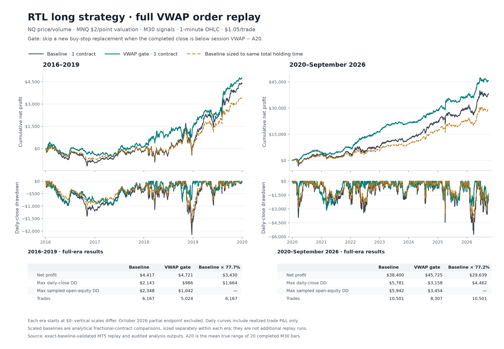

# RTL VWAP: full strategy replay

**Update 2026-10-27, later: the rule does not transfer.** Under a frozen protocol it confirms on
none of ES, YM and RTY (0 of 3) and fails on NQ 2010-15. The replay below stands as NQ 2016-26
history only. See [cross-instrument results](CROSS_RESULTS.md).

Completed 2026-10-27. [Protocol](REPLAY_PROTOCOL.md) frozen before outcomes;
follow-up to the [ledger study](RESULTS.md). **The risk-reduction result survives
the full engine replay, and net dollars improve in both eras.** This warrants
prospective validation of the unchanged rule, not automatic adoption. Production
RTL has not been changed, and the rule has not been activated for live trading.

## Rule and exact replication

Uncapped M30 RTL, original RR1 bar-close exit and session flatten, one contract
valued at $2/point, $1.05 per completed round trip. Suppress a new buy stop when
the completed signal close is strictly below full-session HLC3 VWAP minus A20,
the arithmetic mean of 20 completed M30 true ranges. Equality and unavailable
current-session features permit entry. This uses NQ prices and actual NQ volume
with MNQ valuation; OHLCV VWAP approximates transaction VWAP.
The source clock is Chicago plus 8 hours; VWAP resets for each normal
01:00-23:59 source session, including overnight trading.

The original red-candidate cancellation runs before deciding whether to submit
its replacement. The gate adds no position exit or independent cancellation.
Reevaluate every eligible new signal; do not wait for a cross above VWAP to resume.
All VWAP/A20 inputs must be available at submission, in the same source session.
No thresholds, windows, anchors or exits were optimized in this replay.

The OFF arm reproduced **all 25,833 original trades**, exact execution fields,
ticket IDs and raw trade-log bytes. Complete native orders/deals and the separate
path observer agree, including fast trades. Independent reconstruction checked
60,194 OFF and 66,666 ON candidates; no observer errors or entry lag. The ON arm
has 20,721 whole-run trades. Analysis excludes pre-2016 warmup and the incomplete
October 1 endpoint, leaving 16,668 baseline and 13,331 filtered trades.

## Profit and drawdown

All dollar figures below are net of $1.05 round-trip cost. Early = 2016-19;
recent = 2020-September 2026. Drawdowns reset at each era's start.

| Measure | Early baseline | Early VWAP gate | Recent baseline | Recent VWAP gate |
|---|---:|---:|---:|---:|
| Completed trades | 6,167 | 5,024 | 10,501 | 8,307 |
| Net profit | $4,416.65 | **$4,721.30** | $38,399.95 | **$45,724.65** |
| Net dollar profit factor | 1.064 | 1.095 | 1.090 | 1.159 |
| Mean net planned R | -0.0143 | -0.0087 | +0.0476 | +0.0667 |
| Daily-close maximum DD | $2,143.15 | **$985.55** | $5,781.15 | **$3,158.35** |
| Closed-trade maximum DD | $2,175.90 | $998.35 | $5,781.15 | $3,415.90 |
| Sampled open-equity maximum DD | $2,348.40 | **$1,041.85** | $5,941.70 | **$3,454.05** |
| Longest daily DD, calendar days | 906 | 735 | 283 | **328** |
| Worst session | -$454.45 | -$266.25 | -$2,218.00 | -$1,008.20 |
| Worst week | -$788.50 | -$397.45 | -$2,777.15 | -$1,347.05 |

Net profit rises **6.9% early / 19.1% recently**. Daily-close DD falls
**54.0% / 45.4%**; sampled open-equity DD falls **55.6% / 41.9%**.
The recent longest daily drawdown still grows by 45 days. Lower depth does not
mean shorter waiting time, and the deepest and longest episodes may differ.



## Does this merely trade less?

The replay retains 77.7% / 77.2% of holding time and 69.0% / 67.8% of summed
planned dollar risk. The rejected opportunities tend to carry larger risk.
Uniformly scale the baseline and its costs by each exposure ratio:

| Era | Curve | Net profit | Daily-close DD |
|---|---|---:|---:|
| Early | Same-holding baseline | $3,430.12 | $1,664.44 |
| Early | Same-planned-risk baseline | $3,047.20 | $1,478.63 |
| Early | VWAP gate | **$4,721.30** | **$985.55** |
| Recent | Same-holding baseline | $29,638.76 | $4,462.14 |
| Recent | Same-planned-risk baseline | $26,047.85 | $3,921.53 |
| Recent | VWAP gate | **$45,724.65** | **$3,158.35** |

Historical selection contributes beyond simple exposure reduction in these
comparisons. These fractional-contract controls are diagnostics, not executable
sizing with a single MNQ. They do not establish causation or independent evidence.
Early positive dollars still coexist with negative mean R: this is not a robust
positive result under equal planned risk per trade.

Actual fill-to-stop risk equals planned entry-to-stop risk on every eligible
trade in this modeled run. Baseline/gated totals are $133,929.50/$92,402.50 early
and $829,077/$562,388 recently; actual fill risk is also saved separately per
trade. This equality does not establish live fill certainty. Equal-weight
planned-R drawdown falls only 14.2% early (233.38R to 200.19R) and 11.7% recently
(57.24R to 50.52R), smaller improvements than the dollar-risk reductions.

## Why full replay improves on deleting ledger rows

Skipping a trade changes when RTL is flat and which later signals it can process.
Tickets change across runs, so executions are matched by submission and original
entry/stop prices. No matched trade changed its execution economics.

| Relative to baseline | Early count | Early net contribution | Recent count | Recent net contribution |
|---|---:|---:|---:|---:|
| Unchanged trades | 4,501 | $3,834.45 | 7,550 | $44,996.00 |
| Removed trades, original PnL | 1,666 | +$582.20 | 2,951 | -$6,596.05 |
| Newly enabled completed trades | 523 | +$886.85 | 757 | +$728.65 |
| Net improvement: new minus removed PnL | | **+$304.65** | | **+$7,324.70** |

New trades are positive in dollars but slightly negative in total planned R
(-0.76 early / -4.45 recent). They are not evidence of a separate strong entry edge.
The early gain depends on their inclusion; removing baseline trades alone loses
profitable dollars. Recently, most improvement comes from removing net losses.

Against the prior ledger-omission estimate, replay adds $782.65 / $2,289.40.
It adds the 523 / 757 new trades, and loses a further 46 / 65 originally retained
trades with +$104.20 / -$1,560.75 net. Those differences reconcile exactly.
Replay daily DD is slightly higher than omission ($985.55 vs $931.95 early;
$3,158.35 vs $3,084.05 recent), but recent daily duration is shorter (328 vs 392).

Candidate opportunities are distinct from completed trades. There are 1,714 /
2,985 candidates seen only in the ON arm; 658 / 1,273 are themselves blocked.
Accepted orders total 11,126 / 18,646, comprising 5,024 / 8,307 filled and
6,102 / 10,339 canceled. No accepted orders finish expired or rejected.
Separate unsuccessful requests number 54 / 142. Complete state inventories and
all candidate/trade membership changes are saved in the research tables.

## Costs, annual variation and risk conventions

Profit improves in 8 of 11 eligible years, including partial 2026. It falls in
2017 by $241.30, 2019 by $1,096.95 and 2024 by $2,726.00. The largest recent
improvement is 2022 (+$5,463.75). Annual daily DD is lower in every eligible year,
but those years are examined history, not independent forward tests.

| Total round-trip cost | Early baseline | Early gate | Recent baseline | Recent gate |
|---|---:|---:|---:|---:|
| $1.05 | $4,416.65 | $4,721.30 | $38,399.95 | $45,724.65 |
| $2.05 | -$1,750.35 | **-$302.70** | $27,898.95 | $37,417.65 |
| $3.05 | -$7,917.35 | -$5,326.70 | $17,397.95 | $29,110.65 |

The early sample remains cost-fragile. These are extra fixed costs per trade,
not an execution model of adverse fills or failed orders.

Open-equity samples include simulated tick and transaction callbacks, not just
trade exits: 6,925,771 OFF and 5,220,326 ON samples. Charges apply to every sample
at or after an entry timestamp, including same-millisecond callbacks; duplicate
timestamp sample order is preserved. Final balance and flat equity reconcile
with all deals. Unfinished sampled drawdowns extend to the period end minus 1 ms.
Closed-trade and sampled-equity durations include the recovery timestamp. The
inherited daily statistic ends at the last underwater session close for direct
comparison with earlier studies; these duration conventions differ.

| Longest drawdown duration, calendar days | Early baseline | Early gate | Recent baseline | Recent gate |
|---|---:|---:|---:|---:|
| Closed-dollar path, through recovery | 887.44 | 735.88 | 290.29 | 331.94 |
| Sampled open-equity path, through recovery | 887.15 | 735.74 | 285.01 | 331.89 |
| Equal-weight planned-R path, through recovery | 1,412.46 | 1,412.44 | 348.19 | 332.33 |

Unchanged equity samples are deduplicated within a date, so a retained peak
timestamp can precede the end of a flat plateau. Sampled-path durations are
approximations, not a claim of millisecond-accurate continuous recovery timing.

This is MT5 **1-minute OHLC**, not actual tick execution or measured live slippage.
The platform documents distinct order execution behavior for this test mode.
See [MT5 testing features](https://www.metatrader5.com/en/terminal/help/algotrading/testing_features).
Repeated use of the same historical data and the source-volume/session definition
remain material limitations. No independent instrument or future performance is claimed.

## Environment, verification and reproduction

The accountless portable runtime could not start the tester. After user
authorization, both historical tests used the usual MT5 installation and saved
account context; credentials were not copied. The research EA refuses non-tester
execution, and live EA trading was disabled in launch configs. The original
strategy, custom history, feature file and compiled binary were unchanged.
This is an environment deviation from the frozen protocol, not a rule change.

The OFF absolute report path was unsupported, so no OFF HTML was generated.
Complete native order/deal exports provide all execution fields, independently
reconciled to the original baseline. ON uses a corrected relative report path;
its HTML also agrees with native history. MT5 requires report paths relative to
the platform directory: [startup documentation](https://www.metatrader5.com/en/terminal/help/start_advanced/start).

Saved artifacts are in `Reports/rtl_vwap_replay_20261026/` (gitignored): frozen
manifest, compiler audit (zero errors/warnings), launch/completion records,
baseline and independent audits, complete raw outputs, normalized trades,
summaries, annual/cost results, daily curves, candidate/order inventories,
trade attribution and sampled equity. The folder retains its freeze-date name.

Independent verification passes both raw arms and all nine analysis tables:
10 summary rows, 55 annual rows, 13,880 daily rows, 16 attribution rows,
31,390 trade changes, 34 open-equity rows, four candidate-count rows,
44,402 candidate changes and 40 order-state rows. All 22 VWAP tests pass,
including nine replay audit tests for causal boundaries, attribution, fast/missing
deals and drawdown recovery. The final chart was rendered and visually inspected.

Code: `prepare_rtl_vwap_replay.py`, `run_rtl_vwap_replay.py`,
`prepare_rtl_vwap_active_tester.py`, `analyze_rtl_vwap_replay.py`,
`verify_rtl_vwap_replay.py`, `report_rtl_vwap_replay.py`, and tester-only
`mt5/experts/vwap_replay_research.mqh`. Existing outputs are protected against
accidental reruns. On a fresh run, validate OFF before preparing ON.

```powershell
.\venv\Scripts\python.exe -B python\analyze_rtl_vwap_replay.py analyze
.\venv\Scripts\python.exe -B python\verify_rtl_vwap_replay.py all
.\venv\Scripts\python.exe -B -m unittest discover -s python -p 'test_rtl_vwap*.py'
.\venv\Scripts\python.exe -B python\report_rtl_vwap_replay.py
```

Decision: the frozen full-replay risk screen passes historically against both
static exposure controls. Keep this exact rule as a candidate for prospective
paper/shadow validation with matching session, volume and execution accounting.
Do not retune the threshold on these outcomes. Drawdowns remain substantial;
the test supports reducing their depth, not avoiding all unfavorable periods.
