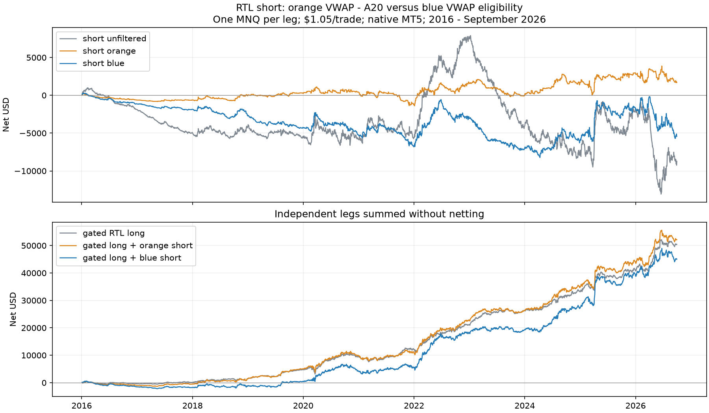

# RTL short: blue VWAP versus orange VWAP - A20

2026-10-31. User-requested native MT5 follow-up to the
[orange-line study](SHORT_RESULTS.md). [Frozen protocol](SHORT_LINE_PROTOCOL.md).

**Using blue VWAP is worse in both primary periods.** Shorts below blue lose
$4,302 in 2016-19 and $1,122 in 2020-September 2026, versus orange's small
+$243 / +$1,454. Blue trades about three times as often and has substantially
larger drawdowns. No adoption; orange remains the EA's default choice.

## Switch and unchanged entry

The installed tester-only EA is `CodexShortVwap\RTL_short_vwap`.
Set `UseVwapGate=true`, then choose `VwapFilterLine`:

| Choice | Condition on the completed signal close |
|---|---|
| Orange cutoff (0, default) | close < VWAP + VwapFarBelowZ × A20; default Z=-1 |
| Blue line (1) | close < VWAP |

This switches the eligibility cutoff. The **actual entry stays a sell stop
at the green M30 candle's low**, with a stop at its high. There is no order
at the VWAP price itself. Blue session VWAP and orange VWAP - A20 retain
their definitions. Equality and unknown/stale values do not qualify. Existing
position and pending-order management, 1R bar-close exit, no run cap, session
windows, early closes and 23:30 flatten/fallback are unchanged. The shared
known-label rule still requires A20 availability in blue mode.

One MNQ ($2/point), MT5 1-minute OHLC, $1.05 per completed trade. Same history,
causal real-volume labels and dates as the original test. Periods use
submission sessions; recent data ends September 30, 2026. Drawdowns below
are daily closed equity after costs, not intratrade equity.

## Native results

| Period | Short version | Trades | Net $ | Net PF | Daily DD $ | Mean gross R | Mean net R |
|---|---|---:|---:|---:|---:|---:|---:|
| 2016-19 | Unfiltered | 6,457 | -5,492 | 0.927 | 6,730 | -0.019 | -0.117 |
| 2016-19 | Orange | 640 | +243 | 1.026 | 1,089 | -0.038 | -0.109 |
| 2016-19 | Blue | 2,116 | -4,302 | 0.837 | 4,643 | -0.087 | -0.186 |
| 2020-Sep 2026 | Unfiltered | 11,176 | -3,228 | 0.993 | 20,967 | -0.002 | -0.027 |
| 2020-Sep 2026 | Orange | 1,217 | +1,454 | 1.024 | 2,772 | -0.006 | -0.023 |
| 2020-Sep 2026 | Blue | 3,710 | -1,122 | 0.993 | 7,667 | -0.016 | -0.040 |
| Pooled 2016-26 | Orange | 1,857 | +1,697 | 1.024 | 2,772 | -0.017 | -0.053 |
| Pooled 2016-26 | Blue | 5,826 | -5,424 | 0.971 | 8,515 | -0.042 | -0.093 |

Blue's closed-trade DD is $4,698 early / $7,773 recently (pooled $8,557).
Mean gross and net R are negative in both primary eras, so costs alone do
not explain its weakness on an equal-initial-risk basis. The minimum
positive-net-dollars screen fails in both primary periods.

Four-week circular block bootstrap (5,000 draws) gives blue mean-net-R 95%
intervals [-0.258, -0.115] early and [-0.083, +0.002] recently; pooled
[-0.134, -0.053]. Those intervals describe this reused historical sample,
not independent confirmation or future-return probabilities.

| Extra cost per trade | Early blue net $ | Recent blue net $ | Pooled blue net $ |
|---|---:|---:|---:|
| $0 (base cost $1.05) | -4,302 | -1,122 | -5,424 |
| $1 | -6,418 | -4,832 | -11,250 |
| $2 | -8,534 | -8,542 | -17,076 |

Blue loses in every year of 2010-21. Its only positive years are 2022
(+$3,586), 2024 (+$1,077) and 2025 (+$4,255); 2023 loses $4,041 and
January-September 2026 loses $3,665. Descriptive 2010-15: -$4,241, 3,035
trades, PF 0.780. The full annual table is saved with the run.

## Illustrative combination with gated RTL longs

The long stays on its original orange gate. Each leg has one MNQ and is
summed independently, without netting opposite positions. This is not a
single-account netting or switching replay.

| Period | Combination | Net $ | Daily DD $ |
|---|---|---:|---:|
| 2016-19 | Gated long alone | 4,721 | 986 |
| 2016-19 | Long + orange short | 4,964 | 1,868 |
| 2016-19 | Long + blue short | 419 | 2,785 |
| 2020-Sep 2026 | Gated long alone | 45,725 | 3,158 |
| 2020-Sep 2026 | Long + orange short | 47,179 | 4,290 |
| 2020-Sep 2026 | Long + blue short | 44,603 | 4,893 |

Blue reduces profit and raises drawdown versus gated long alone in both
primary eras. It also loses to the orange-short combination on both metrics.



## Verification and reproduction

- New orange option: original ON ledger **byte-identical**, all **2,646**
  full-history trades and six native totals unchanged.
- Orange: **92,585** candidate decisions, **5,855** eligible, **5,853**
  original sell-stop orders. Blue: **87,233** decisions, **19,907** eligible,
  **19,902** original sell-stop orders and **8,861** full-history fills.
- Zero decision mismatches for known/eligible/allowed flags, logged selection,
  cutoff, signal close, VWAP and A20. All actual original orders, including
  unfilled/canceled ones, match eligible green signal candles and their
  low/high entry-stop levels. Unknown values never allow an order.
- Native reports match raw ledgers and tester totals. Completed report/output
  hashes verified. Independent arithmetic check passes for eight short-period
  rows, 34 annual short rows and combined profit/trade counts.
- Source generator reproduces the installed EA source. Compilation has
  **0 errors, 0 warnings**. Both native tester processes return zero.
  The previous installed binary is preserved in the run folder.

Evidence: `Reports/rtl_short_vwap_lines_20261031/`, including source/binary,
full explicit INIs, orange/blue `.set` presets, native reports, raw trade and
candidate logs, frozen hashes, period/annual tables, bootstrap intervals,
chart, `orange_validation.json`, `verification.json` and
`independent_verification.json`.

```powershell
.\venv\Scripts\python.exe python\analyze_rtl_short_vwap_lines.py
.\venv\Scripts\python.exe python\verify_rtl_short_vwap_lines.py
```

Preparation: `prepare_rtl_short_vwap_lines.py prepare` then `compile`.
Execution: `run_rtl_short_vwap_lines.py orange` then `blue`; blue requires
orange validation. These commands preserve completed outputs and refuse to
close an existing terminal. Manual testers can load the matching `.set`
from the run folder; use a fresh `RunTag` for new manual runs. The short EA
remains tester-only. [MT5 input instructions](MT5_EA.md#rtl-short-cutoff-switch-2026-10-31).
