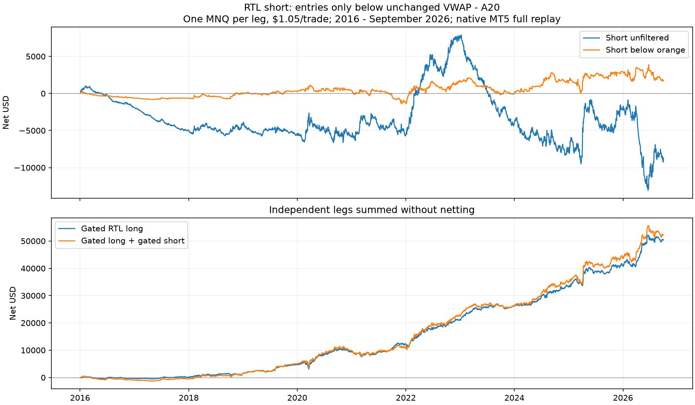

# RTL short only below the unchanged orange VWAP line

2026-10-31. User-requested exploratory test on existing NQ history.
[Protocol](SHORT_PROTOCOL.md). Both arms ran in native MT5.

**The filter removes most short losses, but the remaining dollar profit is
small and fragile.** No baseline change. Gated shorts earn $243 early and
$1,454 recently, with net profit factors 1.026 and 1.024. Another $1 per trade
makes pooled 2016-26 net negative. Adding the short leg increases the gated
long strategy's drawdown in both eras.

## Exact rule and execution

The project's RTL-short definition is the mirror of RTL: a **green M30
candle**, sell stop at its low, stop at its high. This is the existing
`GG_outside_short` control with `UseOutsideFilter=false`, not a new outside
pattern. No run cap; 1R bar-close exit, existing windows, early-close calendar
and 23:30 flatten/fallback unchanged. One MNQ ($2/point), 1-minute OHLC,
$1.05 round-turn cost.

Blue stays session HLC3 VWAP. Orange stays **VWAP - A20**, with A20 the
arithmetic mean of the last 20 completed M30 true ranges. Allow a new short
only if its completed signal close is **strictly below orange**. This is
exactly the known condition blocking longs under the original orange rule.
Equality and unknown/stale values do not qualify. No blue-line alternative
or threshold optimization was tested.

The gate runs after cancellation of a green signal's previous pending order.
Existing positions and pending orders across red bars retain baseline
management. Consequently, eligibility is measured at submission: a resting
order can fill later when price or VWAP has moved. Real-volume causal label
files avoid the tester's synthetic-volume problem. The long EA, indicator
and both chart lines were unchanged. The new short EA is tester-only.

## Short results

Submission sessions define periods; recent history ends September 30, 2026.
Drawdowns below use daily closed equity after costs, not intratrade equity.

| Period | Version | Trades | Net $ | Net PF | Daily DD $ | Mean net R |
|---|---|---:|---:|---:|---:|---:|
| 2016-19 | Unfiltered short | 6,457 | -5,492 | 0.927 | 6,730 | -0.117 |
| 2016-19 | Only below orange, full replay | 640 | +243 | 1.026 | 1,089 | -0.109 |
| 2020-Sep 2026 | Unfiltered short | 11,176 | -3,228 | 0.993 | 20,967 | -0.027 |
| 2020-Sep 2026 | Only below orange, full replay | 1,217 | +1,454 | 1.024 | 2,772 | -0.023 |
| Pooled 2016-26 | Unfiltered short | 17,633 | -8,720 | 0.984 | 20,967 | -0.060 |
| Pooled 2016-26 | Only below orange, full replay | 1,857 | +1,697 | 1.024 | 2,772 | -0.053 |

Gated closed-trade DD is $1,089 early / $2,853 recently. The historical
positive-dollar screen passes in both primary periods, but the margin is
only $0.38 / $1.19 per trade. Mean **gross** R is negative too (-0.038 /
-0.006); dollar profit comes from the size of the winning candles, not
positive average return per equal unit of initial risk.

Four-week circular block bootstrap, 5,000 draws: 95% intervals for gated mean
net R are [-0.231, +0.010] early and [-0.100, +0.054] recently. Both cross
zero. Positive net dollars occur in only 59% / 61% of those bootstrap draws;
these are resampling diagnostics, not probabilities of future profit.

| Cost per trade | 2016-19 gated net $ | 2020-26 gated net $ | Pooled gated net $ |
|---|---:|---:|---:|
| $1.05 | +243 | +1,454 | +1,697 |
| $2.05 | -397 | +237 | -160 |
| $3.05 | -1,037 | -980 | -2,017 |

Gated annual net dollars: 2016 -632; 2017 +25; 2018 +528; 2019 +322;
2020 +188; 2021 -1,690; 2022 +2,868; 2023 -1,694; 2024 +1,813;
2025 +1,227; January-September 2026 -1,258. Profitable in 7 of 11 years;
without 2022, recent net is -$1,414. Descriptive 2010-15 also loses: -$1,380,
789 trades, PF 0.780. These results do not establish a dependable short edge.

## Full replay versus deleting baseline trades

Keeping qualifying trades from the original short ledger alone gives -$50 /
+$2,026 early/recent. Full replay instead gives +$243 / +$1,454 because
withheld orders free the engine for different subsequent signals. In the
replay, trades absent from the original run contribute +$308 / -$734. The
full replay, not the ledger subset, is the strategy result.

## Adding the leg to gated RTL longs

One MNQ per independent leg, summed without netting simultaneous opposite
positions. This is illustrative account arithmetic, not a single-netting-
account or mutually exclusive switching replay. Long results are reused
from the verified original orange-gate MT5 run.

| Period | Version | Net $ | Daily DD $ |
|---|---|---:|---:|
| 2016-19 | Gated RTL long alone | 4,721 | 986 |
| 2016-19 | Gated long + gated short | 4,964 | 1,868 |
| 2020-Sep 2026 | Gated RTL long alone | 45,725 | 3,158 |
| 2020-Sep 2026 | Gated long + gated short | 47,179 | 4,290 |

The short adds 5.1% / 3.2% net profit but increases daily drawdown 89.6% /
35.8%. Pooled profit/drawdown declines from 16.0 to 12.2. It does not improve
the long strategy's historical risk tradeoff.



## Verification and reproduction

- Native OFF reproduces all **27,179** baseline trades **byte for byte** and
  all six checked native tester totals.
- Native ON: **92,585** candidate decisions; **90,351** known, **5,855**
  eligible and **86,730** blocked. All eligibility, known flags, prices,
  VWAP and A20 match the frozen file. All **5,853** actual sell-stop orders,
  including canceled ones, have an allowed decision (two eligible order
  attempts did not produce an original order).
- All **2,646** filled gated trades across 2010-26 originate from green
  signals below orange, with order low/high matching the signal candle.
  Native reports reconcile with raw ledgers and native tester totals.
- A separate arithmetic verifier checks output/report hashes, all eight short
  period rows, 34 short annual rows and combined profit/trade counts.
- EA compilation: **0 errors, 0 warnings**. Both native jobs completed with
  return code zero. No live chart attachment or live execution.

Evidence: `Reports/rtl_short_vwap_20261031/` contains frozen inputs, both INIs,
compiled EA, native HTML reports, decision logs, trade ledgers, summaries,
annual and attribution tables, bootstrap intervals, equity chart,
`baseline_validation.json`, `verification.json` and
`independent_verification.json`.

```powershell
.\venv\Scripts\python.exe python\analyze_rtl_short_vwap.py
.\venv\Scripts\python.exe python\verify_rtl_short_vwap.py
```

For a fresh study folder, `prepare_rtl_short_vwap.py prepare` writes every
input, `compile` builds the EA, and `run_rtl_short_vwap_native.py off` / `on`
runs the arms. Completed outputs are preserved; the runner refuses to stop
an existing terminal. The historical sample was reused for this new idea;
no untouched out-of-sample or live claim is made.
