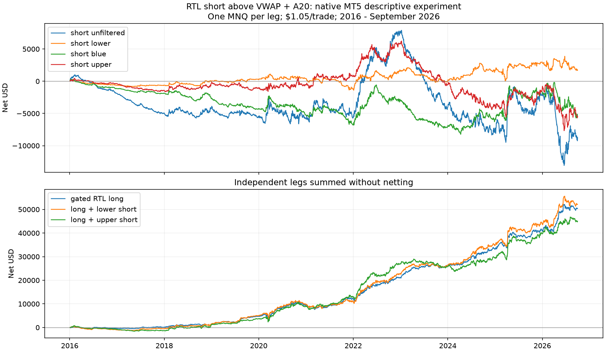

# RTL short above VWAP + A20

2026-11-01. User-requested descriptive experiment on reused NQ history.
[Protocol](SHORT_UPPER_PROTOCOL.md). [Feature-file manual](FEATURE_FILE_GUIDE.md).

**Overextension does not produce a consistent profitable short strategy in
this test.** Above VWAP + A20 loses $1,016 early and $4,414 recently after
$1.05 per trade. Recent daily closed-equity drawdown is $13,913. The tiny
positive early mean gross R (+0.006) reverses recently (-0.025). No adoption.

## Exact mirror condition

Allow a new short only when the completed **green M30 signal closes strictly
above session VWAP + A20**. Sell stop at that candle's low, stop at its high,
1R bar-close exit, no run cap, existing windows, early-close calendar and
flatten/fallback unchanged. The condition is checked at submission, so a
resting order can fill later after price or VWAP has moved. Equality and
unknown labels never qualify. This is an upper-band entry filter, not a
market short or limit order placed at VWAP + A20.

The separate installed tester-only EA is
`CodexShortVwapUpper\RTL_short_vwap_upper`. Upper settings:
`VwapFilterLine=Orange`, `VwapFarBelowZ=+1`, `ShortVwapSide=Above line`.
**Changing the offset to +1 without reversing the side would test a different
rule.** The original lower/blue EA remains unchanged. The upper EA also
supports Below line for the reproduction control. To draw the upper orange
line on a chart, use the indicator's `FarBelowZ=+1`.

No new threshold-specific feature file is needed: labels already contain
VWAP and A20 separately. This experiment reuses the exact same label bytes.

## Native MT5 results

One MNQ ($2/point), 1-minute OHLC, $1.05 per completed trade. Periods use
submission sessions; recent data ends September 30, 2026. DD below means
daily closed equity after costs, not intratrade equity.

| Period | Short condition | Trades | Net $ | Net PF | Daily DD $ | Mean gross R | Mean net R |
|---|---|---:|---:|---:|---:|---:|---:|
| 2016-19 | Unfiltered | 6,457 | -5,492 | 0.927 | 6,730 | -0.019 | -0.117 |
| 2016-19 | Below VWAP - A20 | 640 | +243 | 1.026 | 1,089 | -0.038 | -0.109 |
| 2016-19 | Below VWAP | 2,116 | -4,302 | 0.837 | 4,643 | -0.087 | -0.186 |
| 2016-19 | **Above VWAP + A20** | **2,197** | **-1,016** | **0.963** | **2,079** | **+0.006** | **-0.075** |
| 2020-Sep 2026 | Unfiltered | 11,176 | -3,228 | 0.993 | 20,967 | -0.002 | -0.027 |
| 2020-Sep 2026 | Below VWAP - A20 | 1,217 | +1,454 | 1.024 | 2,772 | -0.006 | -0.023 |
| 2020-Sep 2026 | Below VWAP | 3,710 | -1,122 | 0.993 | 7,667 | -0.016 | -0.040 |
| 2020-Sep 2026 | **Above VWAP + A20** | **3,961** | **-4,414** | **0.976** | **13,913** | **-0.025** | **-0.046** |

Pooled upper short, 2016-26: 6,158 trades, -$5,429.90, PF 0.974,
mean gross/net R -0.014 / -0.056. Closed-trade DD is $2,088 early /
$14,039 recently. The minimum positive-net-dollar screen fails in both eras.
Before costs, dollars are +$1,290.50 early / -$254.50 recently; costs alone
do not explain the recent loss.

Four-week circular block bootstrap (5,000 draws) puts upper mean-net-R 95%
intervals at [-0.131, -0.020] early and [-0.085, -0.007] recently. Both are
below zero in this historical sample; these are descriptive intervals, not
an untouched out-of-sample test.

| Extra cost per trade | Early upper net $ | Recent upper net $ | Pooled upper net $ |
|---|---:|---:|---:|
| $0 (base cost $1.05) | -1,016 | -4,414 | -5,430 |
| $1 | -3,213 | -8,375 | -11,588 |
| $2 | -5,410 | -12,336 | -17,746 |

Upper shorts profit in 5 of 11 years from 2016: 2018 +$1,091; 2020 +$439;
2021 +$1,387; 2022 +$4,996; 2025 +$2,430. Losses include 2023 -$6,390,
2024 -$3,059, and January-September 2026 -$4,216. The full annual table is
saved with the study. Descriptive 2010-15 also loses: -$4,717 on 3,275 trades,
PF 0.799.

## Summed with the original gated RTL long

Independent one-MNQ legs summed without netting opposite positions; this is
not a switching or single-netting-account execution replay.

| Period | Version | Net $ | Daily DD $ |
|---|---|---:|---:|
| 2016-19 | Gated long alone | 4,721 | 986 |
| 2016-19 | Long + lower short | 4,964 | 1,868 |
| 2016-19 | Long + upper short | 3,705 | 2,404 |
| 2020-Sep 2026 | Gated long alone | 45,725 | 3,158 |
| 2020-Sep 2026 | Long + lower short | 47,179 | 4,290 |
| 2020-Sep 2026 | Long + upper short | 41,311 | 5,247 |

The upper short reduces profit and increases DD versus gated long alone in
both primary eras. Nothing in this result supports adding it.



## Verification, files and reproduction

- New EA's lower/-1 control reproduces all **2,646** original lower-band
  trades byte for byte and all six checked native tester totals.
- Upper/+1: **85,543** candidate decisions, **83,309** known, **25,549**
  eligible, **25,548** original sell-stop orders and **9,433** full-history
  filled trades. All candidate flags, side/line selection, cutoffs, VWAP,
  A20 and signal closes match the file; zero mismatches.
- All original orders, including unfilled/canceled orders, originate from
  eligible green signal bars with entry/SL at their low/high. All filled
  trades pass the same check. Native reports reconcile with raw ledgers and
  tester totals. Independent arithmetic and output/report hash checks pass.
- Both native processes return zero. EA compilation: **0 errors, 0 warnings**.
  The previous lower/blue EA and its historical inputs are preserved.
- The new exporter passes **7 tests** covering weighting, session resets,
  completed-bar availability, no future leakage, bad data, partial bars,
  date boundary and overwrite protection. Re-exporting the existing feature
  panel and rebuilding from all 5,511,965 M1 rows (with the same availability
  cutoff) each reproduce all **191,781** historical label rows **byte for
  byte**, including 191,755 known rows. SHA256:
  `ccec54cb4ca00e7923537f191333929ff9ce868cee8ba79e51fb7226487bd557`.

Evidence: `Reports/rtl_short_vwap_upper_20261101/` contains native reports,
INIs, `.set` presets, source/binary, frozen input/output hashes, decision logs,
trade ledgers, summaries, annual table, chart, lower-control validation,
independent verification and exporter verification.

```powershell
.\venv\Scripts\python.exe python\analyze_rtl_short_vwap_upper.py
.\venv\Scripts\python.exe python\verify_rtl_short_vwap_upper.py
.\venv\Scripts\python.exe -m unittest discover -s python -p test_export_vwap_labels.py -v
```

Preparation/compilation: `prepare_rtl_short_vwap_upper.py prepare` / `compile`.
Native execution: `run_rtl_short_vwap_upper.py lower` / `upper`. Completed
outputs are preserved, and an existing terminal is never closed by the runner.
[Brief feature-file manual](FEATURE_FILE_GUIDE.md).
