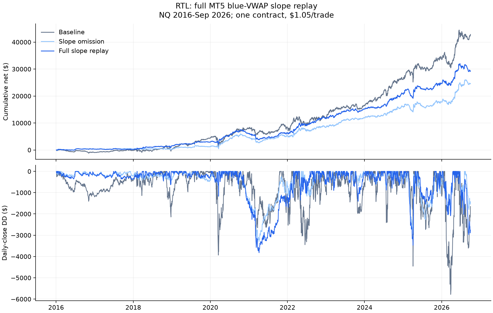

# RTL blue VWAP slope: full MT5 replay

Completed 2026-11-01 under the [replay plan](SLOPE_REPLAY_PROTOCOL.md).
**The replay increases profit compared with omission, but the improvement over
unfiltered RTL in pooled profit/drawdown ratio remains modest.** Blue VWAP slope
is the only new condition: no price-versus-blue or orange-cutoff requirement.

## Native results

Slope OFF reproduces all 25,833 baseline trades byte for byte. The ON run permits
new orders only for a positive change between consecutive same-session M30 VWAP
endpoints. Flat, falling and unavailable slopes block. Pending-order cancellation
runs before the gate; existing exit rules and fills apply; no slope check at fill.
Withheld orders can free later signals to trade.

One contract, $2/point and $1.05 external cost/trade. Submission-session attribution,
daily-close drawdown and frozen observed calendar match the descriptive study.
2026 ends in September; 2010-15 is secondary.

| Era | Curve | Trades | Net | Mean net R | Daily-close DD | Net/DD |
|---|---|---|---|---|---|---|
| 2016-19 | baseline | 6,167 | $4,417 | -0.0143 | $2,143 | 2.06 |
| 2016-19 | replay | 3,199 | $2,924 | -0.0102 | $629 | 4.65 |
| 2016-19 | omission | 2,408 | $1,200 | -0.0090 | $608 | 1.97 |
| 2020-26 | baseline | 10,501 | $38,400 | +0.0476 | $5,781 | 6.64 |
| 2020-26 | replay | 5,207 | $26,338 | +0.0713 | $3,823 | 6.89 |
| 2020-26 | omission | 3,938 | $23,421 | +0.0821 | $3,296 | 7.11 |
| 2016-26 | baseline | 16,668 | $42,817 | +0.0247 | $5,781 | 7.41 |
| 2016-26 | replay | 8,406 | $29,262 | +0.0403 | $3,823 | 7.65 |
| 2016-26 | omission | 6,346 | $24,620 | +0.0475 | $3,296 | 7.47 |
| 2010-15 | baseline | 9,164 | $-7,496 | -0.1810 | $8,254 | -0.91 |
| 2010-15 | replay | 4,481 | $-4,151 | -0.2260 | $5,131 | -0.81 |
| 2010-15 | omission | 3,373 | $-3,411 | -0.2304 | $4,261 | -0.80 |

## What changes in a replay

Over 2016-Sep 2026, the replay takes 8,406 trades versus omission's 6,346:
2,060 more trades overall. Net rises $4,641.50, while maximum daily DD rises
$527.25. Mean net R falls from +0.0475 to +0.0403. The net trade-count difference
does not mean the surviving trade sets are nested; later entries can change which
subsequent baseline trades are available.

Compared with unfiltered RTL, pooled replay net is 31.7% lower and DD 33.9% lower.
Net/DD rises from 7.41 to 7.65 (about 3.3%). In 2016-19, net/DD improves from
2.06 to 4.65 and DD falls strongly, but mean net R is still negative. In 2020-26,
net/DD improves only from 6.64 to 6.89, with substantially less total profit.
2010-15 remains unprofitable. Dollar profit and average R differ because trade
risks vary and external commission weighs more heavily on narrow signals.

This is exploratory known-history reuse, without optimization, a fresh sample,
or a significance claim. The result describes a smaller-profit, smaller-drawdown
strategy path; it does not establish a reliable improvement for future trading.
The research EA is tester-only and was not attached to a live chart.

## Checks and evidence

- Both builds: zero compiler errors/warnings. All 25,833 OFF trade ledger rows
  reproduce the baseline byte for byte; native report, ledger and totals reconcile.
- OFF: 60,194 candidate decisions checked. ON: 77,182 checked, 48,996 blocked.
  Each known/blocked flag matches a separate frozen-feature slope calculation.
- Every filled ON trade maps to an accepted rising-slope source signal, with
  requested high and initial stop low matching the source candle.
- Native profit is reconstructed from entry/exit prices at $2/point; every ledger
  profit and entry/exit timestamp agrees with the report. Net deducts $1.05/trade.
- Baseline/omission summaries reproduce the descriptive study. Replay daily DD is
  independently accumulated from zero through the full observed calendar.

The first OFF attempt stopped after the frozen feature window at the October edge.
It is preserved in `Reports/rtl_vwap_slope_replay_20261101/`. The corrected version
treats beyond-window data as unavailable: OFF allows, strict ON blocks. Successful
evidence is in `Reports/rtl_vwap_slope_replay_20261101_v2/` (gitignored), including
hashes, configs, frozen sources/labels, native reports, ledgers, logs, candidate
decisions, summaries and `verification.json`. Published periods exclude October.

Code: [preparation](../../../python/prepare_rtl_vwap_slope_replay.py),
[tester-only gate](../../../mt5/experts/slope_replay_research.mqh),
[verification](../../../python/verify_rtl_vwap_slope_replay.py),
[report](../../../python/report_rtl_vwap_slope_replay.py).
