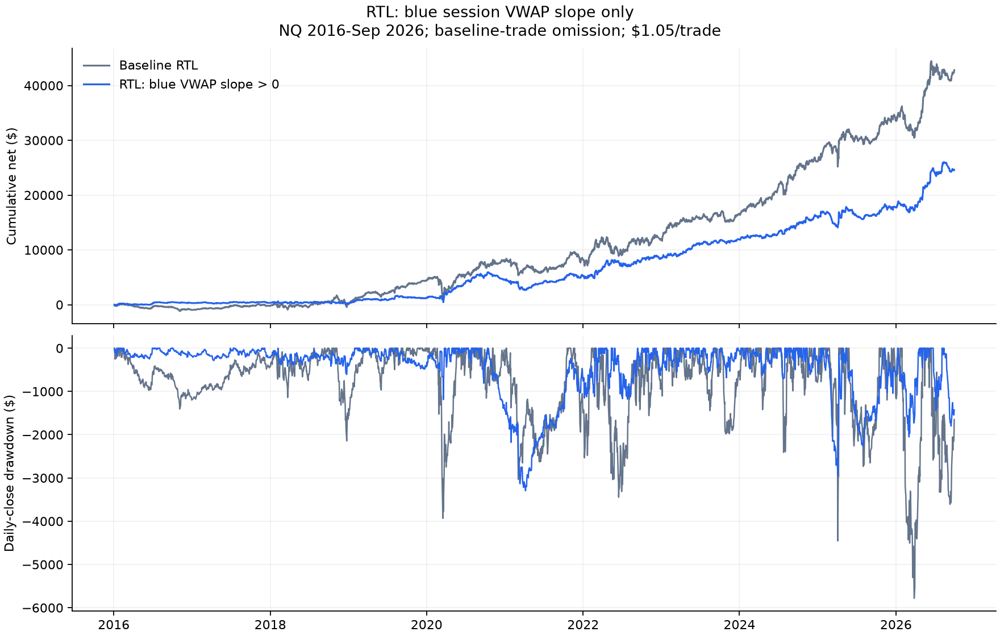

# RTL: trading only when blue VWAP slopes upward

Completed 2026-11-01. **Blue session VWAP slope only, RTL only.** There is no
requirement for the signal price to be above VWAP or any offset line. The user's
[scope amendment](SLOPE_BLUE_PROTOCOL.md) narrowed publication after initial
descriptive calculations; the initial [plan](SLOPE_PROTOCOL.md) and evidence remain
preserved. The preceding GG open/close study is committed as `c52a51d`.

**Rising-only reduces both profit and drawdown, with little improvement in their
pooled ratio.** It retains fewer, smaller-risk trades with a higher mean net R, but
many trades taken while VWAP is falling are also profitable in aggregate. These
results support a description of the trade-off, not a claim that down-slope periods
are uniformly unfavorable.

## Exact rule

At a completed red signal candle, measure `delta = VWAP[t] - VWAP[t-1]`, where the
two VWAP values are at consecutive M30 closes within the same session. Positive
delta permits the normal RTL entry order; negative or zero delta blocks it.
Unknown slope also blocks under this strict rule. Session resets and missing bars
never create a synthetic slope. No A20 warmup is required.

The signal candle is included; the slope is known at order submission. No slope
check is made at a subsequent fill. Units are price points per 30 minutes, not a
screen angle. One fixed interval, no smoothing or magnitude-threshold optimization.

## Results after costs

One contract, $2/point, $1.05 per trade. Same baseline fills and exits; periods are
attributed by submission session. **This is baseline-trade omission, not a native
MT5 replay.** The 2010-15 period is secondary; 2026 ends in September.

| Era | Policy | Trades | Net | Mean net R | Daily-close DD | Net/DD |
| --- | --- | --- | --- | --- | --- | --- |
| 2016-19 | baseline | 6,167 | $4,417 | -0.0143 | $2,143 | 2.06 |
| 2016-19 | rising | 2,408 | $1,200 | -0.0090 | $608 | 1.97 |
| 2020-26 | baseline | 10,501 | $38,400 | +0.0476 | $5,781 | 6.64 |
| 2020-26 | rising | 3,938 | $23,421 | +0.0821 | $3,296 | 7.11 |
| 2016-26 | baseline | 16,668 | $42,817 | +0.0247 | $5,781 | 7.41 |
| 2016-26 | rising | 6,346 | $24,620 | +0.0475 | $3,296 | 7.47 |
| 2010-15 | baseline | 9,164 | $-7,496 | -0.1810 | $8,254 | -0.91 |
| 2010-15 | rising | 3,373 | $-3,411 | -0.2304 | $4,261 | -0.80 |

In 2016-Sep 2026, rising-only keeps 6,346 of 16,668 trades (38.1%). Net profit
falls 42.5%, from $42,816.60 to $24,620.20; maximum daily drawdown falls 43.0%,
from $5,781.15 to $3,295.75. Net/DD moves only from 7.41 to 7.47.

Mean net R rises from +0.0247 to +0.0475. That improvement is not the same as a
large improvement in the dollar equity curve: the retained trades carry about
32.5% of total planned initial risk. In 2016-19, mean net R remains negative and
net/DD is slightly lower. In 2020-26, both improve modestly. The secondary
2010-15 history remains unprofitable, and mean net R deteriorates from -0.181 to
-0.230. Net/DD ratios on losing policies are not useful evidence of improvement.

## Rising, falling and unavailable slope

| Slope | Trades | Net | Mean net R | Profit factor |
| --- | --- | --- | --- | --- |
| up | 6,346 | $24,620 | +0.0475 | 1.15 |
| down | 9,369 | $17,689 | +0.0122 | 1.06 |
| flat | 0 | $0 | — | — |
| unknown | 953 | $508 | -0.0049 | 1.02 |

The filter removes 9,369 falling-slope trades earning **$17,688.55** and averaging
**+0.0122 net R**. Their average is weaker than the rising group, but their aggregate
profit is positive. No exactly flat slopes occur in this sample.

The 953 unknown slopes contribute +$507.85 net. Of these, 400 lack a preceding
same-session VWAP and 553 are submissions in a new session referencing an older
signal candle. Session-start unavailable trades lose $1,648; the older-signal
group earns $2,155.85. They are not classified as falling slopes.

## Exposure and availability diagnostics

| Policy | Trades | Net | Daily-close DD | Baseline planned risk retained | Net/DD |
| --- | --- | --- | --- | --- | --- |
| baseline | 16,668 | $42,817 | $5,781 | 100.0% | 7.41 |
| rising | 6,346 | $24,620 | $3,296 | 32.5% | 7.47 |
| known_baseline | 15,715 | $42,309 | $5,175 | 96.0% | 8.18 |
| rising_risk_scaled_baseline | 16,668 | $13,910 | $1,878 | 32.5% | 7.41 |

`known_baseline` keeps every trade with measurable slope, regardless of direction.
It earns $42,309 with $5,175 DD (net/DD 8.18), versus rising-only's $24,620 and
$3,296 (7.47). So the modest ratio improvement against the full baseline does not
persist when both groups use only known slopes.

`rising_risk_scaled_baseline` scales all baseline trades to 32.5% of their size,
matching rising-only's total planned initial risk. It earns $13,910 with $1,878 DD.
Rising-only earns more but also has more drawdown, leaving their profit/DD ratios
close. This is fractional-size arithmetic, not an executable one-contract policy
or a claim that the two paths have identical market risk.

## Annual comparison

| Year | Baseline net | Rising-only net | Baseline DD | Rising-only DD |
| --- | --- | --- | --- | --- |
| 2016.0 | $-972 | $308 | $1,406 | $251 |
| 2017.0 | $761 | $41 | $382 | $254 |
| 2018.0 | $274 | $-132 | $2,143 | $608 |
| 2019.0 | $4,354 | $983 | $968 | $483 |
| 2020.0 | $3,402 | $3,308 | $3,934 | $1,425 |
| 2021.0 | $311 | $671 | $3,031 | $2,040 |
| 2022.0 | $3,683 | $3,337 | $3,447 | $1,180 |
| 2023.0 | $4,661 | $3,423 | $1,983 | $685 |
| 2024.0 | $9,662 | $4,130 | $2,409 | $705 |
| 2025.0 | $7,423 | $1,740 | $4,455 | $2,937 |
| 2026.0 | $9,259 | $6,811 | $5,781 | $2,051 |

## Interpretation and limits

For cumulative VWAP, a rising value means the newest candle's volume-weighted
average minute price exceeds the preceding session VWAP. This is related to price
location, but not identical to the signal close being above VWAP. Its magnitude
also depends on how much volume has already accumulated in the session. Here only
the sign matters.

For this definition and history, the filter concentrates average trade quality
while sacrificing many profitable trades. The main effect is a smaller equity
curve with a smaller drawdown; it does not clearly improve profit per dollar of
maximum drawdown. No statistical significance or fresh confirmation claim.

All results reuse known NQ history and original baseline fills/exits. A real replay
can enter later trades freed by skipped orders, so executable results may differ.
No EA setting, strategy default or live configuration was changed.

## Verification and saved evidence

The initial verifier independently rejoined 25,832 eligible RTL trades to frozen
features, matched signal OHLC/economics, recomputed slope using endpoint subtraction
and the cumulative-VWAP update identity, and checked all daily paths and metrics.
Maximum identity residual was 7.05e-12 points; no sign disagreements or near-zero
ambiguities. Three synthetic tests cover up/down/flat, session reset/gap, missing
VWAP, volume and immunity of past labels to future rows.

Publication rechecks all original input/output hashes and extracts only unconditional
slope policies. Selected rows round-trip exactly; the published rising-only count
and profit are checked directly against `slope_state == up`, with no price-location
condition. The original frozen feature rebuild was not repeated.

Publication tables and manifest: `Reports/rtl_vwap_slope_blue_20261101/`.
Initial independently verified evidence: `Reports/rtl_vwap_slope_20261101/`.
Both directories are gitignored. Code:
[analysis](../../../python/analyze_rtl_vwap_slope.py),
[verification](../../../python/verify_rtl_vwap_slope.py),
[boundary tests](../../../python/test_rtl_vwap_slope.py),
[slope-only publication](../../../python/report_rtl_vwap_slope.py).
