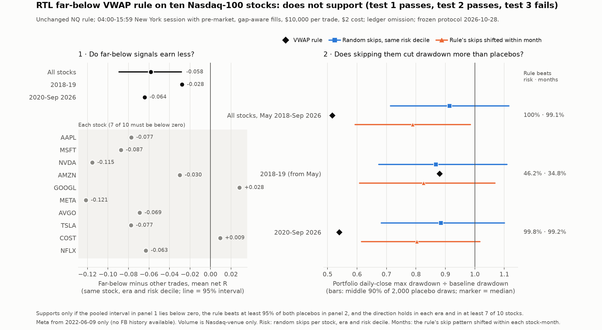

# RTL far-below VWAP rule on Nasdaq-100 stocks: results

Completed 2026-10-28. [Protocol](STOCK_PROTOCOL.md) frozen before any stock label or outcome
(SHA-256 `a12a4172…4e38`). Follows the [cross-instrument test](CROSS_RESULTS.md), and the NQ
[study](RESULTS.md) and [replay](REPLAY_RESULTS.md).

**Verdict: does not support. Tests 1 and 2 pass; test 3 fails.** Across the ten stocks,
far-below signals earn clearly less than signals of similar risk. Over the whole period,
skipping them cuts the portfolio's drawdown far more than random skipping does. But from May
2018 to 2019 the drawdown cut was no better than random skipping, so the protocol's required
consistency fails. As fixed in advance, the VWAP line for RTL closes on history. A forward paper
test on NQ remains possible. No strategy, default or live change.



## What was tested

The unchanged NQ rule: skip a new RTL buy stop when the signal close is below full-session HLC3
VWAP minus A20 (z < -1). Ten stocks: AAPL, MSFT, NVDA, AMZN, GOOGL, META, AVGO, TSLA, COST, NFLX.
Data are Databento Nasdaq exchange 1-minute bars from May 2018. RTL runs in a 04:00-15:59 New York
session that includes the pre-market, with a 15:30 cutoff, gap-aware fills, $10,000 per trade and
$2 cost per trade. The rule is applied by removing trades from the ledger (not a replay). The two
questions and three tests are those of the cross-instrument test, pooled over the stocks into one
portfolio.

## Results

| | All ten stocks | 2018-19 (from May) | 2020-Sep 2026 |
|---|---:|---:|---:|
| Trades / far-below | 60,052 / 11,330 | 9,940 / 1,862 | 50,112 / 9,468 |
| 1. Far-below minus others, mean net R, same stock, era and risk decile | **-0.058** | -0.028 | -0.064 |
| 95% interval | -0.089 to -0.028 | | |
| Baseline net / daily-close DD | +$795 / $37,345 | -$9,722 / $13,517 | +$10,517 / $30,122 |
| Rule net / daily-close DD | +$25,152 / $19,270 | -$6,914 / $11,897 | +$32,066 / $16,259 |
| 2. Rule's DD beats risk placebo | 100% | 46.2% | 99.8% |
| 2. Rule's DD beats months placebo | 99.05% | 34.8% | 99.2% |
| Median placebo DD, risk / months | $34,146 / $29,489 | $11,733 / $11,167 | $26,660 / $24,207 |

- **Test 1 passes:** the whole interval lies below zero.
- **Test 2 passes:** the rule beats 100% and 99.05% of the two placebos.
- **Test 3 fails.** The contrast is below zero in both eras and in 8 of 10 stocks (7 needed).
  But in 2018-19 the rule's drawdown ($11,897) is above the median of both placebos ($11,733
  and $11,167).

| Stock | Far-below trades | Contrast (R) | Net, baseline to rule | DD, baseline to rule |
|---|---:|---:|---:|---:|
| AAPL | 1,167 | -0.077 | +$109 to +$4,317 | $6,148 to $3,980 |
| MSFT | 1,230 | -0.087 | -$13,427 to -$8,122 | $14,727 to $9,326 |
| NVDA | 1,194 | -0.115 | +$15,429 to +$19,151 | $4,522 to $3,993 |
| AMZN | 1,240 | -0.030 | -$3,908 to -$2,420 | $5,743 to $3,809 |
| GOOGL | 1,175 | +0.028 | -$8,038 to -$7,458 | $10,233 to $9,401 |
| META (from June 2022) | 690 | -0.121 | +$9,372 to +$10,425 | $2,777 to $2,088 |
| AVGO | 1,070 | -0.069 | -$1,605 to +$1,750 | $4,858 to $3,917 |
| TSLA | 1,209 | -0.077 | +$16,954 to +$19,226 | $3,974 to $3,533 |
| COST | 1,082 | +0.009 | -$8,938 to -$8,949 | $9,470 to $9,401 |
| NFLX | 1,273 | -0.063 | -$5,154 to -$2,769 | $7,824 to $7,604 |

## What this means

- **It is the strongest evidence so far that far-below signals are weaker trades.** It comes
  from data the rule was not found on: eight of ten stocks and both eras. It also holds away
  from NQ's sell-offs: 63% of the stocks' far-below trades came while NQ was also far below, and
  without them the contrast is still -0.060. On ES, YM and RTY it vanished on that test.
- **The drawdown benefit depends on the period.** From May 2018 to 2019, skipping far-below
  trades was no better than skipping at random; the benefit sits in 2020-26, the same years
  that produced the NQ result.
- **Taken together with the earlier tests,** the picture is mixed. ES, YM and RTY showed no
  effect, and neither did NQ 2010-15. On these stocks there is a per-trade effect, but its
  drawdown value is not stable across periods. That is not enough to count as confirmed, and the
  frozen verdict stands.
- **What remains** is a forward paper test on NQ, which the protocol allows. This result makes it
  more worthwhile than it looked after the futures test. Its rules should be written down before
  it starts.
- **This is about the filter, not about trading stocks.** RTL itself barely breaks even on these
  stocks at $2 a trade (+$795 over the whole period), and loses heavily at $4 and $6.

## Checks, deviations and descriptive results

- **Sources.** Hashes recorded; NVDA matches the frozen file. Every file is `XNAS.ITCH`
  `ohlcv-1m`, 2018-05-01 to 2026-10-27. The simulator (`python/rtl_stock_engine.py`), given NQ's
  session and MT5 fills, reproduces all 25,833 MT5 NQ trades: same minutes, prices and profits,
  plus 18 trades in MT5's warm-up days. Every trade's signal bar is red, at the requested price
  and stop (0 mismatches in 60,052 trades); no order or position crosses a session.
- **Splits.** The nine announced splits all show in the data. AAPL's and TSLA's on 2020-08-31
  deviate 10% and 6% from the exact ratio because of real moves that day. NFLX's -25% on
  2022-04-20 is its earnings reaction, not a split.
- **Early closes.** 18 sessions ending at 13:00, detected from volume (afternoon share near
  zero, against at least 17.8% on every other day) and all in the exchange calendar.
- **Deviation 1:** Databento offered no FB history, so Meta enters from 2022-06-09. Its META bars
  from June 2021 to January 2022 (39,142, an ETF that held the ticker) are excluded. This was
  decided before any outcome.
- **Deviation 2:** 17 one-minute bars carry volume but no price and are dropped. Two fall inside
  the session: GOOGL, 36 shares, and COST, 1 share, both on 2022-09-19.
- **Descriptive.** Without risk matching, the contrast is -0.009, because far-below trades have
  larger stops and pay less cost per R; adjusted for pre-market/regular hours and risk it is -0.085.
  - Regular-hours-only version: contrast -0.068, net +$14,953 to +$34,456, DD $12,747 to $13,040.
  - Yearly drawdown is lower in all 9 years; yearly net is better in 5 of 9.
  - At +$2 and +$4 extra cost the baseline loses $119,309 and $239,413, and the rule $72,292
    and $169,736.

## Verification and reproduction

Independent verification passed, with separate code (`python/verify_rtl_vwap_stocks.py`):

- Its own RTL state machine first matches all 25,833 MT5 NQ trades.
- It then re-reads the raw files and re-simulates all 90,176 stock trades (both sessions),
  matching every one exactly, with their economics.
- Literal VWAP, A20 and z reproduce all 89,292 in-sample labels and signal bars.
- It recomputes every contrast, all 5,000 bootstrap draws, every placebo draw (with count and
  rotation checks), the summaries and the verdict.

6 new focused tests pass (39 VWAP tests in all). The chart was rendered and visually inspected.

Outputs: `Reports/rtl_vwap_stocks_20261028/` (gitignored). Code: `python/analyze_rtl_vwap_stocks.py`,
`rtl_stock_engine.py`, `verify_rtl_vwap_stocks.py`, `report_rtl_vwap_stocks.py`, tests
`test_rtl_vwap_stocks.py`.

```powershell
.\venv\Scripts\python.exe -B python\analyze_rtl_vwap_stocks.py all
.\venv\Scripts\python.exe -B python\verify_rtl_vwap_stocks.py
.\venv\Scripts\python.exe -B -m unittest discover -s python -p 'test_rtl_vwap*.py'
.\venv\Scripts\python.exe -B python\report_rtl_vwap_stocks.py
```
