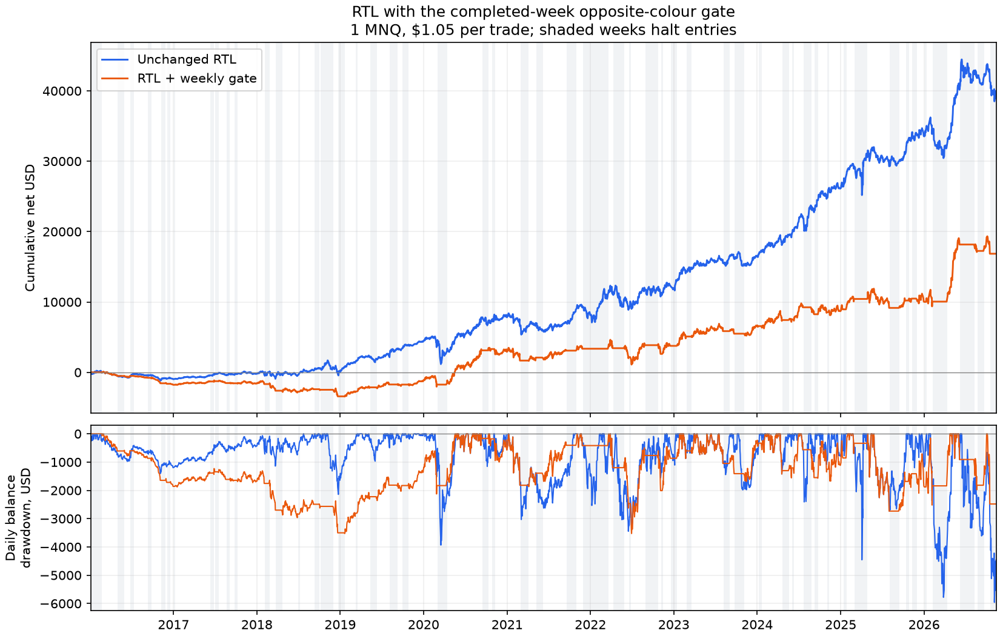

# RTL weekly opposite-colour gate: less profit, lower recent drawdown

2026-11-17. **The exact requested gate does not improve RTL over the main
historical sample.** From 2016 through November 13, 2026, it reduces net profit
from **$40,010.90 to $16,854.95 (-57.9%)**, and maximum intraday equity drawdown
from **$6,584.30 to $3,637.65 (-44.8%)**. Profit per dollar of drawdown falls
from 6.08 to 4.63. In 2016-19 it both loses money and increases drawdown.

[Frozen protocol](PROTOCOL.md) | [All period and annual results](summary.csv) |
[Comparisons and uncertainty](comparisons.csv) | [Verification](verification.json)

## Exact experiment

- Halt new RTL entries when a completed **red** week closes strictly below the
  **low of the most recent earlier green week**, however far back it is.
- Resume when a completed **green** week closes strictly above the **high of
  the most recent earlier red week**.
- Update references after each completed week, including while halted. Dojis
  and equality do not switch state. Start enabled; maintain state between triggers.
- Apply the decision on the next week's first available quote. Cancel pending
  entries while halted; retain ordinary RTL exits for existing positions.

Two full native MT5 backtests: unchanged RTL and RTL plus this gate. M30
entries, no red-run cap, normal 1R close-confirmed target, stop at the signal
low, normal trade windows and daily/early-close flattening. **One MNQ contract,
$1.05 round-trip cost, 1-minute OHLC execution.** No VWAP or cash-open filters.
Raw weekly candles from the newly extended custom symbol
`MNQcontDTBNT20261114`, through November 13, 2026. Roll gaps are preserved.
MT5 labels weekly candles on Sunday; actual source quotes run Monday-Friday.
The independent weekly tables label the same candles by Monday.

This differs from the older [adjacent-week gate](../rtl-weekly-gate/RESULTS.md):
the triggering candle must have the stated colour, and its reference can be
several weeks old. The old study was preserved.

## Native results

Drawdown below is **maximum intraday equity drawdown after costs**, not only
drawdown at daily closes. Each period starts from its own zero profit.

| Period | RTL trades | Gated trades | RTL net | Gated net | RTL max DD | Gated max DD |
|---|---:|---:|---:|---:|---:|---:|
| 2010-15 | 9,164 | 5,970 | -$7,496 | -$6,242 | $8,273 | $6,379 |
| 2016-19 | 6,167 | 4,232 | $4,417 | -$1,199 | $2,348 | $3,590 |
| 2020-Sep 2026 | 10,501 | 6,375 | $38,400 | $19,542 | $5,942 | $3,638 |
| Oct 1-Nov 13, 2026 | 204 | 84 | -$2,806 | -$1,488 | $5,830 | $2,754 |
| 2016-Sep 2026 | 16,668 | 10,607 | $42,817 | $18,343 | $5,942 | $3,638 |
| **2016-Nov 13, 2026** | **16,872** | **10,691** | **$40,011** | **$16,855** | **$6,584** | **$3,638** |



The chart's lower panel shows daily closed-balance drawdown; the table includes
floating intraday losses and therefore has larger drawdown values.

## What the gate removes

Across 2016-November 13 it halts entries in **1,020 of 2,808 sessions (36.3%)**
and removes 6,181 trades. Those skipped trades earned **$23,155.95 net**:
$252,051.50 of losing trades avoided, but $275,207.45 of winning trades missed.
Their mean net R was **+0.0561**, compared with **+0.0037** for retained trades.
This comparison is descriptive; it does not show that every halted period was good.

Since 2020 through September, net R per trade barely changes (+0.0476 to
+0.0462), while profit roughly halves. In 2016-19 it deteriorates from -0.0143
to -0.0576. Fixed-contract dollar profits and average R can have different signs
because each trade has a different dollar stop distance.

The native replay confirms that the gated trades are exactly the retained
subset of the control, with **zero replacement trades**. There were no pending
orders or open positions at halted weekly boundaries, and no fills during a
halt. Daily flattening had already removed them. Cancellation and existing
position handling were nevertheless implemented and tested with synthetic cases.

Over all available history there were 75 halt episodes and 74 resumptions;
308 of 857 next-week states were halted. The last observed switch was a halt
effective October 19, 2026. [Weekly decisions](weekly_decisions.csv) and
[halt intervals](halt_periods.csv) expose every reference level and switch.
The final interval is censored at the dataset end, not an observed resumption.

## Is the smaller drawdown worth the lost profit?

For 2020-September 2026, the gate retains 61.3% of baseline holding time.
A theoretical uniformly scaled baseline at that exposure earns **$23,549**
with **$3,644** equity drawdown. The gate earns **$19,542** with **$3,638**:
essentially the same drawdown, about $4,007 less profit. Fractional MNQ size is
an analytical benchmark, not an executable one-contract position.

For 2016-November 13, the equivalent exposure-scaled baseline earns $25,424
with $4,184 drawdown, versus the gate's $16,855 / $3,638. The gate has somewhat
lower drawdown but also lower net profit per drawdown dollar.

The small October-November extension favours the gate in absolute loss avoided
($1,317.50), but both arms lose money. It is only 32 sessions and is not
independent forward validation of an idea formed from recent charts. The gate
has higher annual net profit in 3 of 11 years from 2016 through partial 2026.

With another $1 cost per trade, pooled 2016-November net falls to $23,138.90
for RTL and $6,163.95 for the gate; the ordering is unchanged.

The paired weekly-block bootstrap's 95% interval for the gate's net-profit
change is **-$45,766 to -$1,997** over 2016-November 13 (observed -$23,156).
For 2020-September alone it is -$40,287 to +$1,406. These are descriptive
resampling intervals on repeatedly studied history; a single-week bootstrap
does not preserve all longer market-regime dependence.

## Verification and reproducibility

- Both native tester runs compiled with **0 errors and 0 warnings**; EA has a
  tester-only initialization guard. No baseline or live settings changed.
- 5,556,005 raw minute bars; every one of **857 weekly OHLC/colour/reference/
  state decisions** agrees with the independently aggregated raw history.
- The extended control reproduces all **25,832** saved historical trades
  through September 2026 in entry/exit timestamps, PnL and signal range.
- Native ledgers, HTML reports and tester totals reconcile for **26,036
  control trades** and **16,661 gated trades** over the full history.
- Independent minute replay matches all **26,028 / 16,653** trades after the
  tester's first startup session: submissions, entry/exit minutes, prices,
  stops and exit reasons. The first eight trades in each run remain in native
  performance but are excluded from replay comparison because of startup.
- Native full-history gross equity drawdown matches the passive equity
  reconstruction exactly; costs are then deducted at trade closes. The
  established equity-envelope verifier also reconciles period drawdown paths.
- **18 tests pass**: 12 new gate tests and 6 regression tests for the reused
  cancellation, execution and equity routines.
- Input/protocol hashes were frozen before running; outputs and verification
  are saved. Main scripts: `python/prepare_rtl_weekly_opposite_gate.py`,
  `python/rtl_weekly_opposite_gate.py`, `python/test_rtl_weekly_opposite_gate.py`.
  Raw native artifacts: `Reports/rtl_weekly_opposite_gate_20261117/`.

Recalculate the analysis using the existing artifacts:

```powershell
.\venv\Scripts\python.exe python\rtl_weekly_opposite_gate.py
.\venv\Scripts\python.exe -m unittest discover -s python -p test_rtl_weekly_opposite_gate.py -v
.\venv\Scripts\python.exe -m unittest discover -s python -p test_rtl_news_windows.py -v
```

The result applies to this raw continuous-contract chart and session clock.
Different roll adjustment or session definitions can change weekly colours and
break levels. This experiment supplies no case for adopting this gate as an
improvement to RTL's historical profit/drawdown tradeoff.
