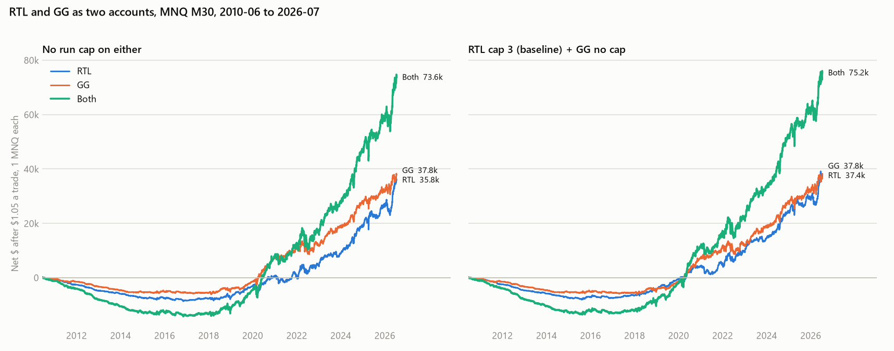
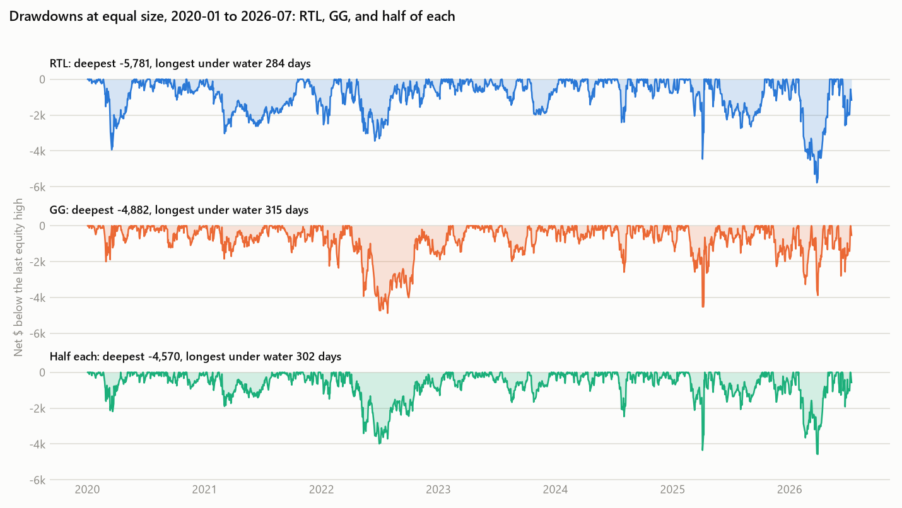

# Signal colour and a no-pattern control (MNQ, control also on MES)

2026-10-08 · Exploratory, no pre-set gate · [Baseline studies](../README.md)

**2026-10-09 audit:** the EA's CSV logger can omit a market-entry trade that is stopped on the very next tick
(found in the [granularity study](../granularity/RESULTS.md)). Every ledger here was audited against MT5's own
order/deal report ([audit_signal_colour_ledgers.py](../../../python/audit_signal_colour_ledgers.py)). Buy-stop
runs missed nothing. Controls missed 72 trades (MNQ) and 127 (MES, plus 2 rows logged with the next trade's risk
on ES flatten-gap days). Every figure below uses the audited ledgers; all audited totals match MT5 exactly. The
corrections move control figures by 0.002–0.005 R and change no conclusion.

**2026-10-13 correction (user's catch):** `MaxRedRun = 3` was chosen and tested for RTL only. The "Green, cap 3"
rows and the first RTL + GG table below apply it to GG without a test. The
[GG run-cap test](#gg-run-cap-and-the-combined-equity-curve-2026-10-13) finds no cap that helps GG, so **GG's own
setting is no cap**. Read green from the "no cap" rows; the corrected combined figures and the equity chart are
in that section.

## Summary

- **Question:** is the RTL edge the red candle, any buy stop over the previous bar, or just being long NQ
  while it rises?
- **Not drift.** The control has no pattern: it buys at market at every bar open, with the same stop
  distance and exit. It earns about nothing before costs: +0.009 / +0.007 R (2016–19 / 2020–26), with
  intervals that include zero. It loses after costs.
- **Colour matters little.** Without the run cap, green (the user's GG) and red are close: +0.071 / +0.070 R
  against +0.081 / +0.071. The cap lifts red to +0.093 / +0.085 and does nothing for green (2026-10-13). The
  edge is the **buy stop over a previous M30 high**, not the red candle.
- **Running RTL and GG together** doubles net profit and roughly doubles drawdown. Daily correlation is
  +0.62, so this is about twice the size, not diversification. This matches the user's experience.
  [Equity chart](#gg-run-cap-and-the-combined-equity-curve-2026-10-13).
- **Meaning for forward testing:** the thing to watch is whether buy-stop entries keep beating plain long
  entries on NQ. Here they beat them by about 0.06–0.08 R in 2016–26.

## Setup

- EA: the baseline runband EA with one added input, `SignalMode`. 0 = red (baseline), 1 = green,
  2 = any non-doji candle, 3 = control (market buy at each bar open while flat, stop one previous-candle
  range below). Edits are in `python/prepare_signal_colour.py`. Flatten, early-close calendar, windows and
  exit are unchanged.
- MNQ `MNQcontDTBNT20102026_2`, M30, 1-minute OHLC, 2010-06-07 → 2026-07-14, $1.05 costs, R = profit ÷
  (candle range × $2).
- Checks: mode 0 with cap 3 reproduces the baseline ledger byte for byte. The standalone
  `mt5/experts/GG_r_MFE_buy-stop-entry_runband.cs` (the RTL EA with only the colour flipped; `MinRedRun` /
  `MaxRedRun` keep their names and count green bars) reproduces the green cap-3 run byte for byte.

## Results

Mean R before costs, with 95% intervals from resampling days:

| Run | 2010–15 | 2016–19 | 2020–26 |
|---|---|---|---|
| Red, cap 3 (baseline) | +0.005 [−0.021, +0.031] | +0.093 [+0.059, +0.129] | +0.085 [+0.059, +0.112] |
| Green, cap 3 | +0.019 [−0.007, +0.045] | +0.073 [+0.043, +0.105] | +0.066 [+0.042, +0.091] |
| Red, no cap | +0.006 | +0.081 | +0.071 |
| Green, no cap | +0.022 | +0.071 | +0.070 |
| Any candle | +0.013 | +0.057 | +0.061 |
| Control: market buy, no pattern | −0.036 [−0.057, −0.014] | +0.009 [−0.016, +0.035] | +0.007 [−0.013, +0.027] |

After costs:

| Run | PF 2016–19 | PF 2020–26 | Net $ 2020–26 | Max DD $ 2020–26 | Trades (all) |
|---|---|---|---|---|---|
| Red, cap 3 | 1.106 | 1.107 | 37,981 | 4,847 | 23,427 |
| Green, cap 3 | 1.051 | 1.084 | 35,626 | 5,675 | 24,852 |
| Any candle | 1.027 | 1.078 | 40,928 | 5,803 | 32,960 |
| Control | 0.952 | 1.006 | 4,847 | 11,587 | 35,872 |

RTL + GG (cap 3 on both; superseded by the [2026-10-13 tables](#gg-run-cap-and-the-combined-equity-curve-2026-10-13))
as two accounts, summed by exit day:

| Period | RTL net / DD | GG net / DD | Both net / DD |
|---|---|---|---|
| 2016–19 | 6,485 / 1,412 | 3,701 / 1,619 | 10,186 / 3,032 |
| 2020–26 | 37,981 / 4,352 | 35,626 / 4,881 | 73,607 / 8,517 |

- **By year:** every buy-stop variant follows the same path. All lose 2010–17 after costs and all are positive
  2018–26. The control is negative or near zero in almost every year.
- **2010–15:** buy-stop entries already beat the control by about 0.04–0.06 R before costs. But candles
  were small, so costs were 0.19 R per trade (0.03 R in 2020–26) and outweighed it.
- "Any candle" is below both red and green. One mechanical difference: in red or green mode a resting order
  survives opposite-colour bars, so some entries are at an older high. In "any" mode the order always
  moves to the latest bar. Why this matters is not tested.

## MES: same control (2026-10-08)

The user asked for the same market-buy control on MES. Red cap 3 was rerun with the same EA and
reproduces the [MES baseline](../mes-unseen-instrument/RESULTS.md) byte for byte.

Mean R before costs. The middle column is the gain over the control: red minus control, with a 95%
interval from resampling days jointly.

| | Control (plain long) | Gain over control | = Red baseline |
|---|---|---|---|
| MNQ 2010–15 | −0.036 | +0.041 [+0.016, +0.064] | +0.005 |
| MNQ 2016–19 | +0.009 | +0.085 [+0.056, +0.113] | +0.093 |
| MNQ 2020–26 | +0.007 | +0.078 [+0.056, +0.101] | +0.085 |
| MES 2010–15 | −0.147 | +0.029 [+0.007, +0.051] | −0.118 |
| MES 2016–19 | −0.083 | +0.044 [+0.016, +0.070] | −0.039 |
| MES 2020–26 | −0.040 | +0.042 [+0.021, +0.062] | +0.002 |

- **The buy-stop gain exists on ES too.** In every period it is positive with an interval above zero, about
  half the NQ size (+0.04 vs +0.08 R). This comparison was decided on MNQ before the MES control was run.
  MES itself had already been seen in the baseline test, so this is supporting evidence, not a clean
  confirmation.
- **The instruments differ in the plain-long control.** On NQ a long entered at the bar open with this stop
  and exit breaks even before costs (2016–26). On ES it loses −0.04 to −0.08 R. That fits ES being more
  mean-reverting intraday than NQ, but this is not tested here. So the buy-stop gain only shows up as
  profit where the plain long is not negative.
- **Correction to the MNQ summary above:** "not drift" holds in that the plain long earns ~0 on NQ. But
  the plain long is exactly where NQ and ES differ, so the market's character (drift, trend vs reversion)
  does decide whether the strategy pays.

## Candle size in ticks (exploratory, 2026-10-08)

Does ES lag because its candles span fewer ticks? Both instruments have a 0.25 tick, so the question is
ticks per candle. Gross mean R in 2016–26, by signal-candle size ([script](../../../python/analyze_tick_buckets.py)):

| Ticks | NQ control | NQ red | ES control | ES red | NQ trades (ctrl) | ES trades (ctrl) |
|---|---|---|---|---|---|---|
| <8 | −0.184 | −0.004 | −0.266 | −0.141 | 125 | 2,623 |
| 8–16 | −0.076 | +0.088 | −0.072 | −0.030 | 1,033 | 5,804 |
| 16–24 | +0.005 | +0.111 | −0.056 | +0.035 | 1,361 | 4,301 |
| 24–32 | +0.056 | +0.076 | +0.013 | +0.050 | 1,371 | 2,960 |
| 32–48 | +0.031 | +0.150 | +0.010 | +0.035 | 2,541 | 3,362 |
| 48–64 | −0.010 | +0.089 | −0.038 | +0.003 | 2,245 | 1,950 |
| 64–128 | +0.009 | +0.088 | −0.021 | −0.001 | 5,939 | 2,657 |
| >128 | +0.010 | +0.061 | +0.053 | +0.074 | 8,875 | 768 |

- **Small candles hurt both instruments.** Under 16 ticks the plain long loses on both, and ES has far more
  of these trades: 34% of ES control trades vs 5% on NQ. Tick granularity explains part of ES's negative
  plain long.
- **It is not the whole answer.** At the same candle size (16–128 ticks), NQ red still earns +0.08 to +0.15 R
  against ES's 0.00 to +0.05.
- Each cell holds 1,000–9,000 trades, so a single cell is noisy (about ±0.03 R). Candle size is also tied
  to time of day and to calm vs volatile years, which differ between the instruments.

## GG run cap and the combined equity curve (2026-10-13)

**Why:** the run cap was chosen for RTL. Using it on GG was an untested assumption. Two fixes were possible:
compare both without the cap, or test a cap for GG. Both are done here.

**Protocol, fixed before the runs** (the [RTL rule](../maxredrun/RESULTS.md), applied to green):

- Same EA, `SignalMode = 1`. `MaxRedRun` counts consecutive green bars. Caps off, 1, 2, … 7. Eight full-period
  runs, split by entry year.
- Train 2016–19: winner = highest gross PF. A tie within 0.005 goes to the larger cap (off is the largest).
- Test 2020–26: the winner against off. It passes if net PF is higher and net drawdown is lower.
- The cap 3 and off runs reproduce the 2026-10-08 green ledgers exactly. All eight match MT5's own totals.

**Result: no cap passes. GG keeps no cap.**

| Cap | 1 | 2 | 3 | 4 | 5 | 6 | 7 | off |
|---|---:|---:|---:|---:|---:|---:|---:|---:|
| Train gross PF | 1.152 | 1.128 | 1.146 | 1.150 | 1.150 | 1.144 | 1.142 | 1.142 |
| Train net $ | 3,609 | 2,439 | 3,701 | 4,072 | 4,104 | 3,753 | 3,586 | 3,636 |
| Test net PF | 1.078 | 1.080 | 1.084 | 1.089 | 1.082 | 1.085 | 1.087 | 1.088 |
| Test net $ | 30,026 | 32,928 | 35,626 | 38,711 | 36,229 | 37,940 | 38,759 | 39,230 |
| Test net DD $ | 5,071 | 5,791 | 5,675 | 5,641 | 5,632 | 5,632 | 5,270 | 5,316 |

- **Train:** caps 1, 4 and 5 tie within 0.005, so the rule picks 5. The whole row is flat (1.128 to 1.152); there
  is no peak to pick.
- **Test:** cap 5 is worse than off on all three measures (net PF 1.082 vs 1.088, DD 5,632 vs 5,316, net $36.2k
  vs $39.2k). No cap beats off on net $. Cap 3, used on 2026-10-08, costs GG about $3.6k and its drawdown is
  higher, not lower (5,675 vs 5,316).
- **Mean R, cap minus off:** between −0.007 and +0.002 R for every cap in both periods. 13 of the 14 intervals
  include zero.
- **The cap has little to remove on GG:** 76% of GG trades come after a single green candle and 8% after more
  than three. For RTL it is 47% and 12%. Likely reason, not tested: GG enters right after the first green candle
  and is already in a trade while the run goes on.
- Drawdown in this table is trade by trade. The table below uses daily closes, so its figures are a little lower.

**RTL + GG as two accounts, summed by exit day** (net $ after costs / drawdown on daily closes):

| Period | RTL | GG | Both | Daily correlation |
|---|---|---|---|---|
| **No cap on either** | | | | |
| 2010–15 | −7,496 / 8,254 | −5,108 / 5,833 | −12,604 / 13,764 | +0.62 |
| 2016–19 | 4,417 / 2,143 | 3,636 / 1,561 | 8,052 / 3,695 | +0.65 |
| 2020–26 | 38,890 / 5,781 | 39,230 / 4,882 | 78,120 / 9,141 | +0.65 |
| **Each at its own setting: RTL cap 3, GG no cap** | | | | |
| 2010–15 | −7,027 / 8,186 | −5,108 / 5,833 | −12,135 / 13,754 | +0.60 |
| 2016–19 | 6,485 / 1,412 | 3,636 / 1,561 | 10,121 / 2,964 | +0.62 |
| 2020–26 | 37,981 / 4,352 | 39,230 / 4,882 | 77,211 / 8,158 | +0.62 |

Later on 2026-10-13 the user [dropped the RTL cap](../maxredrun/RESULTS.md#extended-test-to-2026-10-01-2026-10-13),
so the "no cap on either" rows and the left panel below are now the baseline pairing.



- **Like for like, red and green earn about the same:** $38.9k vs $39.2k in 2020–26, $4.4k vs $3.6k in 2016–19.
- **The earlier conclusion holds:** both together give about twice the profit and about twice the drawdown of
  one. Correlation is +0.6, so it is more size, not diversification.
- **The correction is small:** the 2020–26 combined figure moves from 73,607 / 8,517 to 77,211 / 8,158.
- **Limits:** 2020–26 had been seen for GG at cap 3 and off, so this is a consistency check, not a fresh test.
  Both curves lose in 2010–15 and earn most of their profit after 2020. Two accounts are summed; margin and
  the two positions overlapping in one account are not modelled.

## Is the combined curve smoother? (2026-10-13)

**Question (user):** the two are correlated at +0.6, not 1. Is the sum a smoother curve, or only a bigger one?

**How to tell:** adding two accounts doubles the size, so profit and drawdown double whatever happens. Compare at
equal size instead: half of RTL plus half of GG against one of them alone. Both with no cap, net of $1.05.

**Answer: slightly smoother in 2020–26, not at all in 2016–19, and the gain is inside the noise.**

| 2020-01 → 2026-07, equal size | RTL | GG | Half of each |
|---|---:|---:|---:|
| Net $ | 38,890 | 39,230 | 39,060 |
| Typical daily swing $ (st. dev.) | 294 | 304 | 272 |
| Deepest drawdown $ (daily closes) | 5,781 | 4,882 | 4,570 |
| Worst month $ | −3,575 | −2,853 | −2,194 |
| Losing months, of 79 | 26 | 24 | 23 |
| Winning weeks | 59.7% | 59.9% | 61.1% |
| Winning days | 54.9% | 53.3% | 53.6% |
| Longest time below an equity high, days | 284 | 315 | 302 |
| Yearly mean ÷ st. dev. | 1.24 | 1.21 | 1.35 |



- **Daily swings are 9% smaller.** That is what a +0.65 correlation gives: the swings of an equal mix are
  √((1 + 0.65) / 2) = 0.91 of one alone. Correlation is no lower by week (+0.59) or month (+0.53).
- **Bad months are milder, drawdowns come at the same times.** The worst month is 23–39% smaller and the deepest
  drawdown 6–21% smaller. But the chart shows all three falling together (2022, April 2025, early 2026), and the
  time spent below a high is no shorter. The share of winning days does not change.
- **Not beyond chance.** Mean ÷ st. dev. of both minus RTL is +0.11 with an interval of −0.23 to +0.44; minus GG it
  is +0.14, −0.17 to +0.46.
- **2016–19 shows nothing:** mean ÷ st. dev. 0.82 / 0.67 / 0.82, winning months 69% / 65% / 60%, drawdown at
  equal size 2,143 / 1,561 / 1,847.
- **In one account the mix needs two positions.** While RTL is in a trade, GG is in one too 71% of the time. Half of
  each cannot be traded with a one-contract minimum, so running both in one account means holding two contracts most
  of the time. One contract taking either signal is roughly the "any candle" run above, which earned about the same
  as one of them alone ($40.9k in 2020–26).
- **Across several one-contract accounts the mix is free.** RTL on half of them and GG on the other half gives the
  "half of each" column for the total, at the same total size as running one strategy on all. Each single account
  still carries the full drawdown of its own strategy; only the total is smoother.

## Reproduce

```powershell
# Smoothness of the combined curve (2026-10-13)
.\venv\Scripts\python.exe python\analyze_rtl_gg_smoothness.py
# GG run cap and the equity chart (2026-10-13)
.\venv\Scripts\python.exe python\prepare_gg_run_cap.py
.\venv\Scripts\python.exe python\run_mt5_job.py Reports\gg_run_cap_20261013 RTL_signal
.\venv\Scripts\python.exe python\analyze_gg_run_cap.py
# Original study
.\venv\Scripts\python.exe python\prepare_signal_colour.py
.\venv\Scripts\python.exe python\run_mt5_job.py Reports\signal_colour_20261008 RTL_signal
.\venv\Scripts\python.exe python\analyze_signal_colour.py
# MES control
.\venv\Scripts\python.exe python\prepare_signal_colour.py mes
.\venv\Scripts\python.exe python\run_mt5_job.py Reports\signal_colour_20261008_mes RTL_signal
# Audit every ledger first; the analysis scripts then use the audited files
.\venv\Scripts\python.exe python\audit_signal_colour_ledgers.py
.\venv\Scripts\python.exe python\analyze_signal_colour.py mes
```
