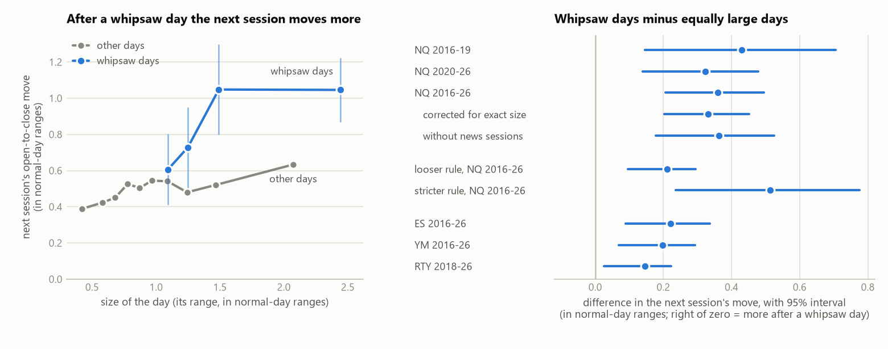

# Whipsaw sessions: do they come before a large move?

Completed 2026-11-11 under the [frozen protocol](PROTOCOL.md). Its hash was
recorded in [freeze.json](freeze.json) before any outcome code existed. An
event study on NQ M30 bars: no MT5 run, no strategy change.

**Answer: yes, on this history. The pre-set reading is met ("supported").**
After a whipsaw session the next session moved about 60% more than after
other sessions that were just as large. This holds in both eras, with a looser
and a stricter rule, without scheduled news, and on ES, YM and RTY. It says
nothing about direction, and it is not a trading rule.

All figures are in normal-day ranges (ATR20 = the average range of the 20
sessions before). NQ, 2016 to September 2026, 174 whipsaw sessions:

- **Next session's open-to-close move:** 0.93 after a whipsaw day, 0.57 after
  equally large days of the same year, 0.50 after all other days.
  Difference +0.36 (95% interval +0.21 to +0.50).
- **A full normal range or more on the next session:** 36% after a whipsaw
  day, 15% after equally large days, 11% after all other days.
- **Up or down:** no lean. Signed difference -0.01 (-0.23 to +0.19).

## How to read this

- **Whipsaw session** = three or more swings of at least 0.75 x ATR20 inside
  one session (up, down, up or the reverse), counted by a fixed zigzag and
  known at the session's close. 243 since July 2010, counted before any
  outcome was looked at.
- **Why "equally large days".** A whipsaw day is a large day, and large days
  are followed by larger moves whatever their shape. So each whipsaw day is
  compared with ordinary days of the same year that were about as large.
  Here size alone adds little (0.57 against 0.50); the back-and-forth adds
  much more (0.93). In the chart the gray line is the size effect and the blue
  points are what whipsaw days add to it.
- **95% interval** = the range the true difference plausibly lies in, given
  how much such averages wobble from month to month. An interval that stays
  above zero means chance alone is an unlikely explanation.

## The reading fixed beforehand

| Condition | Result |
|---|---|
| 1. Difference above zero in 2016-19 and in 2020-26 | +0.43 and +0.32: met |
| 2. Pooled 2016-26 interval above zero | +0.21 to +0.50: met |
| 3. Same after correcting for the day's exact size | +0.33 (+0.20 to +0.45): met |
| 4. Looser and stricter rule both above zero | +0.21 and +0.51: met |

| NQ period | Whipsaw days | After whipsaw | After equally large days | Difference (95% interval) |
|---|---|---|---|---|
| 2016-19 | 60 | 0.98 | 0.55 | +0.43 (+0.15 to +0.70) |
| 2020-Sep 2026 | 114 | 0.90 | 0.58 | +0.32 (+0.14 to +0.48) |
| 2016-Sep 2026 | 174 | 0.93 | 0.57 | +0.36 (+0.21 to +0.50) |
| same, without news sessions | 123 | 0.94 | 0.57 | +0.36 (+0.18 to +0.53) |
| 2010-15 (secondary) | 69 | 0.77 | 0.61 | +0.16 (-0.02 to +0.32) |

| Other instruments (protocol step after a pass) | Whipsaw days | After whipsaw | After equally large days | Difference (95% interval) |
|---|---|---|---|---|
| ES 2016-Sep 2026 | 198 | 0.89 | 0.66 | +0.22 (+0.09 to +0.34) |
| YM 2016-Sep 2026 | 167 | 0.84 | 0.64 | +0.20 (+0.07 to +0.29) |
| RTY 2018-Sep 2026 | 142 | 0.75 | 0.60 | +0.15 (+0.03 to +0.22) |

All three meet points 1 to 3, with a smaller difference than NQ. They are not
independent evidence: 55-63% of their whipsaw days are NQ whipsaw days too.

## What else the next session showed (NQ, 2016-26)

| Measure | After whipsaw | After equally large days | Difference (95% interval) |
|---|---|---|---|
| Range of the next session | 1.64 | 1.21 | +0.43 (+0.27 to +0.59) |
| Share of trend days (move at least 0.6 of the range) | 45% | 31% | +14 points (+5 to +22) |
| Move over the next three sessions | 1.31 | 1.06 | +0.25 (+0.03 to +0.43) |
| GG net $ per session | 49 | 16 | +32 (-86 to +106) |
| RTL net $ per session | 47 | 22 | +25 (-75 to +96) |

| Definition | Days | After event | After equally large days | Difference (95% interval) |
|---|---|---|---|---|
| Looser: 4+ swings of 0.5 x ATR20 | 367 | 0.76 | 0.55 | +0.21 (+0.10 to +0.29) |
| Stricter: 3+ swings of 1.0 x ATR20 | 46 | 1.17 | 0.66 | +0.51 (+0.24 to +0.78) |
| Outside day closing back inside the previous range | 144 | 0.53 | 0.55 | -0.02 (-0.10 to +0.07) |

## What it does not say

- **No direction and no guarantee.** The next session closed up after 61% of
  whipsaw days against 55% of equally large days; that gap (+6 points, -3 to
  +16) is inside the noise, like the signed move. And 30% of whipsaw days
  were followed by less than the typical move of their own controls.
- **Nothing for GG or RTL yet.** Both made more on the session after a whipsaw
  day, but the difference is far inside the noise (table above). No filter or
  size change follows.
- **Not every "failed breakout" label works.** The outside-day definition
  shows nothing. The result belongs to the swing count.
- **Reused history.** The rule and its counts were fixed before the outcomes,
  and the session that prompted the idea is later than the data, so this is
  cleaner than most studies here. Forward sessions are still the real test.

## Checks made after the result (not part of the frozen reading)

A pass is rare in this project, so it was attacked before being written up.
These checks cannot change the reading; they show how far to trust it.

- **Not a few cases.** Above zero in 10 of 11 years since 2016. Without 2020:
  +0.29. Without the five largest cases: +0.29. Median next move 0.77 against
  0.39 for all other days.
- **Uneven over the years.** 2016 +0.55, 2017 +0.06, 2018 +0.77, 2019 +0.12,
  2020 +0.83, 2021 +0.38, 2022 +0.18, 2023 -0.01, 2024 +0.05, 2025 +0.09,
  2026 +0.43. Large in years with volatility shocks, close to nothing in the
  calm years 2023-25.
- **Shape, or just a busier day than its range shows?** Both. A whipsaw day
  has twice the movement inside the session (1.17 against 0.58), and it tends
  to come when the last five sessions were already 27% larger than the
  20-session yardstick. Correcting for both lowers the difference from +0.33
  to +0.20 (+0.05 to +0.34): about 40% of it is "more volatile than it looks",
  the rest remains with the back-and-forth itself.

## Verification and limits

- The analysis stops unless the protocol and the event code match the frozen
  hashes; it reproduced the handed-over counts (243, 549, 63, 233 of 4,180)
  before computing any outcome. 5,511,965 raw minutes were checked against the
  cache the bars come from. A second run gives a byte-identical summary.
- Independent re-computation with separate code: all 4,180 sessions (events,
  sizes, outcomes, news and ledger columns), all 352 summary rows, 1,920
  resampling draws redone by really repeating whole months, and the 32
  headline intervals are equal. Both ledgers reproduce their published trade
  counts and net dollars. 33 focused tests pass.
- Limits as stated in the protocol: raw prices with small roll effects on
  ATR20; M30 bars hide the order of moves inside a bar; a statistic about
  sessions with no claim about fills.

## Next (not done)

Log the frozen rule on sessions after September 2026 and compare, without
changing it. Anything that trades on it needs its own frozen study first.

## Files

[Protocol](PROTOCOL.md), [freeze record](freeze.json),
[verdict](verdict.json), [all NQ rows](summary.csv),
[ES/YM/RTY rows](cross_summary.csv) and [verdicts](cross_verdict.json),
[later checks](review_checks.csv), [chart data](size_groups.csv),
[verification](verification.json).
Code in `python/`: `whipsaw_days.py` (event rule, frozen),
`prepare_whipsaw_days.py`, `analyze_whipsaw_days.py`,
`analyze_whipsaw_days_cross.py`, `verify_whipsaw_days.py`,
`review_whipsaw_days.py`, `report_whipsaw_days.py`, `test_whipsaw_days.py`.
Session tables, draws and logs: `Reports/whipsaw_days_20261111/` (not in git).
