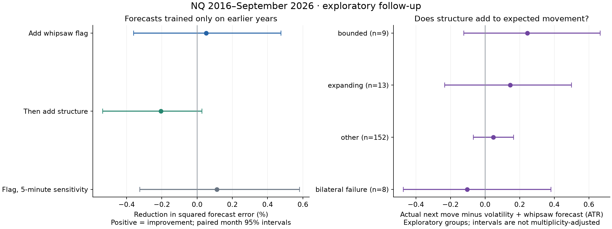
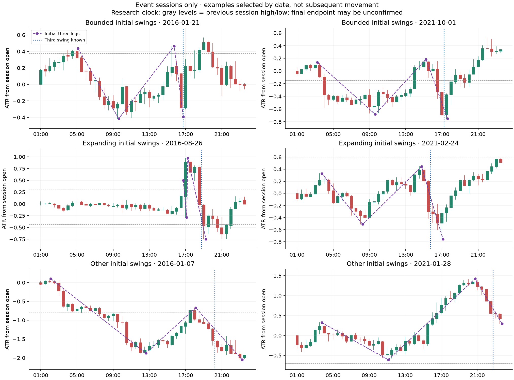

# Whipsaw follow-up: does the flag add to a volatility forecast?

Completed 2026-11-12 under the [recorded exploratory specification](PROTOCOL.md).
The original study and its positive historical association remain unchanged.

**The fixed historical forecast test does not demonstrate incremental improvement.** Adding the unchanged whipsaw flag changes pooled squared
forecast error by +0.05% improvement.
The paired loss reduction is +0.00011, with a month-resampling
95% interval of -0.00077 to +0.00101.
Positive means the added feature improves forecasts; negative means worse.

On the 174 whipsaw sessions, the volatility-only model already forecast an
average move of 0.81 ATR, against 0.93
actually observed. Adding the flag raises the forecast to 0.87 ATR,
but does not reliably reduce prediction errors. This does not prove the flag
contains no information: a full-history adjusted association and improvement
in predictions trained only on earlier history are different tests.

This is chronological historical evaluation on already studied data. It is
not fresh prospective evidence. No strategy, EA or live settings changed.

## The main comparison

Both models see current range, minute-level volatility, prior 5/20-session
volatility, recent true ranges, signed session body, scheduled news, weekday
and contract-roll indicators. The second also sees the unchanged whipsaw flag.
Each year uses coefficients and scaling fitted only on earlier years, excluding
training events whose outcomes cross into the evaluation year. Models predict
next-session absolute open-to-close movement in preceding-event ATR20 units.

| Period | Sessions | Whipsaws | Baseline MSE | + flag MSE | MSE reduction | Paired gain (95% interval) |
| --- | --- | --- | --- | --- | --- | --- |
| 2016-19 | 1031 | 60 | 0.2407 | 0.2414 | -0.30% | -0.00072 (-0.00181 to +0.00024) |
| 2020-26 | 1743 | 114 | 0.1964 | 0.1958 | +0.30% | +0.00060 (-0.00067 to +0.00189) |
| 2016-26 | 2774 | 174 | 0.2129 | 0.2128 | +0.05% | +0.00011 (-0.00077 to +0.00101) |

MSE is in squared ATR units. Its reduction measures forecast accuracy, not a
percentage increase in the market's move. Pooled all-session MAE:
0.3298 baseline versus 0.3300 with flag.
Event-only MSE improvement: +0.06% (secondary).
The primary test requires a positive pooled interval and improvement in both
eras. No secondary result can rescue it. Intervals hold fitted forecasts fixed;
they do not include all model-estimation uncertainty or correct for prior research.

## Structure and five-minute sensitivity

| Secondary comparison | MSE reduction | Paired gain (95% interval) |
| --- | --- | --- |
| Structure added to volatility + whipsaw | -0.20% | -0.00044 (-0.00114 to +0.00006) |
| Whipsaw added to 5-minute baseline | +0.11% | +0.00024 (-0.00069 to +0.00124) |

The five-minute variant checks sensitivity to sampling frequency; it was fixed
before this run. The structure model adds bounded/expanding initial-swing labels
and a bilateral previous-boundary failure flag. These comparisons are exploratory,
not alternative primary tests.

## What the new structure labels actually found

| Group | Events | Next move (ATR) | Share >=1 ATR | Volatility + whipsaw forecast | Residual (95% interval) |
| --- | --- | --- | --- | --- | --- |
| all_whipsaws | 174 | 0.93 | 36% | 0.87 | +0.07 (-0.05 to +0.18) |
| initial_bounded | 9 | 0.97 | 44% | 0.73 | +0.24 (-0.12 to +0.67) |
| initial_expanding | 13 | 1.05 | 46% | 0.90 | +0.14 (-0.23 to +0.50) |
| initial_other | 152 | 0.92 | 35% | 0.87 | +0.05 (-0.07 to +0.17) |
| bilateral_failure | 8 | 0.79 | 25% | 0.89 | -0.10 (-0.47 to +0.38) |
| no_bilateral_failure | 164 | 0.94 | 37% | 0.86 | +0.08 (-0.04 to +0.20) |

Bounded requires both repeated highs and repeated lows within 0.10 ATR.
Expanding requires a higher second high AND lower second low, each by more than
0.10 ATR. Other includes drift, contraction and mixed geometry. These classify
the first three legs only; the fourth endpoint can be the observed terminal
extreme at session close. They are specific operational proxies, not an exhaustive
classification of every visual rectangle or gramophone.

Bilateral failure requires the first buffered breach of EACH previous-session
boundary to close back through that boundary within four M30 closing opportunities.
Previous raw levels are unavailable on roll dates. A failure flag does not
identify stop executions, nor does it require the two breaches to alternate.
This narrow previous-day definition may miss the intraday levels in the user's
example. Small subgroup counts cannot settle the broader chart-pattern hypothesis.

Residual means actual next move minus the model forecast that already includes
volatility and the whipsaw flag. A positive residual is descriptive underprediction,
not proof of a causal shape effect. Intervals are not adjusted for multiple groups.
The bilateral and geometry groups overlap and must not be added together.
Two whipsaw sessions have unavailable prior levels on roll dates and are excluded
from the failure/no-failure comparison. Their two-observation residual interval
is not interpreted here. Resamples with no members of a sparse subgroup cannot
produce a mean; structure_groups.csv records the omitted-draw counts.

## Recognition timing

All 174 main events have a recorded third-swing recognition bar.
Median number of M30 bars remaining after recognition: 7.
172 have at least one later bar; 2 have none.
From the next bar's open, the mean remaining-session absolute displacement is
0.541 ATR and remaining range is
0.935 ATR. These are descriptive event averages,
with no matched comparison or fills. The recognition bar is excluded.

The full forecast uses session-close information; it is not an intraday forecast
available at the earlier recognition timestamp. An executable entry/exit study
would need its own specification and point-in-time inputs.

## Association after more detailed volatility controls

| Period | Controls | Adjusted association (95% interval) |
| --- | --- | --- |
| 2016-19 | replicate_review_m1 | +0.221 (-0.079 to +0.533) |
| 2016-19 | add_volatility_history | +0.235 (-0.067 to +0.539) |
| 2020-26 | replicate_review_m1 | +0.115 (-0.029 to +0.253) |
| 2020-26 | add_volatility_history | +0.119 (-0.023 to +0.257) |
| 2016-26 | replicate_review_m1 | +0.151 (+0.011 to +0.292) |
| 2016-26 | add_volatility_history | +0.157 (+0.020 to +0.297) |

The first regression reproduces the previously disclosed M1 review. The second
adds prior 5/20-session minute volatility. These use the old year/size fixed
effects and old resampling seed, as recorded in the table; the forecast experiment
does not use full-history size bins. These coefficients are conditional
associations, not causal decompositions and not forecast-loss reductions.

## Verification and reproduction

- All seven original input files and the original frozen rule/protocol hashes
  were verified. Original counts: 4,180 sessions, 243 events; 174 in 2016-26.
- M1 reconstruction: 178 events in the evaluated main sample,
  4 labels different from the original M30 flag.
- All 11 annual fits record training/test boundaries in forecast_folds.csv;
  the latest training outcome is before the evaluation year.
- 53 focused original/follow-up tests passed. Independent verification reproduced
  both volatility measures and all four histories for 4,180 sessions, all 243
  recognition times, 8,230 available boundary labels, all 13,870 annual-model
  forecasts and all 18 score rows. See [verification.json](verification.json).
- The [design record](design.json) fixes code/specification hashes and the prepared
  feature hash. The [verdict](verdict.json) records prediction and code hashes.

Commands, from the project root with the project venv:
prepare once with python/analyze_whipsaw_followup.py prepare; reproduce results
with python/analyze_whipsaw_followup.py analyze; render with
python/report_whipsaw_followup.py. Independently verify with
python/verify_whipsaw_followup.py. Run unittest discovery for test_whipsaw*.py.

Compact outputs: forecast_scores.csv, yearly_scores.csv, structure_groups.csv,
regressions.csv, forecast_folds.csv, coefficients.csv and example_sessions.csv.
Full features, session outcomes and predictions:
Reports/whipsaw_followup_20261112/. No thresholds or models were tuned after
these results. The bounded/expanding classifications need visual validation
before they can represent the broader patterns the user recognizes.
