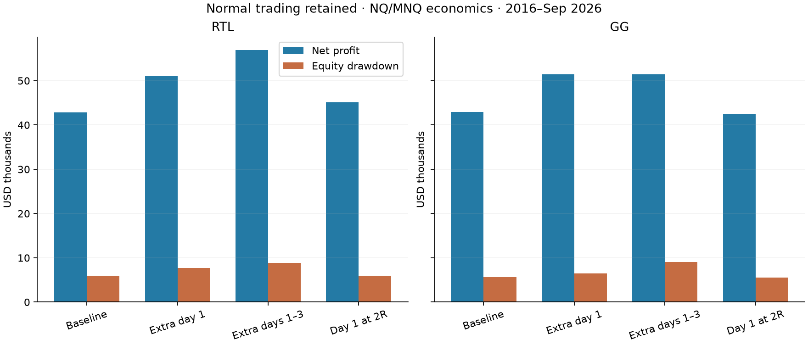

# Whipsaw native replays: extra size, 2R and persistence

Completed 2026-11-12. Eight native MT5 Model=1 runs, zero compilation warnings.
Exploratory reused history, under the [fixed specification](PROTOCOL.md).
Previous work was committed as 5d2062f before these runs. No live settings changed.

**An extra contract adds profit and risk. Extending it to three sessions is
especially unattractive for GG. RTL's next-session 2R experiment is worth
further checking, but its incremental-profit interval includes zero.**

## Keep normal trading and adjust selected sessions

All figures include $1.05 per round trip per contract. Day 1 uses 174 sessions;
the non-stacking union of days 1-3 uses 403. The selected-only runs isolate the
extra activity; the table below keeps normal baseline trades on all other days.

| Strategy | Normal trading plus adjustment | Net $ | Equity DD $ | Extra net $ | Net/DD |
| --- | --- | --- | --- | --- | --- |
| RTL | Normal 1 contract / 1R | 42,816.60 | 5,941.70 | — | 7.21 |
| RTL | +1 contract on day 1 | 51,011.75 | 7,721.20 | +8,195.15 | 6.61 |
| RTL | +1 contract on days 1-3 | 56,989.40 | 8,830.50 | +14,172.80 | 6.45 |
| RTL | 2R on day 1; 1R otherwise | 45,139.00 | 5,941.70 | +2,322.40 | 7.60 |
| GG | Normal 1 contract / 1R | 42,951.05 | 5,621.75 | — | 7.64 |
| GG | +1 contract on day 1 | 51,400.90 | 6,483.35 | +8,449.85 | 7.93 |
| GG | +1 contract on days 1-3 | 51,468.10 | 9,093.65 | +8,517.05 | 5.66 |
| GG | 2R on day 1; 1R otherwise | 42,378.80 | 5,540.20 | -572.25 | 7.65 |

The extra-contract scenarios use two contracts total on eligible sessions and
one elsewhere. Their exact native session equity envelopes are scaled under
identical-fill and linear-cost assumptions. They are not native two-contract
runs and do not model market impact. Mean net R in overlays.csv is per contract
round trip, not an account-level risk-adjusted return. Net/DD is descriptive.

The 2R scenario uses one contract throughout, replacing selected-day trades
with the actual native 2R trades. It retains the EA's bar-close exit logic.
It does not mean a resting 2R take-profit. It changes subsequent entries too:
selected trades fall from 1,037 to 859 for RTL and from 1,043 to 838 for GG.

RTL extra day 1 increases net by about 19%, but drawdown by about 30%.
GG extra day 1 increases net by about 20%, with drawdown about 15% higher.
Extending GG to three days adds only $67.20 beyond the day-1 overlay while
raising full-history equity DD from $6,483.35 to $9,093.65. RTL's three-day
overlay earns more but also worsens net/DD versus its baseline.

RTL 2R adds $2,322.40 overall with the same maximum full-history equity DD;
it adds $733.95 early and $1,588.45 recently. GG 2R subtracts $572.25 overall
and is negative in both eras. None of this establishes a rule for adoption.

## Stability and uncertainty

| Strategy | Adjustment | Period | Extra net $ | 95% interval: extra $ / calendar session |
| --- | --- | --- | --- | --- |
| RTL | +1 contract on day 1 | 2016-19 | +1,117.55 | -0.91 to +3.38 |
| RTL | +1 contract on day 1 | 2020-26 | +7,077.60 | -0.64 to +8.80 |
| RTL | +1 contract on day 1 | 2016-26 | +8,195.15 | -0.05 to +6.13 |
| RTL | +1 contract on days 1-3 | 2016-19 | +1,494.60 | -0.30 to +3.29 |
| RTL | +1 contract on days 1-3 | 2020-26 | +12,678.20 | +0.86 to +13.77 |
| RTL | +1 contract on days 1-3 | 2016-26 | +14,172.80 | +1.17 to +9.32 |
| RTL | 2R on day 1; 1R otherwise | 2016-19 | +733.95 | -0.24 to +1.98 |
| RTL | 2R on day 1; 1R otherwise | 2020-26 | +1,588.45 | -2.27 to +4.10 |
| RTL | 2R on day 1; 1R otherwise | 2016-26 | +2,322.40 | -1.22 to +2.98 |
| GG | +1 contract on day 1 | 2016-19 | -46.55 | -2.26 to +2.02 |
| GG | +1 contract on day 1 | 2020-26 | +8,496.40 | -0.13 to +10.39 |
| GG | +1 contract on day 1 | 2016-26 | +8,449.85 | -0.08 to +6.65 |
| GG | +1 contract on days 1-3 | 2016-19 | -326.90 | -2.56 to +2.10 |
| GG | +1 contract on days 1-3 | 2020-26 | +8,843.95 | -0.61 to +10.50 |
| GG | +1 contract on days 1-3 | 2016-26 | +8,517.05 | -0.45 to +6.54 |
| GG | 2R on day 1; 1R otherwise | 2016-19 | -209.30 | -1.01 to +0.60 |
| GG | 2R on day 1; 1R otherwise | 2020-26 | -362.95 | -2.50 to +2.29 |
| GG | 2R on day 1; 1R otherwise | 2016-26 | -572.25 | -1.70 to +1.38 |

Intervals redraw complete calendar months (5,000, seed 20261112) and measure
incremental PnL on the FULL calendar, including inactive sessions. They are
not intervals for total historical dollars or for drawdown. Most include zero;
the positive RTL days1-3 pooled interval still does not show superiority over
volatility-matched allocation or offset its added drawdown. Additional R
intervals and an extra $2-per-contract cost stress are in overlays.csv.

The larger-day hypothesis is not itself a long signal: both EAs are long-only.
The previous study also did not establish incremental volatility-forecast value
beyond detailed volatility controls. A matched-volatility allocation comparison
and genuinely prospective evidence remain necessary before changing live risk.

## Do several running sessions follow?

| Strategy | Day | Events | Mean absolute move / event ATR | Trend share | Net $ / selected day | 95% interval | Also fresh day 1 |
| --- | --- | --- | --- | --- | --- | --- | --- |
| RTL | 1 | 174 | 0.93 | 45% | 47.10 | -1.06 to 99.40 | 0 |
| RTL | 2 | 174 | 0.87 | 41% | 41.47 | -8.26 to 102.38 | 50 |
| RTL | 3 | 174 | 0.81 | 34% | 64.54 | 4.03 to 142.67 | 38 |
| GG | 1 | 174 | 0.93 | 45% | 48.56 | -3.84 to 104.28 | 0 |
| GG | 2 | 174 | 0.87 | 41% | 24.85 | -24.30 to 76.33 | 50 |
| GG | 3 | 174 | 0.81 | 34% | 35.88 | -7.98 to 83.37 | 38 |

These are separate sessions, each open to close, scaled by the ORIGINAL event's
ATR. Trend means absolute body >=60% of that session's range. The average move
and trend frequency decline across the three horizons. These descriptive
averages have no matched-market baseline and do not establish excess persistence.

50 day-2 observations and 38 day-3 observations are also day 1 following a
newer whipsaw. Removing these leaves mean absolute moves of 0.75 and 0.70 ATR;
RTL selected-day profit intervals then include zero at both horizons. GG's
intervals include zero throughout. See horizons.csv for all and no-fresh-signal
cohorts. Do not sum horizon profits: their session sets overlap.

A supplemental descriptive check across 174 complete sequences:
day 2 has the same open-to-close sign as day 1 in 43%;
all three share a sign in 22%; all three meet
the trend-day definition in 9%. These rates
are not compared with controls and are not evidence for or against a causal
stop-liquidity mechanism. The old three-day aggregate did not answer this question.

## Verification

- Controls reproduce the published primary ledgers: 16,668 RTL / 17,569 GG trades.
- Both day-1 and days1-3 native 1R arms exactly match their control subsets in
  submission, entry/exit times, requested stops, fills, exits, net dollars and R.
- All positions and orders stay within their sessions; eligible dates are checked.
- Full native equity drawdowns reconcile with compressed session envelopes.
- An independent minute replay matches both native 2R arms (859 RTL / 838 GG
  primary trades), including entry/exit minutes and prices.
- Five focused tests cover chronological calendars, endpoint exclusions,
  non-stacking windows and overlay equity arithmetic.

Artifacts: native_summary.csv, overlays.csv, horizons.csv, verification.json,
rr2_verification.json, persistence_descriptive.json, run_manifest.json (input/output hashes).
Full native files, inputs,
manifests and per-session overlay envelopes: Reports/whipsaw_native_20261112/.
Preparation: python/prepare_whipsaw_native.py; runner: python/run_mt5_job.py;
analysis: python/analyze_whipsaw_native.py; independent 2R check:
python/verify_whipsaw_native_rr2.py; report: python/report_whipsaw_native.py.

No thresholds or targets were tuned after these outcomes. The original frozen
whipsaw study and the committed follow-up remain intact.
